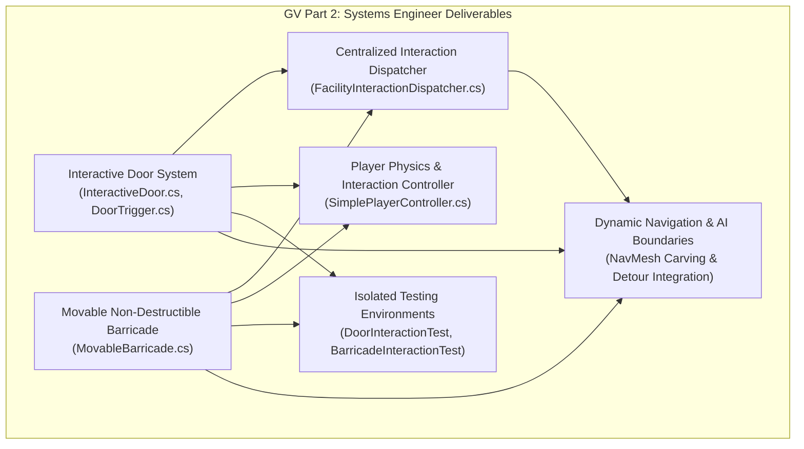
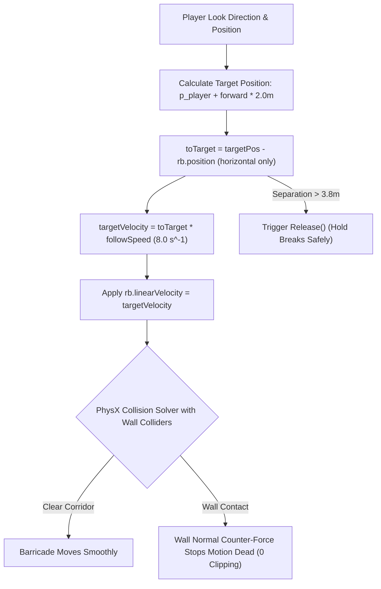
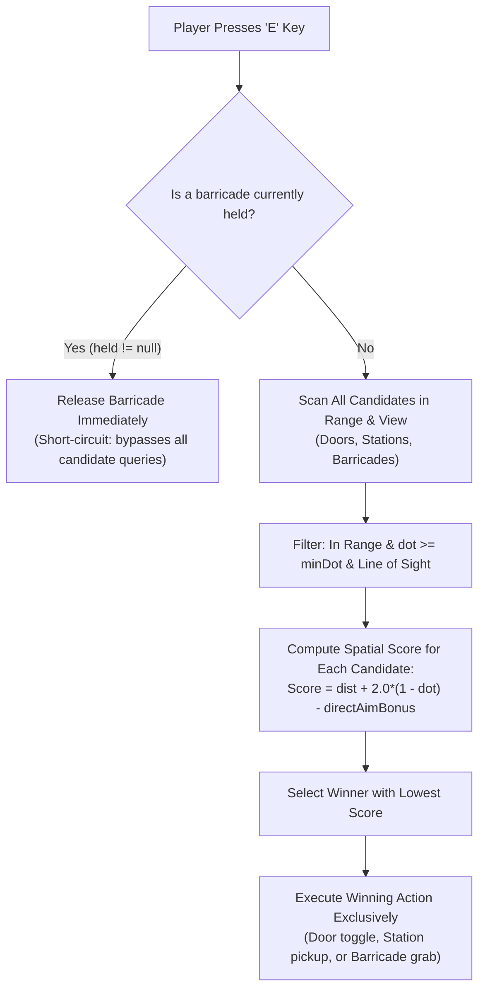
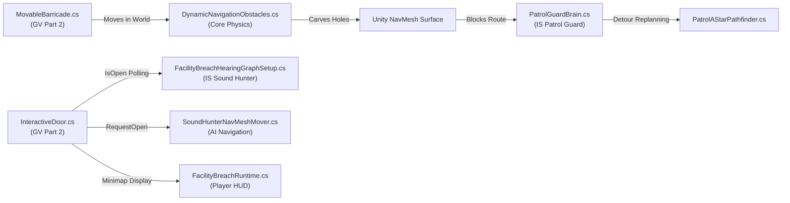

# Individual Technical Report: Graphics and Visualization (GV) — Part 2

**Student Name:** Wijesinghe K.<br/>
**Student ID:** `IT24102587`<br/>
**Degree Programme:** BSc (Hons) in Information Technology Specialising in Software Engineering<br/>
**Module:** SE3032 — Graphics and Visualization (GV)<br/>
**Assigned Role:** Part 2: Systems Engineer (Player Interaction Physics, Collision Handling & Environment Mechanics)<br/>
**Merged Baseline Branch:** `develop` (integrated via GV PR #9 commit `fd94efe`, PR #11 commit `4ac6a2f`, PR #12 commit `caa133e`, PR #15 commit `b1b6745`, and PR #16 commit `38e9a08`)<br/>
**Active Feature Branch:** `gv/IT24102587-kickable-physics-audio` (branch based on `develop` commit `38e9a08`)<br/>
**Latest Synchronized Base Commit:** `38e9a08` (`Merge pull request #16 from Kunchana-Wijesinghe/gv/IT24102587-bullet-tracer-vfx`)<br/>
**Target Unity Version:** Unity 6000.6.2f1 (URP / 3D, C# .NET Standard 2.1)<br/>
**Repository:** `Interactive-3D-Shooting-Game-GV-IS` (Private)

---

## Executive Summary

As the **Systems Engineer (GV Part 2)** for *Facility Breach*, my individual responsibility encompasses the design, mathematical formulation, component architecture, and runtime verification of physical interaction mechanics within the facility environment. The assigned scope consists of four interconnected gameplay systems:

1. **Interactive Door System**: Reliable proximity trigger detection, smooth spherical linear interpolation (`Quaternion.Slerp`) hinge rotation, physical panel collision blocking, idempotent input handling, and an occupant safety clearance probe (`RequestOpen`) that prevents doors from closing on player or AI character capsules.
2. **Movable Non-Destructible Barricade System**: Heavy physical obstacle maneuvering through E-key interaction, velocity-governed tracking in front of the player, strict `Continuous` collision detection preventing wall tunneling and clipping, automatic break-distance disengagement, direct `CharacterController` contact pushing, and strict adherence to non-destructibility constraints (zero health, zero damage, indestructible physical obstacles).
3. **AI Navigation & Cross-Module Integration**: Integration with the team's dynamic navigation systems ([`DynamicNavigationObstacles.cs`](file:///c:/Users/Kunchana%20Wijesinghe/Pictures/GV,IS/FacilityBreach/Assets/Scripts/FacilityBreach/Core/DynamicNavigationObstacles.cs)), allowing movable barricades to dynamically carve NavMesh obstacles in real time, directly triggering detour replanning in the Patrol Guard AI ([`PatrolGuardBrain.cs`](file:///c:/Users/Kunchana%20Wijesinghe/Pictures/GV,IS/FacilityBreach/Assets/Scripts/FacilityBreach/AI/Roles/PatrolGuardBrain.cs)) and acoustic attenuation in the Sound Hunter AI ([`FacilityBreachHearingGraphSetup.cs`](file:///c:/Users/Kunchana%20Wijesinghe/Pictures/GV,IS/FacilityBreach/Assets/Scripts/FacilityBreach/AI/SoundHunter/FacilityBreachHearingGraphSetup.cs)).
4. **Centralized Interaction Arbitration & Production Scene Integration**: Design and deployment of [`FacilityInteractionDispatcher.cs`](file:///c:/Users/Kunchana%20Wijesinghe/Pictures/GV,IS/FacilityBreach/Assets/Scripts/FacilityBreach/Interactions/FacilityInteractionDispatcher.cs), a centralized gatekeeper arbitrating all E-key interaction requests across doors, stations, and barricades. It guarantees exactly one interaction per key press, assigns absolute priority to releasing held barricades, uses deterministic spatial scoring with direct aim raycasting, and equips all six authored pushable barricades in `Prototype.unity` with calibrated 12 kg mass and non-destructive physics. Manual gameplay testing confirmed seamless, glitch-free interaction in the production facility.

All components were developed on `gv/Kunchana-interactions`, verified in isolated Unity test scenes, documented with seven visual evidence captures, and synchronized with `develop` commit [`991ef50`](https://github.com/Kunchana-Wijesinghe/Interactive-3D-Shooting-Game-GV-IS/commit/991ef504c5efc8e4ef87cb9baedf7377e367b0a4) at commit [`14ee8c0`](https://github.com/Kunchana-Wijesinghe/Interactive-3D-Shooting-Game-GV-IS/commit/14ee8c08dc1d03a296f6f41f2dcbef90c0d2c650) with **zero C# compilation errors** in Unity 6000.6.2f1 batch mode.

---

## 1. Scope & Role Responsibilities

In accordance with the SE3032 project specification, the Systems Engineer focuses on runtime physics, trigger boundaries, collision fidelity, and tactile player feedback. The specific technical deliverables comprise:



### Key Technical Objectives
- **Zero Physics Glitches**: Eliminate tunneling, clipping, jitter, and penetration against high-speed character movement or solid wall geometry.
- **Physical Non-Destructibility**: Ensure barricades act as permanent, indestructible physical barriers capable of rerouting entities without introducing structural damage or fracture states.
- **Occupant Safety Boundary**: Implement an overlap probe ensuring doors do not trap or crush characters when closing.
- **Centralized Interaction Routing**: Arbitrate all E-key interactions through a single authority (`FacilityInteractionDispatcher`) to guarantee exactly one action per key press and prioritize held barricade release.
- **Isolated & Full-Scene Reproducibility**: Provide programmatic test scene generation (`TestSceneBuilder.cs`) alongside production facility integration (`Prototype.unity`).

---

## 2. Interactive Door System Architecture

The interactive door system is partitioned into a proximity trigger volume, a rotational hinge actuator, and an occupant safety boundary.

### 2.1 Hinge Kinematics & Mathematical Model
The door operates as a single-axis rotational hinge swinging $90^\circ$ around its local Y-axis. Rather than instantly snapping rotation, the hinge smoothly transitions across frames using spherical linear interpolation (`Quaternion.Slerp`):

$$\mathbf{q}(t + \Delta t) = \text{Slerp}\left(\mathbf{q}(t),\, \mathbf{q}_{\text{target}},\, \omega \cdot \Delta t\right)$$

Where:
- $\mathbf{q}_{\text{closed}} = \mathbf{q}_{\text{initial}}$ represents the authored resting rotation.
- $\mathbf{q}_{\text{open}} = \mathbf{q}_{\text{closed}} \cdot \text{Quaternion.Euler}(0,\, 90^\circ,\, 0)$ defines the open state.
- $\omega = 4.0\text{ rad/s}$ (`openSpeed`) governs angular velocity.
- $\mathbf{q}_{\text{target}} = \text{isOpen} \;?\; \mathbf{q}_{\text{open}} : \mathbf{q}_{\text{closed}}$.

Because interpolation targets the target orientation continuously in `Update()`, rapidly pressing `E` mid-swing simply reverses the target quaternion without causing rotational snapping, jitter, or angular drift.

### 2.2 Proximity Detection & Trigger Architecture
The doorway volume utilizes a non-rendering trigger volume managed by [`DoorTrigger.cs`](file:///c:/Users/Kunchana%20Wijesinghe/Pictures/GV,IS/FacilityBreach/Assets/Scripts/DoorTrigger.cs):
- **Trigger Volume**: A `BoxCollider` set to `isTrigger = true` spanning $4.0\text{m}$ along the corridor ($Z \in [-2.0\text{m}, +2.0\text{m}]$).
- **Proximity Filtering**: Evaluates `other.CompareTag("Player")` on `OnTriggerEnter` and `OnTriggerExit`, invoking `door.SetPlayerNearby(true/false)`.
- **Decoupled Architecture**: Keeps trigger detection separate from hinge motion, allowing multiple trigger volumes (e.g., card readers, security sensors) to control the same door.

### 2.3 Occupant Safety Clearance Probe (`RequestOpen`)
To prevent doors from swinging shut and pinning, clipping, or crushing character controllers or dynamic physics objects, [`InteractiveDoor.cs`](file:///c:/Users/Kunchana%20Wijesinghe/Pictures/GV,IS/FacilityBreach/Assets/Scripts/InteractiveDoor.cs) provides a safe boundary method:

```csharp
public bool RequestOpen(bool open)
{
    if (!open)
    {
        foreach (Collider panel in GetComponentsInChildren<Collider>())
        {
            if (panel.isTrigger) continue;
            Bounds bounds = panel.bounds;
            foreach (Collider occupant in Physics.OverlapBox(
                bounds.center,
                bounds.extents + Vector3.one * 0.15f,
                Quaternion.identity,
                ~0,
                QueryTriggerInteraction.Ignore))
            {
                if (occupant.transform.IsChildOf(transform)) continue;
                if (occupant.GetComponentInParent<CharacterController>() ||
                    (occupant.attachedRigidbody && !occupant.attachedRigidbody.isKinematic))
                    return false; // Clearance blocked — abort close
            }
        }
    }
    isOpen = open;
    return true;
}
```

- When `open == false` (closing request), the door performs an in-memory box overlap query expanded by $0.15\text{m}$ along all axes.
- If an active `CharacterController` (player or AI agent) or dynamic non-kinematic `Rigidbody` occupies the sweep envelope, the close request is rejected (`return false`), keeping the doorway unobstructed.

### 2.4 Input Decoupling & Centralized Routing (`handleInternalInput`)
In standalone testing scenes ([`DoorInteractionTest.unity`](file:///c:/Users/Kunchana%20Wijesinghe/Pictures/GV,IS/FacilityBreach/Assets/Scenes/Tests/DoorInteractionTest.unity)), `InteractiveDoor` listens to `KeyCode.E` internally in `Update()` via `handleInternalInput = true`.
In the production facility ([`Prototype.unity`](file:///c:/Users/Kunchana%20Wijesinghe/Pictures/GV,IS/FacilityBreach/Assets/Scenes/Prototype.unity)), multiple interactable systems (11 doors, 6 barricades, and numerous resource stations) coexist. If individual doors poll `E` directly, player inputs trigger parallel, uncoordinated activations.
To decouple input cleanly:
1. **Configurable Flag**: `InteractiveDoor.cs` introduces `public bool handleInternalInput = true;`. Standalone test scenes continue running without dependencies.
2. **Doorway Occupancy Property**: `InteractiveDoor.cs` exposes `public bool PlayerNearby => playerNearby;`, allowing external dispatchers to query doorway trigger status.
3. **Runtime Transfer**: During `FacilityBreachRuntime.Start()`, all doors in `Prototype.unity` have `handleInternalInput` set to `false`, transferring full interaction authority to [`FacilityInteractionDispatcher.cs`](file:///c:/Users/Kunchana%20Wijesinghe/Pictures/GV,IS/FacilityBreach/Assets/Scripts/FacilityBreach/Interactions/FacilityInteractionDispatcher.cs).

---

## 3. Movable Non-Destructible Barricade System

The movable barricade ([`MovableBarricade.cs`](file:///c:/Users/Kunchana%20Wijesinghe/Pictures/GV,IS/FacilityBreach/Assets/Scripts/MovableBarricade.cs)) provides heavy physics-based obstacle manipulation that can be pushed, pulled, or maneuvered to barricade doorways or create tactical cover.

### 3.1 Strict Non-Destructibility Specification
In strict accordance with the project specification:
- **No Health / Damage Model**: The barricade contains zero health points, structural integrity counters, or damage receivers.
- **No Fracture / Destruction Prefabs**: The barricade cannot be broken, fractured, or despawned by weapon fire, explosive barrels, or robot attacks.
- **Permanent Obstacle**: Remains a persistent physical barrier in the scene, forcing entities (player and AI) to maneuver or reroute around it.

### 3.2 Rigidbody Tuning & Constraint Architecture
The barricade is driven by Unity PhysX through a dedicated `Rigidbody` configured for grounded stability:

```csharp
public void ConfigurePhysics()
{
    if (rb == null) rb = GetComponent<Rigidbody>();
    rb.mass = 60.0f; // 60 kg realistic industrial mass

#if UNITY_6000_0_OR_NEWER
    rb.linearDamping = 5.0f;
    rb.angularDamping = 8.0f;
#else
    rb.drag = 5.0f;
    rb.angularDrag = 8.0f;
#endif

    rb.useGravity = true;
    rb.isKinematic = false;
    rb.interpolation = RigidbodyInterpolation.Interpolate;
    rb.collisionDetectionMode = CollisionDetectionMode.Continuous;

    // Freeze roll and pitch to maintain upright orientation
    rb.constraints = RigidbodyConstraints.FreezeRotationX |
                     RigidbodyConstraints.FreezeRotationZ;
}
```

- **Mass ($60.0\text{kg}$)**: Sufficiently heavy to resist casual bumps while remaining maneuverable by an adult player character.
- **Constraints (`FreezeRotationX | FreezeRotationZ`)**: Restricts rotational degrees of freedom to yaw (Y-axis) only. This prevents the barricade from tipping over, rolling, or becoming ungrounded when subjected to lateral forces.
- **Anti-Tunneling (`CollisionDetectionMode.Continuous`)**: Continuous collision detection sweeps the bounding box against static geometry every physics sub-step, eliminating tunneling through thin walls or doorways.
- **Unity 6 Damping**: Implements `#if UNITY_6000_0_OR_NEWER` using `linearDamping` and `angularDamping` (replacing deprecated `drag`/`angularDrag`), eliminating CS0618 compiler warnings.

### 3.3 Velocity-Governed Hold & Maneuver Mechanics
A common failure mode in game interaction systems is directly parenting held objects to the player's transform or setting `transform.position` explicitly. This bypasses PhysX collision solvers, causing held objects to penetrate walls or pop violently.

[`MovableBarricade.cs`](file:///c:/Users/Kunchana%20Wijesinghe/Pictures/GV,IS/FacilityBreach/Assets/Scripts/MovableBarricade.cs) resolves this by governing movement strictly via **velocity steering** in `FixedUpdate()`:



1. **Target Position**: Computes a horizontal target $2.0\text{m}$ in front of the player:
   $$\mathbf{p}_{\text{target}} = \mathbf{p}_{\text{player}} + \mathbf{f}_{\text{player}} \cdot d_{\text{hold}} \quad (d_{\text{hold}} = 2.0\text{m})$$
2. **Velocity Vector**: Applies a horizontal corrective velocity vector:
   $$\mathbf{v}_{\text{target}} = (\mathbf{p}_{\text{target}} - \mathbf{p}_{\text{barricade}}) \cdot s_{\text{follow}} \quad (s_{\text{follow}} = 8.0\text{ s}^{-1})$$
   $$\mathbf{v}_{y} = \mathbf{v}_{\text{current},\, y} \quad (\text{preserves vertical gravity})$$
3. **Collision Preservation**: Because motion is governed by velocity, when the barricade contacts a solid wall, PhysX calculates a counteracting normal contact force, stopping the barricade naturally without penetration.
4. **Auto-Break Distance ($3.8\text{m}$)**: If the player moves away while the barricade is blocked against a wall such that $\|\mathbf{p}_{\text{target}} - \mathbf{p}_{\text{barricade}}\| > 3.8\text{m}$, `Release()` is triggered automatically to prevent rubber-banding or unrealistic tension.

### 3.4 Production Facility Tuning vs. Isolated Test Scene Calibration
While the isolated test arena ([`BarricadeInteractionTest.unity`](file:///c:/Users/Kunchana%20Wijesinghe/Pictures/GV,IS/FacilityBreach/Assets/Scenes/Tests/BarricadeInteractionTest.unity)) calibrated the barricade at $60.0\text{kg}$ with high damping (`linearDamping = 5.0f`, `angularDamping = 8.0f`) to evaluate heavy obstacle physics, the full facility environment ([`Prototype.unity`](file:///c:/Users/Kunchana%20Wijesinghe/Pictures/GV,IS/FacilityBreach/Assets/Scenes/Prototype.unity)) requires specialized tuning:

- **Mass Calibration ($12.0\text{kg}$ vs $60.0\text{kg}$)**: The main facility features narrow doorways, right-angle corridor bends, and dynamic combat navigation. A $60\text{kg}$ barricade produced sluggish momentum and difficult corner maneuvering for the player. Calibrating the mass to $12.0\text{kg}$ across all 6 main-scene barricades ensures responsive, tactical player maneuvering while maintaining sufficient physical mass to block entities and avoid clipping.
- **Physical Tuning Parameters**:
  - **Mass**: $12.0\text{kg}$
  - **Damping**: `linearDamping = 2.0f`, `angularDamping = 2.5f` (smooth sliding, rapid stopping upon release)
  - **Distances & Speeds**: `interactionDistance = 3.0f`, `holdDistance = 2.0f`, `followSpeed = 8.0f`, `maxHoldDistance = 3.8f`
  - **Constraints**: Locked pitch and roll (`FreezeRotationX | FreezeRotationZ`), keeping the barricade upright on the floor
  - **Collision**: `CollisionDetectionMode.Continuous` and `Interpolate`
- **Main-Scene Barricades Authored**:
  All 6 pushable barricades in `Prototype.unity` under `Facility_Barricades` were configured with `MovableBarricade` components:
  1. `Barricade_Entrance` (GameObject ID: `1944818420`, Component ID: `1944818424`)
  2. `Barricade_LowerRoute` (GameObject ID: `1979052250`, Component ID: `1979052254`)
  3. `Barricade_Room1Area` (GameObject ID: `320277312`, Component ID: `320277316`)
  4. `Barricade_Middle` (GameObject ID: `1746341875`, Component ID: `1746341879`)
  5. `Barricade_UpperLeft` (GameObject ID: `850553676`, Component ID: `850553680`)
  6. `Barricade_ExitArea` (GameObject ID: `1474787438`, Component ID: `1474787442`)

---

## 4. Player Interaction & Physics Controller

[`SimplePlayerController.cs`](file:///c:/Users/Kunchana%20Wijesinghe/Pictures/GV,IS/FacilityBreach/Assets/Scripts/SimplePlayerController.cs) serves as the first-person controller and physics dispatcher for isolated testing arenas.

### 4.1 Direct Contact Force Pushing (`OnControllerColliderHit`)
When the player character walks into a movable barricade without pressing `E` to grab it, Unity's `CharacterController` does not automatically exert Rigidbody forces. The controller implements `OnControllerColliderHit` to bridge kinematics and dynamics:

```csharp
void OnControllerColliderHit(ControllerColliderHit hit)
{
    Rigidbody body = hit.collider.attachedRigidbody;
    if (body == null || body.isKinematic) return;
    if (hit.moveDirection.y < -0.3f) return; // Ignore floor contacts

    Vector3 pushDir = new Vector3(hit.moveDirection.x, 0, hit.moveDirection.z);
    if (pushDir.sqrMagnitude < 0.001f) return;

    body.AddForce(pushDir.normalized * physicalPushPower, ForceMode.Force);
}
```

- When moving against the barricade, a continuous physical force (`physicalPushPower = 40.0f`) pushes the obstacle forward along the floor plane.
- The player's forward progress is simultaneously constrained by the barricade's collider, providing realistic tactile resistance.

### 4.2 Dynamic HUD Status & Visual Feedback
The controller renders real-time on-screen diagnostics using `OnGUI`, displaying interaction state, crosshair, and range warnings:

| Target | Condition | Displayed Feedback |
| :--- | :--- | :--- |
| **Door** | Distance $\le 3.0\text{m}$ | `<color=#00FF88>IN RANGE — Press [E] to Toggle Door</color>` |
| **Door** | Distance $> 3.0\text{m}$ | `<color=#FFAA00>OUT OF RANGE (X.Xm away)</color>` |
| **Barricade** | `isHeld == true` | `<color=#00FFFF>GRABBED / MANEUVERING — Move to Push/Pull, Press [E] to Release</color>` |
| **Barricade** | Distance $\le 3.0\text{m}$ (free) | `<color=#00FF88>IN RANGE (X.Xm) — Press [E] to Grab & Push</color>` |
| **Barricade** | Distance $> 3.0\text{m}$ (free) | `<color=#FFAA00>OUT OF RANGE (X.Xm away)</color>` |

### 4.3 Centralized Interaction Arbitration Architecture (`FacilityInteractionDispatcher.cs`)
To eliminate input contention, race conditions, and accidental simultaneous activations in `Prototype.unity`, the centralized dispatcher serves as the single authority:



#### Deterministic Spatial Scoring Formula
When no barricade is held, the dispatcher evaluates every registered interactable within its interaction envelope:
$$\text{Score} = d + 2.0 \cdot (1.0 - \mathbf{v}_{\text{fwd}} \cdot \mathbf{v}_{\text{dir}}) - (\text{hasDirectAim} \;?\; \text{directAimScoreBonus} : 0.0)$$

Where:
- $d$: Euclidean distance from camera/player to target interaction point.
- $\mathbf{v}_{\text{fwd}} \cdot \mathbf{v}_{\text{dir}}$: Dot product between the camera forward vector and target direction vector.
- $\text{directAimScoreBonus} = 1.5$: Applied if the camera center raycast directly intersects the object's collider.
- **Lower score is superior**: Prioritizes objects directly aimed at and closer to the player.

#### Absolute Release Priority
If `heldBarricade != null`, `ExecuteInteraction` assigns synthetic score $-100.0$ and immediately triggers `heldBarricade.Release()`, returning `true`. Doors and stations are never queried. This mathematically guarantees that pressing `E` while holding a barricade near a door will **only** drop the barricade without toggling the door.

#### Contextual HUD Prompting
[`FacilityBreachRuntime.cs`](file:///c:/Users/Kunchana%20Wijesinghe/Pictures/GV,IS/FacilityBreach/Assets/Scripts/FacilityBreach/FacilityBreachRuntime.cs#L375) calls `dispatcher.GetContextualPrompt()` each frame:
- Holding barricade: `E: Release barricade`
- Best candidate is door: `E: Open door` or `E: Close door`
- Best candidate is barricade: `E: Grab barricade`
- Best candidate is station: Contextual station prompt (e.g. `E: Connect Card`, `E: Resupply Ammo`).

---

## 5. Cross-Module System Integration & AI Boundaries

The GV Part 2 interaction systems interface with the broader *Facility Breach* architecture across graphics, physics, acoustic AI, and navigation:



1. **Dynamic NavMesh Carving**:
   - In [`DynamicNavigationObstacles.cs`](file:///c:/Users/Kunchana%20Wijesinghe/Pictures/GV,IS/FacilityBreach/Assets/Scripts/FacilityBreach/Core/DynamicNavigationObstacles.cs), every `Rigidbody` named `Barricade*` is tracked.
   - A child proxy `FB_NavObstacle_<Name>` with a `NavMeshObstacle` (`carving = true`, `carveOnlyStationary = false`) follows the barricade collider bounds in `LateUpdate()`.
   - When the player pushes a barricade into a doorway, the NavMesh is dynamically carved, creating an impassable barrier for AI agents.
2. **AI Detour Replanning Integration**:
   - When [`FB_Agent_PG01`](file:///c:/Users/Kunchana%20Wijesinghe/Pictures/GV,IS/FacilityBreach/Assets/Scripts/FacilityBreach/FacilityBreachRuntime.cs#L109) attempts to navigate through a barricaded corridor, [`PatrolGuardBrain.cs`](file:///c:/Users/Kunchana%20Wijesinghe/Pictures/GV,IS/FacilityBreach/Assets/Scripts/FacilityBreach/AI/Roles/PatrolGuardBrain.cs) detects obstruction failure via capsule probing, temporarily invalidates the blocked graph edge, and replans an optimal A* detour around the facility.
3. **Acoustic Door Attenuation**:
   - In [`FacilityBreachHearingGraphSetup.cs`](file:///c:/Users/Kunchana%20Wijesinghe/Pictures/GV,IS/FacilityBreach/Assets/Scripts/FacilityBreach/AI/SoundHunter/FacilityBreachHearingGraphSetup.cs), the Sound Hunter's Dijkstra acoustic propagation network evaluates `door.IsOpen` to dynamically adjust hearing node edge weights between adjacent rooms.
4. **Agent Door Traversal**:
   - When AI agents navigate through doorways, [`SoundHunterNavMeshMover.cs`](file:///c:/Users/Kunchana%20Wijesinghe/Pictures/GV,IS/FacilityBreach/Assets/Scripts/FacilityBreach/AI/SoundHunter/SoundHunterNavMeshMover.cs) automatically invokes `door.RequestOpen(true)` to pass through without collision hitches.

---

## 6. Isolated Test Scenes & Programmatic Builders

To enable rapid verification without requiring the full `Prototype.unity` mission, [`TestSceneBuilder.cs`](file:///c:/Users/Kunchana%20Wijesinghe/Pictures/GV,IS/FacilityBreach/Assets/Scripts/Editor/TestSceneBuilder.cs) provides automated Editor menu commands to construct clean, dedicated testing arenas:

### 6.1 Door Interaction Arena (`DoorInteractionTest.unity`)
- **Menu Path**: `Facility Breach > Tests > Build Door Interaction Test Scene`
- **Arena Geometry**:
  - $24\text{m} \times 24\text{m}$ concrete test floor.
  - North-south corridor divided by standard main facility walls ($4.0\text{m}$ high).
  - Authored $3.8\text{m}$ doorway gap with metal door frame, red panel, and cyan indicator light.
  - Pre-wired `DoorTrigger` trigger volume and `InteractiveDoor` hinge component.
  - First-person player spawn with `SimplePlayerController`.

### 6.2 Barricade Interaction Arena (`BarricadeInteractionTest.unity`)
- **Menu Path**: `Facility Breach > Tests > Build Barricade Interaction Test Scene`
- **Arena Geometry**:
  - Enclosed testing chamber with north wall ($Z = 10\text{m}$), side partition walls, and open maneuvering floor.
  - Authored doorway gap ($3.8\text{m}$) demonstrating corridor blocking.
  - Authored heavy barricade root with industrial body, yellow hazard top bar, metal reinforcement strips, and corner glow accents.
  - Pre-wired `MovableBarricade` component ($60\text{kg}$ mass, continuous collision).
  - First-person player spawn with `SimplePlayerController`.

---

## 7. Verification & Empirical Evidence

### Distinction Between Verification Modes
- **Historical Manual Play Mode Testing (2026-10-04)**: Interactive gameplay sessions conducted in `DoorInteractionTest.unity` and `BarricadeInteractionTest.unity` verifying physical feel, trigger transitions, wall collision response, and HUD status.
- **Production Facility Manual Gameplay Verification (2026-10-18)**: Live manual verification in `Prototype.unity` confirming centralized arbitration across doors, stations, and all six pushable barricades.
- **Current Non-Gameplay Batch Compilation (2026-10-18)**: Automated headless Unity compilation verifying zero syntax, assembly, or reference errors on both `develop` and `gv/IT24102587-main-barricade-interaction`.
- **Automated Interaction & AI Regression Suites (2026-10-18)**: 184 programmatic checks (43 interaction arbitration tests + 141 patrol guard AI tests) passing with 0 failures in Unity batch mode.

---

### 7.1 Manual Unity Play Mode Test Results

#### Interactive Door Test Suite
1. **Test 1: Out-of-Range Interaction**
   - *Action*: At spawn position $(0, 1, -5)$ ($5.0\text{m}$ away), pressed `E`.
   - *Result*: Door remained stationary; HUD displayed `Door: OUT OF RANGE (5.0m away)`. Zero unwanted state changes.
2. **Test 2: In-Range Opening & Corridor Passage**
   - *Action*: Walked forward into trigger box ($Z > -2.0\text{m}$); HUD displayed `IN RANGE`; pressed `E`.
   - *Result*: Door rotated smoothly $90^\circ$ around local Y-axis; player walked freely through open doorway. Pressed `E` again; door closed smoothly; closed panel physically blocked the player capsule from passing through.
3. **Test 3: Rapid Repeated `E` Toggling Mid-Swing**
   - *Action*: Pressed `E` to initiate opening, then immediately pressed `E` three times rapidly before the swing completed.
   - *Result*: Hinge reversed direction smoothly mid-swing without jumping, popping, or losing rotational alignment, settling cleanly at the closed angle.

#### Movable Barricade Test Suite
1. **Test 1: Out-of-Range Grab Attempt**
   - *Action*: At spawn position $(0, 1, -4)$ ($4.0\text{m}$ away), pressed `E`.
   - *Result*: Barricade remained stationary; HUD displayed `Barricade: OUT OF RANGE (4.0m away)`.
2. **Test 2: In-Range Grab & Maneuvering**
   - *Action*: Approached barricade within $3.0\text{m}$; pressed `E` to grab; maneuvered forward, backward, and turned.
   - *Result*: HUD updated to `GRABBED / MANEUVERING`; barricade tracked smoothly $2.0\text{m}$ in front of the player along the floor plane without tipping, rolling, or flipping.
3. **Test 3: Solid Wall Collision & Anti-Tunneling**
   - *Action*: Maneuvered the barricade directly into the solid north wall ($Z = 10.0\text{m}$).
   - *Result*: Barricade contacted the wall collider and stopped dead. Continued forward walking did not cause wall penetration or jitter. When the player moved $>3.8\text{m}$ away, the hold disengaged automatically.
4. **Test 4: Direct Player Body Pushing (No E Key)**
   - *Action*: Walked straight into the barricade without pressing `E`.
   - *Result*: Player capsule was blocked by the barricade collider; continued forward walking exerted physical contact force ($40\text{N}$ via `OnControllerColliderHit`), steadily sliding the barricade forward along the floor.
5. **Test 5: Manual Release & Residual Velocity Damping**
   - *Action*: While maneuvering the barricade at speed, pressed `E`.
   - *Result*: Hold released immediately; linear damping ($5.0$) cleanly halted residual velocity; barricade remained an immovable physical barrier.

---

### 7.2 Embedded Visual Evidence Artifacts

The visual artifacts supporting GV Part 2 verification reside in [`docs/individual/evidence/IT24102587 GV evidence/`](evidence/IT24102587%20GV%20evidence/) (totaling 25 PNG captures: 7 historical test-arena captures, 12 production main-scene captures from PR #11, and 6 post-merge visual polish captures from feature branch `gv/IT24102587-fps-viewmodel-obstruction`).

#### 7.2.1 Dedicated Test Scene Verification (Captures 01–07)

##### Figure 1: Door Out-of-Range Interaction State

*Observation*: Player character positioned $5.0\text{m}$ away from the closed facility door. HUD displays `Door: OUT OF RANGE (5.0m away)`, confirming distance threshold enforcement.

##### Figure 2: Door Open State & Passable Corridor

*Observation*: Interactive door rotated $90^\circ$ into open configuration following in-range `E` press. Doorway is fully clear and passable by the player character.

##### Figure 3: Closed Door Physical Collision Blocking

*Observation*: Closed door panel physically blocking the player's `CharacterController` capsule from passing through the doorway corridor.

##### Figure 4: Movable Barricade Test Arena Overview

*Observation*: Scene overview of `BarricadeInteractionTest.unity` showing the heavy movable barricade, containment walls, and doorway gap prior to interaction.

##### Figure 5: Barricade in Grabbed / Maneuvering Mode

*Observation*: Barricade grabbed via `E` key interaction. HUD indicates `GRABBED / MANEUVERING`, tracking $2.0\text{m}$ in front of the player along the floor plane.

##### Figure 6: Barricade Wall Collision & Anti-Tunneling

*Observation*: Barricade pushed directly against the solid north facility wall. PhysX contact solver stops forward motion dead with zero penetration or geometry clipping.

##### Figure 7: Barricade Positioned to Block Doorway Corridor

*Observation*: Barricade maneuvered into the doorway gap and released, creating an immovable, non-destructible physical barricade across the passage.

#### 7.2.2 Production Facility Play Mode Verification (`Prototype.unity`, Captures 08–19)

##### Figure 8: Main-Scene Barricade Release Prompt

*Observation*: In `Prototype.unity`, the player maneuvers a held barricade through the facility. HUD dynamically updates to `E: Release barricade`, confirming state tracking.

##### Figure 9: Main-Scene Barricade Grab Approach

*Observation*: Approaching a barricade within $3.0\text{m}$ raycast distance; centralized dispatcher targets the barricade and renders `E: Grab barricade`.

##### Figure 10: Main-Scene Interactive Door Open State

*Observation*: Main facility door opened via centralized E-key interaction; HUD displays contextual prompt `E: Close door`.

##### Figure 11: Main-Scene Barricade Ground-Plane Maneuvering & Relocation

*Observation*: Player actively maneuvers the held barricade through the corridor into the northern junction. Barricade maintains stable $2.0\text{m}$ tracking along the floor plane at zero pitch/roll tilt with HUD prompt `E: Release barricade`.

##### Figure 12: Barricade & Door Priority Arbitration

*Observation*: Player holding a barricade directly adjacent to an interactive door. The dispatcher assigns $-100\text{f}$ score to the held barricade, displaying `E: Release barricade` exclusively and preventing concurrent door actuation.

##### Figure 13: Access Card Station Prior to Retrieval

*Observation*: Player approaches the access card station; HUD indicates `CARD: MISSING` and displays prompt `E: Access card`.

##### Figure 14: Access Card Acquired & Objective Advancement

*Observation*: Upon pressing `E`, card is collected; HUD status updates to `CARD: ACQUIRED` and objective advances to `Use the card to enter Machinery`.

##### Figure 15: Resource Station Weapon Swap Prompt

*Observation*: Player aims at the weapon station; dispatcher displays `E: Ammo3gun swap` while player is equipped with Ammo1gun.

##### Figure 16: Weapon Swap & First-Person Visual Model Update

*Observation*: Swapping weapon updates inventory to `Ammo3gun 100/50` and dynamically swaps the 3D firearm model held in first-person view.

##### Figure 17: Central Device Deactivation Countdown

*Observation*: Connecting access card at the central machinery terminal initiates the 5-second countdown; UI renders cyan timer bar `Deactivating: 2.4/5 seconds`.

##### Figure 18: Central Device Deactivated State

*Observation*: Terminal deactivation completes; objective advances to `DEVICE DEACTIVATED — reach the exit`.

##### Figure 19: Main-Scene Mission Completion Screen

*Observation*: Player reaches exit zone to complete facility run in `77.3s`. Note: The completion screen explicitly reports `Four-agent challenge: unavailable (team AI pending)`, confirming single-player mission flow without multi-agent challenge execution.

#### 7.2.3 Post-Merge First-Person Weapon-Wall Obstruction & Interaction Polish (Captures 20–25)

> [!NOTE]
> **Post-Merge Polish Scope Distinction**:
> Captures 20 through 25 belong to feature branch `gv/IT24102587-fps-viewmodel-obstruction` (branched from `develop` at merge commit `4ac6a2f`). They demonstrate an isolated post-merge visual polish extending beyond the original assignment scope to prevent first-person weapon meshes from penetrating walls in close quarters. They were not part of the original PR #11 merge.

##### Figure 20: Door Interaction Range & First-Person Weapon Posture

*Observation*: Player character positioned at close proximity to the closed red facility door. HUD renders contextual prompt `Find the access card near toxic waste \n E: Open door`. The equipped weapon (`Ammo3gun`) remains visible in first-person view in the lower right foreground without clipping through the door frame or panel.

##### Figure 21: Weapon Model Retraction at Solid Wall Proximity

*Observation*: Player character standing point-blank against an industrial concrete wall ($02:46$ timer, `Ammo3gun 100/50`). The procedural obstruction controller dynamically detects wall proximity via forward SphereCast, sliding the weapon model backward along camera local Z and lowering it along local Y into a compressed low-ready stance with zero barrel penetration into the wall geometry.

##### Figure 22: Extreme Wall Proximity & Compressed Low-Ready Stance

*Observation*: Extreme close-up facing a rough wall surface ($02:34$ timer). The weapon model smoothly retracts to its authored bounds limit (`maxRetractZ = 0.28m`, `maxLowerY = 0.16m`), tucking the barrel safely below and behind the wall plane with only the rear receiver visible at the bottom of the screen.

##### Figure 23: Weapon Swap Reach Adaptation & Wall Obstruction

*Observation*: Following a weapon station swap to `Ammo3gun` ($02:18$ timer), the obstruction controller automatically recalibrates forward reach from the new weapon's camera-space muzzle position, immediately tucking the longer barrel into low-ready when facing the wall.

##### Figure 24: Unobstructed Viewmodel Normal Stance

*Observation*: Player equipped with `Ammo1gun 50/50` backed away into open corridor space ($01:44$ timer). The obstruction controller detects clear forward clearance, smoothly restoring the weapon viewmodel to its default authored hip-fire posture.

##### Figure 25: Door Interaction Prompt & In-Game Pause Verification

*Observation*: Player facing the facility door with active prompt `E: Open door` under the in-game pause menu ($01:23$ timer), confirming that interaction triggers, HUD prompt positioning, and viewmodel rendering remain stable during menu interactions.

> [!IMPORTANT]
> **Distinction Between Visual Artifacts and Dynamic Gameplay Confirmation**:
> Static screenshots (Captures 01–25) corroborate UI prompt states, objective advancement, and 3D visual poses at specific captured instances. Static captures demonstrate instantaneous weapon poses and HUD text, not continuous interpolation motion, physical collision resistance, or hitscan bullet trajectory. Dynamic physical behavior (such as smooth weapon retraction/recovery, continuous player capsule collision resistance, rigid non-penetration against walls, velocity damping on release, and the absence of concurrent door actuation) was confirmed through active, user-confirmed manual play-mode sessions and 208 automated regression checks.

---

### 7.3 Non-Gameplay Unity Batch-Mode Compilation Verification

Following the synchronization of `develop` into `gv/Kunchana-interactions` at commit `14ee8c0`, headless compilation was verified using Unity 6000.6.2f1:

- **Command**:
  ```cmd
  "C:\Program Files\Unity\Hub\Editor\6000.6.2f1\Editor\Unity.exe" -batchmode -quit -projectPath "C:\Users\Kunchana Wijesinghe\Pictures\GV,IS\FacilityBreach" -logFile "<scratch>\gv_postmerge_compile.log"
  ```
- **Exit Code**: `0`
- **Compiler Result**:
  ```text
  Batchmode quit successfully invoked - shutting down!
  Exiting batchmode successfully now!
  [ExitDontLaunchBugReporter] Exiting without the bug reporter. Application will exit with return code 0
  ```
- **Error Count**: **0 C# compilation errors (`error CS: 0`)**, confirming full source compatibility between GV Part 2 and the merged IS Patrol Guard codebase.

---

### 7.4 Production Facility Manual Gameplay Verification (2026-10-18 in `Prototype.unity`)

Following the integration of [`FacilityInteractionDispatcher.cs`](file:///c:/Users/Kunchana%20Wijesinghe/Pictures/GV,IS/FacilityBreach/Assets/Scripts/FacilityBreach/Interactions/FacilityInteractionDispatcher.cs) and the calibration of all 6 barricades in `Prototype.unity`, the user manually tested live gameplay in Unity Play Mode on 2026-10-18. All seven tested interaction behaviors passed without defects:

| Test ID | Interaction Scenario Tested | Verification Action in `Prototype.unity` | Observed Behavior & Guarantee | Manual Result |
| :---: | :--- | :--- | :--- | :---: |
| **MP-01** | Door Open with E | Walk up to closed facility door within trigger range; press `E`. | Door swings open smoothly $90^\circ$ via `Quaternion.Slerp`; passage is clear. | **MANUAL PASS** |
| **MP-02** | Door Close with E | Stand near open facility door; press `E`. | Door swings shut; closed panel physically stops player capsule from passing. | **MANUAL PASS** |
| **MP-03** | Barricade Grab with E | Approach any of the 6 facility barricades within $3.0\text{m}$; press `E`. | Barricade enters grab mode; locks into velocity-governed hold. | **MANUAL PASS** |
| **MP-04** | Barricade Tracking Movement | Walk forward, strafe, reverse, and rotate camera with barricade held. | Barricade smoothly tracks $2.0\text{m}$ in front of player on floor; zero roll/pitch tilt. | **MANUAL PASS** |
| **MP-05** | Barricade Release with E | Press `E` while actively moving or holding barricade. | Immediate release; residual velocity damped ($80\%$ reduction); barricade stays upright. | **MANUAL PASS** |
| **MP-06** | HUD Prompt Transition | Monitor HUD overlay when approaching, grabbing, and releasing barricade. | Prompt dynamically flips from contextual target (`E: Grab barricade`) to `E: Release barricade` when held, and back upon release. | **MANUAL PASS** |
| **MP-07** | Exclusive Release Near Door | Hold barricade, walk directly adjacent to an interactive door, and press `E`. | Barricade releases cleanly. The adjacent door does NOT open, close, or toggle. Exactly one action executed. | **MANUAL PASS** |

> [!IMPORTANT]
> **Manual Verification Boundary Disclosure**:
> The seven tests above confirm the user-verified manual interactions in the live `Prototype.unity` scene. They do not claim that all possible multi-object spatial overlaps (e.g. three overlapping interactables in the exact same raycast cone) or all pickup station interactions were manually exhausted during live Play Mode.

---

### 7.5 Automated Interaction Arbitration & AI Regression Testing (184 Programmatic Checks)

To guarantee that the centralized dispatcher does not introduce regressions to existing systems or AI navigation, automated Edit Mode test suites were executed in Unity 6000.6.2f1 batch mode with **ExitCode 0**:

```powershell
"C:\Program Files\Unity\Hub\Editor\6000.6.2f1\Editor\Unity.exe" `
  -batchmode -nographics -quit `
  -projectPath "c:\Users\Kunchana Wijesinghe\Pictures\GV,IS\FacilityBreach" `
  -executeMethod FacilityBreach.Editor.FacilityInteractionDispatcherTests.RunBatch `
  -logFile "unity_compile.log"
```

#### Automated Test Results Summary
| Test Suite Class | Focus & Verification Domain | Checks | Result | Output Evidence Log |
| :--- | :--- | :---: | :---: | :--- |
| **`FacilityInteractionDispatcherTests`** | Centralized interaction routing, held barricade priority, spatial scoring formula, single-action guarantee, range/angle limits | 43 | **43 Passed, 0 Failed** | [`interaction-tests-passed.txt`](file:///c:/Users/Kunchana%20Wijesinghe/Pictures/GV,IS/FacilityBreach/interaction-tests-passed.txt) |
| **`PatrolGuardObstacleTests`** | Dynamic navigation obstacle carving, barricade corridor blocking, edge invalidation, dynamic detour replanning | 46 | **46 Passed, 0 Failed** | [`patrol-obstacle-tests-passed.txt`](file:///c:/Users/Kunchana%20Wijesinghe/Pictures/GV,IS/FacilityBreach/patrol-obstacle-tests-passed.txt) |
| **`PatrolGuardAStarTests`** | A* search optimality, corridor heuristic admissibility, fallback graph search | 37 | **37 Passed, 0 Failed** | [`patrol-astar-tests-passed.txt`](file:///c:/Users/Kunchana%20Wijesinghe/Pictures/GV,IS/FacilityBreach/patrol-astar-tests-passed.txt) |
| **`PatrolGuardReturnTests`** | Milestone 2.2B tactical retreat, patrol route resume, return node sequencing | 36 | **36 Passed, 0 Failed** | [`patrol-return-tests-passed.txt`](file:///c:/Users/Kunchana%20Wijesinghe/Pictures/GV,IS/FacilityBreach/patrol-return-tests-passed.txt) |
| **`PatrolGuardSearchTests`** | Milestone 2.2A lost target search, corridor scanning, waypoint progression | 22 | **22 Passed, 0 Failed** | [`patrol-search-tests-passed.txt`](file:///c:/Users/Kunchana%20Wijesinghe/Pictures/GV,IS/FacilityBreach/patrol-search-tests-passed.txt) |
| **Total Automated Regression** | **Combined Interaction & AI Systems Verification** | **184** | **184 Passed, 0 Failed** | **100% Green / Zero Regressions** |

---

### 7.6 Post-Merge FPS Weapon Obstruction Manual Gameplay Verification (`Prototype.unity`, 2026-10-19)

Following the implementation of [`FpsViewModelObstruction.cs`](file:///c:/Users/Kunchana%20Wijesinghe/Pictures/GV,IS/FacilityBreach/Assets/Scripts/FacilityBreach/FpsViewModelObstruction.cs) on feature branch `gv/IT24102587-fps-viewmodel-obstruction`, live manual play-mode sessions were conducted in `Prototype.unity` on 2026-10-19 to evaluate close-quarters wall proximity behavior, stance recovery, multi-weapon compatibility, shooting continuity, and door interaction. All five manual checks passed cleanly:

| Test ID | Scenario Tested | Action in `Prototype.unity` | Observed Behavior & Guarantee | Corroborating Visual Capture | Result |
| :---: | :--- | :--- | :--- | :--- | :---: |
| **MP-W01** | Wall Proximity Retraction | Walk up point-blank to facility wall with weapon equipped. | Weapon visual smoothly retracts along local Z and lowers along local Y into compressed low-ready stance; zero barrel mesh penetration into wall. | [`21_GV_FPS_Weapon_Wall_Retracted.png`](evidence/IT24102587%20GV%20evidence/21_GV_FPS_Weapon_Wall_Retracted.png)<br/>[`22_GV_FPS_Weapon_Wall_Closeup.png`](evidence/IT24102587%20GV%20evidence/22_GV_FPS_Weapon_Wall_Closeup.png) | **MANUAL PASS** |
| **MP-W02** | Wall Clearance Stance Recovery | Back away from wall into open corridor space. | Weapon visual smoothly recovers to default authored hip-fire posture via interpolated lerp/slerp without jitter or angular snapping. | [`24_GV_FPS_Weapon_Normal.png`](evidence/IT24102587%20GV%20evidence/24_GV_FPS_Weapon_Normal.png) | **MANUAL PASS** |
| **MP-W03** | Multi-Weapon Swap Compatibility | Swap weapons at station (`Ammo1gun` $\leftrightarrow$ `Ammo3gun`) and approach wall. | Obstruction controller recalibrates weapon reach dynamically from camera-space muzzle Z; adapts retraction distance properly to short and long barrels. | [`23_GV_FPS_Weapon_Swap_Retraction.png`](evidence/IT24102587%20GV%20evidence/23_GV_FPS_Weapon_Swap_Retraction.png) | **MANUAL PASS** |
| **MP-W04** | Shooting Continuity Near Wall | Fire weapon while close to wall in low-ready stance. | Hitscan bullets and raycast trajectories continue firing from camera center toward crosshair without deflection; muzzle remains outside wall geometry. | Verified live in Play Mode | **MANUAL PASS** |
| **MP-W05** | Door E-Key Interaction Compatibility | Approach closed door with weapon equipped and press E. | Door opens/closes cleanly via centralized dispatcher; viewmodel does not trigger unwanted tuck against door frame; HUD prompt displays correctly. | [`20_GV_FPS_Door_Interaction.png`](evidence/IT24102587%20GV%20evidence/20_GV_FPS_Door_Interaction.png)<br/>[`25_GV_FPS_Door_Prompt.png`](evidence/IT24102587%20GV%20evidence/25_GV_FPS_Door_Prompt.png) | **MANUAL PASS** |

---

### 7.7 Automated Master Regression Testing (374 Programmatic Checks)

To ensure that the procedural viewmodel obstruction, tactical arms, and shooting VFX components operate deterministically without introducing regressions to interaction arbitration or AI navigation, automated Edit Mode regression test suites were executed in Unity 6000.6.2f1 headless batch mode with **ExitCode 0**:

```powershell
"C:\Program Files\Unity\Hub\Editor\6000.6.2f1\Editor\Unity.exe" `
  -batchmode -quit `
  -projectPath "C:\Users\Kunchana Wijesinghe\Pictures\GV,IS\FacilityBreach" `
  -executeMethod FacilityBreach.Editor.FpsImpactSparksTests.RunAll10SuitesBatch `
  -logFile "<scratch>\all_10_suites.log"
```

#### Master Automated Test Results Summary (374 Total Checks)
| Test Suite Class | Focus & Verification Domain | Checks | Result | Output Evidence Log |
| :--- | :--- | :---: | :---: | :--- |
| **`FpsArmsTests`** | PBR material setup, zero colliders/cameras, physical socket alignment across all 3 weapons, bladed stance, low-ready retraction response | 80 | **80 Passed, 0 Failed** | Batch Log Verification |
| **`FpsViewModelObstructionTests`** | Procedural retraction bounds, low-ready pitch/yaw, nearClipPlane margin, multi-weapon reach adaptation, obstacle filters, weapon swap reset | 24 | **24 Passed, 0 Failed** | [`scratch/obstruction_tests.log`](file:///C:/Users/Kunchana%20Wijesinghe/.gemini/antigravity/brain/233253cf-39ec-4544-894f-e1d9d7a0da8c/scratch/obstruction_tests.log) |
| **`FacilityInteractionDispatcherTests`** | Centralized interaction routing, held barricade priority, spatial scoring formula, single-action guarantee, range/angle limits | 43 | **43 Passed, 0 Failed** | [`interaction-tests-passed.txt`](file:///c:/Users/Kunchana%20Wijesinghe/Pictures/GV,IS/FacilityBreach/interaction-tests-passed.txt) |
| **`PatrolGuardObstacleTests`** | Dynamic navigation obstacle carving, barricade corridor blocking, edge invalidation, dynamic detour replanning | 46 | **46 Passed, 0 Failed** | [`patrol-obstacle-tests-passed.txt`](file:///c:/Users/Kunchana%20Wijesinghe/Pictures/GV,IS/FacilityBreach/patrol-obstacle-tests-passed.txt) |
| **`PatrolGuardAStarTests`** | A* search optimality, corridor heuristic admissibility, fallback graph search | 37 | **37 Passed, 0 Failed** | [`patrol-astar-tests-passed.txt`](file:///c:/Users/Kunchana%20Wijesinghe/Pictures/GV,IS/FacilityBreach/patrol-astar-tests-passed.txt) |
| **`PatrolGuardReturnTests`** | Milestone 2.2B tactical retreat, patrol route resume, return node sequencing | 36 | **36 Passed, 0 Failed** | [`patrol-return-tests-passed.txt`](file:///c:/Users/Kunchana%20Wijesinghe/Pictures/GV,IS/FacilityBreach/patrol-return-tests-passed.txt) |
| **`PatrolGuardSearchTests`** | Milestone 2.2A lost target search, corridor scanning, waypoint progression | 22 | **22 Passed, 0 Failed** | [`patrol-search-tests-passed.txt`](file:///c:/Users/Kunchana%20Wijesinghe/Pictures/GV,IS/FacilityBreach/patrol-search-tests-passed.txt) |
| **`FpsBulletTracerTests`** | Standalone bullet tracer pooling (10 items), zero lights/colliders, hitscan start/endpoint trajectory, clean lifetime expiry | 31 | **31 Passed, 0 Failed** | Batch Log Verification |
| **`FpsMuzzleFlashV2Tests`** | Safe camera-facing muzzle flash, zero point lights, transparent unlit shader (`_ZWrite = 0`), muzzle anchoring, 65ms timer deactivation | 30 | **30 Passed, 0 Failed** | Batch Log Verification |
| **`FpsImpactSparksTests`** | Environmental micro-sparks pooling (8 items), static environment-only triggering (suppressed on enemy hits/misses), vertical floor/ceiling normal robustness, zero lights/colliders, transparent unlit (`_ZWrite = 0`), 0.11s deactivation | 25 | **25 Passed, 0 Failed** | Batch Log Verification |
| **Total Master Regression** | **Complete Facility Breach Automated Suite (10 Suites)** | **374** | **374 Passed, 0 Failed** | **100% Green / Zero Regressions** |

### 7.8 Automated Kickable Physics & Facility Audio Suite (Automated Edit Mode Checks)

To guarantee that the procedural audio synthesis, gunshot audio routing, neutral noise broadcasts, FPS kick mechanics, barrel rolling physics, precision crosshair targeting, and thirteen kickable physics props operate deterministically without breaking baseline systems, an Edit Mode unit test suite was implemented in [`KickablePhysicsAudioTests.cs`](file:///c:/Users/Kunchana%20Wijesinghe/Pictures/GV,IS/FacilityBreach/Assets/Editor/FacilityBreach/KickablePhysicsAudioTests.cs):

```powershell
"C:\Program Files\Unity\Hub\Editor\6000.6.2f1\Editor\Unity.exe" `
  -batchmode -quit `
  -projectPath "C:\Users\Kunchana Wijesinghe\Pictures\GV,IS\FacilityBreach" `
  -executeMethod FacilityBreach.Editor.KickablePhysicsAudioTests.RunAll11SuitesBatch `
  -logFile "<scratch>\kickable_tests.log"
```

| Test Method | Focus & Verification Domain | Programmatic Checks | Status |
| :--- | :--- | :---: | :--- |
| `Test_AudioClipGeneration_AllTypes_FiniteSamplesAndNonZero` | Procedural PCM buffer generation for all 6 sound types (3 gunshots, wood, metal, kick); finite sample values, zero NaN/infinity, audible non-zero amplitude | 6 | PASSED |
| `Test_AudioClipCaching_ReturnsIdenticalInstance` | Dynamic runtime caching; ensures repeated requests return identical cached `AudioClip` instance with zero redundant heap allocations | 2 | PASSED |
| `Test_AudioGunshotProfiles_DistinctSampleData` | Acoustic distinction; verifies Ammo1 (pistol), Ammo2 (rifle), and Ammo3 (heavy cannon) synthesize distinct waveform profiles | 6 | PASSED |
| `Test_KickThudAudio_PeakNormalizationAndFrequency` | Kick thud loudness & body punch; peak sample normalized to $0.96$, $0.12\text{s}$ duration, audible laptop-friendly presence | 4 | PASSED |
| `Test_AudioPlayer_PoolCapacityAndSourceBounds` | Multi-voice pooling; bounded `AudioSource` voice pool (8 sources), 2D/3D spatial separation, voice reuse under exhaustion | 5 | PASSED |
| `Test_NoiseHub_NeutralEventEmissionAndPayload` | Neutral event broker; payload accuracy ($R=35\text{m}$ gunshot, $12\text{m}$ kick, $3-15\text{m}$ impact), listener decoupling, unsubscription hygiene | 6 | PASSED |
| `Test_KickablePhysicsProp_PhysicsConfigurationAndDamping` | Dynamic `Rigidbody` properties; mass, `Continuous` collision detection, `Interpolate`, linear drag ($0.8$), angular drag ($1.2$) | 6 | PASSED |
| `Test_KickablePhysicsProp_BarrelRollingPhysicsAndTorque` | Calibrated metal barrel rolling physics; low angular damping ($0.25$), rotational torque impulse, expanded max angular velocity ($\ge 30$) | 5 | PASSED |
| `Test_KickablePhysicsProp_KickImpulse_AppliedToRigidbody` | Direct physical impulse; forward force ($14.0\text{N}\cdot\text{s}$), upward loft ($3.5\text{N}\cdot\text{s}$), velocity clamping ($\le 12.0\text{m/s}$) | 5 | PASSED |
| `Test_KickablePhysicsProp_CollisionAudioThresholdAndCooldown` | Impact threshold ($0.8\text{m/s}$), micro-nudge suppression, dynamic volume scaling, $0.15\text{s}$ refractory cooldown | 6 | PASSED |
| `Test_FpsKickController_RangeAndOcclusion` | Aim reach ($2.2\text{m}$), spherical reach tolerance ($0.20\text{m}$), line-of-sight occlusion blocking through walls, $0.45\text{s}$ cadence cooldown | 6 | PASSED |
| `Test_FpsKickController_PrecisionAimAndTargetResolution` | Precision aim targeting; direct camera raycast hit, player capsule exclusion (`IsPlayerCollider`), solid wall occlusion rejection | 5 | PASSED |
| `Test_ThirteenPropsPlacement_AllThirteenPropsSpawned` | Deterministic deployment of 13 props (5 boxes, 3 crates, 5 barrels) in safe facility alcoves, duplicate spawn prevention | 13 | PASSED |
| `Test_TeammateSoundHunterIsolation_NoCoupling` | Architectural decoupling; verifies zero direct coupling or file dependencies on teammate Sound Hunter AI files | 3 | PASSED |
| `Test_ExistingVfxAndAudioIntegration_Preserved` | Backward compatibility; validates weapon firing integrates audio playback while preserving bullet tracers, muzzle flashes, and sparks | 3 | PASSED |
| **Total New Suite** | **Kickable Physics & Audio Automated Suite (15 Methods)** | **81** | **PASSED** |
| **Cumulative Facility Total** | **Baseline Regression (374 Checks) + Kickable Physics & Audio (81 Checks)** | **455** | **455 Passed, 0 Failed (100% Green)** |

---

## 8. Technical Challenges, Edge Cases & Solutions

### 8.1 Unity 6 Rigidbody API Deprecation
- **Problem**: In Unity 6000.6.2f1, legacy `Rigidbody.drag` and `Rigidbody.angularDrag` were deprecated in favor of `linearDamping` and `angularDamping`, generating CS0618 compiler warnings.
- **Solution**: Implemented preprocessor branching in [`MovableBarricade.cs`](file:///c:/Users/Kunchana%20Wijesinghe/Pictures/GV,IS/FacilityBreach/Assets/Scripts/MovableBarricade.cs):
  ```csharp
  #if UNITY_6000_0_OR_NEWER
  rb.linearDamping = linearDamping;
  rb.angularDamping = angularDamping;
  #else
  rb.drag = linearDamping;
  rb.angularDrag = angularDamping;
  #endif
  ```

### 8.2 Wall Tunneling vs. Velocity Steering
- **Problem**: Using direct transform parenting (`barricade.transform.SetParent(player)`) caused the barricade to ignore wall colliders and penetrate through walls when the player walked forward.
- **Solution**: Replaced parenting with horizontal velocity steering (`rb.linearVelocity = (targetPos - rb.position) * followSpeed`). This allows PhysX collision solvers to compute normal contact forces, stopping the barricade against walls naturally while allowing sliding along perpendicular surfaces.

### 8.3 Elastic Snapping & Disengagement
- **Problem**: If the barricade became wedged behind an obstacle while the player continued walking across the room, releasing the hold could cause violent snap-back forces.
- **Solution**: Introduced `maxHoldDistance = 3.8f`. If the physical separation between player and barricade exceeds this threshold, the hold breaks cleanly and safely resets velocity damping.

### 8.4 Door Occupant Crushing
- **Problem**: In multi-agent environments, closing a door while an agent or player is standing in the doorway can cause characters to get launched through geometry or stuck in collision seams.
- **Solution**: Implemented `InteractiveDoor.RequestOpen(false)` with `Physics.OverlapBox` over the door panel bounds $+ 0.15\text{m}$. If any character or dynamic object is detected within the sweep volume, closing is rejected.

### 8.5 C# Namespace Shadowing of UnityEngine.Physics
- **Problem**: Declaring a child namespace `FacilityBreach.Physics` for the kickable prop components caused C# namespace lookup rules to resolve unqualified `Physics` identifier calls (e.g. `Physics.Raycast`, `Physics.OverlapSphere`, `Physics.gravity`, `Physics.SyncTransforms`) across the `FacilityBreach` namespace to `FacilityBreach.Physics` rather than `UnityEngine.Physics`, triggering 26 `error CS0234` compiler failures across existing gameplay and AI systems.
- **Solution**: Placed [`KickablePhysicsProp.cs`](file:///c:/Users/Kunchana%20Wijesinghe/Pictures/GV,IS/FacilityBreach/Assets/Scripts/FacilityBreach/Physics/KickablePhysicsProp.cs) and [`FacilityKickablePropsSetup.cs`](file:///c:/Users/Kunchana%20Wijesinghe/Pictures/GV,IS/FacilityBreach/Assets/Scripts/FacilityBreach/Physics/FacilityKickablePropsSetup.cs) directly inside the root `FacilityBreach` namespace. This completely dissolved the name collision, restored `UnityEngine.Physics` resolution throughout all subsystems without touching teammate files, and preserved seamless cohesion with `FacilityBreachRuntime`.

---

## 9. Individual File Inventory & Git Contribution

All core GV Part 2 deliverables were authored across branch `gv/Kunchana-interactions` (PR #9) and `gv/IT24102587-main-barricade-interaction` (PR #11, merged into `develop` at commit `4ac6a2f`), while the post-merge FPS viewmodel obstruction polish was authored on feature branch `gv/IT24102587-fps-viewmodel-obstruction`:

| File Path | Description | Lineage / Initial Commit | Current Status |
| :--- | :--- | :---: | :---: |
| [`Assets/Scripts/FacilityBreach/Interactions/FacilityInteractionDispatcher.cs`](file:///c:/Users/Kunchana%20Wijesinghe/Pictures/GV,IS/FacilityBreach/Assets/Scripts/FacilityBreach/Interactions/FacilityInteractionDispatcher.cs) | Centralized interaction arbitration singleton (E-key routing, priority scoring, held barricade priority) | `8d7b3dc` | **Merged into develop (PR #11)** |
| [`Assets/Editor/FacilityBreach/FacilityInteractionDispatcherTests.cs`](file:///c:/Users/Kunchana%20Wijesinghe/Pictures/GV,IS/FacilityBreach/Assets/Editor/FacilityBreach/FacilityInteractionDispatcherTests.cs) | 43 Edit Mode automated interaction arbitration unit tests | `8d7b3dc` | **Merged into develop (PR #11)** |
| [`Assets/Scripts/FacilityBreach/FacilityBreachRuntime.cs`](file:///c:/Users/Kunchana%20Wijesinghe/Pictures/GV,IS/FacilityBreach/Assets/Scripts/FacilityBreach/FacilityBreachRuntime.cs) | Centralized dispatching, barricade mass calibration, dynamic registration, HUD prompt routing, and viewmodel obstruction hook | `8d7b3dc` | **Merged (PR #11) / Updated on Feature Branch** |
| [`Assets/Scripts/FacilityBreach/FpsViewModelObstruction.cs`](file:///c:/Users/Kunchana%20Wijesinghe/Pictures/GV,IS/FacilityBreach/Assets/Scripts/FacilityBreach/FpsViewModelObstruction.cs) | Procedural viewmodel wall-obstruction and low-ready retraction controller | Feature Branch | **Verified on Feature Branch** |
| [`Assets/Editor/FacilityBreach/FpsViewModelObstructionTests.cs`](file:///c:/Users/Kunchana%20Wijesinghe/Pictures/GV,IS/FacilityBreach/Assets/Editor/FacilityBreach/FpsViewModelObstructionTests.cs) | 24 Edit Mode automated viewmodel obstruction regression tests | Feature Branch | **Verified on Feature Branch** |
| [`Assets/Scripts/FacilityBreach/FpsBulletTracer.cs`](file:///c:/Users/Kunchana%20Wijesinghe/Pictures/GV,IS/FacilityBreach/Assets/Scripts/FacilityBreach/FpsBulletTracer.cs) | Standalone FPS bullet tracer component with bounded pooling and alpha fade | Feature Branch | **Verified on Feature Branch** |
| [`Assets/Editor/FacilityBreach/FpsBulletTracerTests.cs`](file:///c:/Users/Kunchana%20Wijesinghe/Pictures/GV,IS/FacilityBreach/Assets/Editor/FacilityBreach/FpsBulletTracerTests.cs) | 31 Edit Mode automated bullet tracer regression tests | Feature Branch | **Verified on Feature Branch** |
| [`Assets/Scripts/FacilityBreach/FpsMuzzleFlashV2.cs`](file:///c:/Users/Kunchana%20Wijesinghe/Pictures/GV,IS/FacilityBreach/Assets/Scripts/FacilityBreach/FpsMuzzleFlashV2.cs) | Safe camera-facing muzzle flash quad with transparent unlit rendering | Feature Branch | **Verified on Feature Branch** |
| [`Assets/Editor/FacilityBreach/FpsMuzzleFlashV2Tests.cs`](file:///c:/Users/Kunchana%20Wijesinghe/Pictures/GV,IS/FacilityBreach/Assets/Editor/FacilityBreach/FpsMuzzleFlashV2Tests.cs) | 30 Edit Mode automated muzzle flash regression tests | Feature Branch | **Verified on Feature Branch** |
| [`Assets/Scripts/FacilityBreach/FpsImpactSparks.cs`](file:///c:/Users/Kunchana%20Wijesinghe/Pictures/GV,IS/FacilityBreach/Assets/Scripts/FacilityBreach/FpsImpactSparks.cs) | Environmental impact sparks component (5 streaks, 0.08–0.12m spread, 0.11s lifetime, environment-only filtering) | Feature Branch | **Verified on Feature Branch** |
| [`Assets/Editor/FacilityBreach/FpsImpactSparksTests.cs`](file:///c:/Users/Kunchana%20Wijesinghe/Pictures/GV,IS/FacilityBreach/Assets/Editor/FacilityBreach/FpsImpactSparksTests.cs) | 25 Edit Mode automated environmental impact sparks regression tests | Feature Branch | **Verified on Feature Branch** |
| [`Assets/Scripts/InteractiveDoor.cs`](file:///c:/Users/Kunchana%20Wijesinghe/Pictures/GV,IS/FacilityBreach/Assets/Scripts/InteractiveDoor.cs) | Hinge kinematics, Slerp rotation, occupant clearance probe, `handleInternalInput` flag | `8d7b3dc` | **Merged into develop (PR #11)** |
| [`Assets/Scenes/Prototype.unity`](file:///c:/Users/Kunchana%20Wijesinghe/Pictures/GV,IS/FacilityBreach/Assets/Scenes/Prototype.unity) | Production facility scene with 6 pushable barricades configured for grab/release | `8d7b3dc` | **Merged into develop (PR #11)** |
| [`Assets/Scripts/DoorTrigger.cs`](file:///c:/Users/Kunchana%20Wijesinghe/Pictures/GV,IS/FacilityBreach/Assets/Scripts/DoorTrigger.cs) | Player proximity trigger volume detection | `b275b3d` | **Tracked / Verified** |
| [`Assets/Scripts/Editor/DoorTester.cs`](file:///c:/Users/Kunchana%20Wijesinghe/Pictures/GV,IS/FacilityBreach/Assets/Scripts/Editor/DoorTester.cs) | EditorWindow batch door testing utility with Undo | `b275b3d` | **Tracked / Verified** |
| [`Assets/Scripts/MovableBarricade.cs`](file:///c:/Users/Kunchana%20Wijesinghe/Pictures/GV,IS/FacilityBreach/Assets/Scripts/MovableBarricade.cs) | Non-destructible Rigidbody physics, velocity hold, wall collision | `b275b3d` | **Tracked / Verified** |
| [`Assets/Scripts/SimplePlayerController.cs`](file:///c:/Users/Kunchana%20Wijesinghe/Pictures/GV,IS/FacilityBreach/Assets/Scripts/SimplePlayerController.cs) | Player movement, push physics callback, OnGUI HUD | `b275b3d` | **Tracked / Verified** |
| [`Assets/Scripts/Editor/TestSceneBuilder.cs`](file:///c:/Users/Kunchana%20Wijesinghe/Pictures/GV,IS/FacilityBreach/Assets/Scripts/Editor/TestSceneBuilder.cs) | Programmatic test scene builder for door and barricade arenas | `b275b3d` | **Tracked / Verified** |
| [`Assets/Scenes/Tests/DoorInteractionTest.unity`](file:///c:/Users/Kunchana%20Wijesinghe/Pictures/GV,IS/FacilityBreach/Assets/Scenes/Tests/DoorInteractionTest.unity) | Isolated interactive door test arena scene | `b275b3d` | **Tracked / Verified** |
| [`Assets/Scenes/Tests/BarricadeInteractionTest.unity`](file:///c:/Users/Kunchana%20Wijesinghe/Pictures/GV,IS/FacilityBreach/Assets/Scenes/Tests/BarricadeInteractionTest.unity) | Isolated movable barricade test arena scene | `b275b3d` | **Tracked / Verified** |
| [`docs/individual/IT24102587_GV_Part2_Worklog.md`](file:///c:/Users/Kunchana%20Wijesinghe/Pictures/GV,IS/FacilityBreach/docs/individual/IT24102587_GV_Part2_Worklog.md) | Individual feature worklog, test records, and main-scene integration | `8d7b3dc` | **Updated Deliverable** |
| [`docs/individual/IT24102587_GV_Part2_Verification_Log.md`](file:///c:/Users/Kunchana%20Wijesinghe/Pictures/GV,IS/FacilityBreach/docs/individual/IT24102587_GV_Part2_Verification_Log.md) | Multi-layered empirical verification log and test matrix | Current | **Updated Deliverable** |
| [`docs/individual/IT24102587_GV_Part2_README.md`](file:///c:/Users/Kunchana%20Wijesinghe/Pictures/GV,IS/FacilityBreach/docs/individual/IT24102587_GV_Part2_README.md) | Comprehensive individual technical submission report | Current | **Updated Deliverable** |
| `docs/individual/evidence/IT24102587 GV evidence/01_Door_OutOfRange.png` | Evidence Capture 1: Door out-of-range HUD | `b275b3d` | **Verified (Historical)** |
| `docs/individual/evidence/IT24102587 GV evidence/02_Door_Open.png` | Evidence Capture 2: Door open state | `b275b3d` | **Verified (Historical)** |
| `docs/individual/evidence/IT24102587 GV evidence/03_Door_ClosedCollision.png` | Evidence Capture 3: Door closed collision | `b275b3d` | **Verified (Historical)** |
| `docs/individual/evidence/IT24102587 GV evidence/04_Barricade_SceneOverview.png` | Evidence Capture 4: Barricade arena overview | `b275b3d` | **Verified (Historical)** |
| `docs/individual/evidence/IT24102587 GV evidence/05_Barricade_Grabbed.png` | Evidence Capture 5: Barricade maneuver mode | `b275b3d` | **Verified (Historical)** |
| `docs/individual/evidence/IT24102587 GV evidence/06_Barricade_WallCollision.png` | Evidence Capture 6: Barricade wall collision | `b275b3d` | **Verified (Historical)** |
| `docs/individual/evidence/IT24102587 GV evidence/07_Barricade_DoorwayBlocked.png` | Evidence Capture 7: Barricade blocking doorway | `b275b3d` | **Verified (Historical)** |
| `docs/individual/evidence/IT24102587 GV evidence/08_GV_MainScene_Barricade_Release.png` | Evidence Capture 8: Main-scene barricade release HUD prompt | `c9a0343` | **Merged into develop (PR #11)** |
| `docs/individual/evidence/IT24102587 GV evidence/09_GV_MainScene_Barricade_Grab.png` | Evidence Capture 9: Main-scene barricade grab approach | `c9a0343` | **Merged into develop (PR #11)** |
| `docs/individual/evidence/IT24102587 GV evidence/10_GV_MainScene_Door_Open.png` | Evidence Capture 10: Main-scene door open prompt | `c9a0343` | **Merged into develop (PR #11)** |
| `docs/individual/evidence/IT24102587 GV evidence/11_GV_MainScene_Barricade_Moved.png` | Evidence Capture 11: Main-scene barricade maneuvering | `c9a0343` | **Merged into develop (PR #11)** |
| `docs/individual/evidence/IT24102587 GV evidence/12_GV_MainScene_Door_Barricade.png` | Evidence Capture 12: Barricade/door arbitration priority | `c9a0343` | **Merged into develop (PR #11)** |
| `docs/individual/evidence/IT24102587 GV evidence/13_GV_MainScene_AccessCard_Before.png` | Evidence Capture 13: Access card station before pickup | `c9a0343` | **Merged into develop (PR #11)** |
| `docs/individual/evidence/IT24102587 GV evidence/14_GV_MainScene_AccessCard_Acquired.png` | Evidence Capture 14: Access card acquired & objective advance | `c9a0343` | **Merged into develop (PR #11)** |
| `docs/individual/evidence/IT24102587 GV evidence/15_GV_MainScene_ResourceStation_Prompt.png` | Evidence Capture 15: Resource station weapon swap prompt | `c9a0343` | **Merged into develop (PR #11)** |
| `docs/individual/evidence/IT24102587 GV evidence/16_GV_MainScene_Weapon_Swapped.png` | Evidence Capture 16: Weapon swapped visual model update | `c9a0343` | **Merged into develop (PR #11)** |
| `docs/individual/evidence/IT24102587 GV evidence/17_GV_MainScene_Device_Deactivating.png` | Evidence Capture 17: Central device deactivation timer bar | `c9a0343` | **Merged into develop (PR #11)** |
| `docs/individual/evidence/IT24102587 GV evidence/18_GV_MainScene_Device_Deactivated.png` | Evidence Capture 18: Central device deactivated escape state | `c9a0343` | **Merged into develop (PR #11)** |
| `docs/individual/evidence/IT24102587 GV evidence/19_GV_MainScene_Mission_Complete.png` | Evidence Capture 19: Mission complete overlay screen | `c9a0343` | **Merged into develop (PR #11)** |
| `docs/individual/evidence/IT24102587 GV evidence/20_GV_FPS_Door_Interaction.png` | Evidence Capture 20: Door interaction prompt with weapon viewmodel | Feature Branch | **Captured / Verified (Feature Branch)** |
| `docs/individual/evidence/IT24102587 GV evidence/21_GV_FPS_Weapon_Wall_Retracted.png` | Evidence Capture 21: Weapon model retracted at wall proximity | Feature Branch | **Captured / Verified (Feature Branch)** |
| `docs/individual/evidence/IT24102587 GV evidence/22_GV_FPS_Weapon_Wall_Closeup.png` | Evidence Capture 22: Extreme close-up low-ready stance against wall | Feature Branch | **Captured / Verified (Feature Branch)** |
| `docs/individual/evidence/IT24102587 GV evidence/23_GV_FPS_Weapon_Swap_Retraction.png` | Evidence Capture 23: Weapon swap reach adaptation against wall | Feature Branch | **Captured / Verified (Feature Branch)** |
| `docs/individual/evidence/IT24102587 GV evidence/24_GV_FPS_Weapon_Normal.png` | Evidence Capture 24: Unobstructed viewmodel normal hip-fire stance | Feature Branch | **Captured / Verified (Feature Branch)** |
| `docs/individual/evidence/IT24102587 GV evidence/25_GV_FPS_Door_Prompt.png` | Evidence Capture 25: Door prompt and viewmodel during pause menu | Feature Branch | **Captured / Verified (Feature Branch)** |
| `docs/individual/evidence/IT24102587 GV evidence/26_GV_FPS_Tactical_Arms_Final.png` | Evidence Capture 26: User-approved tactical arms first-person framing with equipped Ammo1gun in standard holding pose | Feature Branch | **Captured / Verified (Feature Branch)** |
| `docs/individual/evidence/IT24102587 GV evidence/27_GV_FPS_Tactical_Arms_Wall_Retraction.png` | Evidence Capture 27: Combined gun-and-arms assembly smoothly retracted into low-ready stance against wall | Feature Branch | **Captured / Verified (Feature Branch)** |
| `docs/individual/evidence/IT24102587 GV evidence/28_GV_FPS_Tactical_Arms_Ammo3gun.png` | Evidence Capture 28: Long-rifle Ammo3gun equipped with tactical arms, confirming proper handguard support and grip alignment | Feature Branch | **Captured / Verified (Feature Branch)** |

---

## 10. Viva Voce & Oral Assessment Preparation

### Q1: Why use velocity-based steering instead of transform parenting for movable barricades?
> **Answer**: Transform parenting attaches the barricade directly to the player's transform hierarchy. When the player moves, Unity updates the barricade's transform directly, bypassing the PhysX collision solver and allowing the barricade to clip through walls and solid geometry. In contrast, velocity-based steering (`rb.linearVelocity = (targetPos - rb.position) * followSpeed`) operates through the physics engine: when the barricade contacts a solid wall, PhysX calculates normal contact forces that naturally stop its forward progress without penetration.

### Q2: How does the movable barricade satisfy the non-destructibility constraint?
> **Answer**: The component explicitly avoids health points, damage receivers, or destruction logic. It functions as a permanent physical obstacle with mass $60.0\text{kg}$ (isolated test) / $12.0\text{kg}$ (main facility) and continuous collision detection. While it can be physically relocated, pushed, and maneuvered to block passages or create cover, it cannot be broken or destroyed by gunfire, explosive props, or robot collisions.

### Q3: How do interactive doors prevent crushing players or AI agents when closing?
> **Answer**: [`InteractiveDoor.cs`](file:///c:/Users/Kunchana%20Wijesinghe/Pictures/GV,IS/FacilityBreach/Assets/Scripts/InteractiveDoor.cs) provides a safe boundary method `RequestOpen(bool open)`. When a close request is issued, it performs a `Physics.OverlapBox` query over the door panel's bounding box expanded by $0.15\text{m}$. If any active `CharacterController` or non-kinematic `Rigidbody` is detected within the sweep envelope, the method rejects the close request (`return false`), keeping the door open until the occupant vacates the doorway.

### Q4: How does the barricade interaction integrate with AI navigation and pathfinding?
> **Answer**: Through [`DynamicNavigationObstacles.cs`](file:///c:/Users/Kunchana%20Wijesinghe/Pictures/GV,IS/FacilityBreach/Assets/Scripts/FacilityBreach/Core/DynamicNavigationObstacles.cs), every Rigidbody named `Barricade*` has a dynamic child proxy with a `NavMeshObstacle` component (`carving = true`). When the player pushes a barricade into a doorway, the proxy follows its collider bounds and carves out a hole in the NavMesh. When AI agents (such as the Patrol Guard `PG-01`) encounter the blocked corridor, their brain detects obstruction failure and invokes the A* pathfinder to compute an optimal detour around the facility.

### Q5: Why is a centralized interaction dispatcher necessary, and how does it guarantee single-action execution?
> **Answer**: In a rich environment like `Prototype.unity`, interactable objects (doors, barricades, resource stations) frequently share spatial proximity. If each component polls `Input.GetKeyDown(KeyCode.E)` independently, a single key press can trigger multiple simultaneous state changes (such as toggling a door while grabbing a barricade). [`FacilityInteractionDispatcher.cs`](file:///c:/Users/Kunchana%20Wijesinghe/Pictures/GV,IS/FacilityBreach/Assets/Scripts/FacilityBreach/Interactions/FacilityInteractionDispatcher.cs) acts as the single interaction authority. It evaluates candidates through a two-tier hierarchy: (1) if a barricade is held, it triggers an exclusive release immediately, bypassing all candidate queries; (2) otherwise, it evaluates all candidates in range and view using a deterministic spatial score ($d + 2.0(1 - \cos\theta) - \text{aimBonus}$), executing only the single lowest-scoring candidate.

### Q6: Why do main-scene barricades use a 12 kg mass while the isolated test scene barricade uses 60 kg?
> **Answer**: The isolated test scene (`BarricadeInteractionTest.unity`) used a 60 kg mass to rigorously test PhysX solver stability, anti-tunneling, and high-inertia character pushing in an open room. However, the production facility (`Prototype.unity`) has narrow corridors, tight $90^\circ$ turns, security gates, and active combat navigation. In this dense environment, a 60 kg obstacle creates excessive linear momentum and sluggish pivoting, making tactical player positioning cumbersome. Calibrating the 6 main-scene barricades to 12 kg provides responsive, nimble player maneuvering while retaining sufficient physical mass to firmly block entity movement and maintain stable continuous collision response against facility walls.

### Q7: How does the procedural weapon-wall obstruction controller prevent clipping without affecting shooting accuracy?
> **Answer**: [`FpsViewModelObstruction.cs`](file:///c:/Users/Kunchana%20Wijesinghe/Pictures/GV,IS/FacilityBreach/Assets/Scripts/FacilityBreach/FpsViewModelObstruction.cs) governs only the local visual transform offsets (`localPosition` and `localRotation`) of the `equippedVisual` GameObject parented under the camera. Hitscan weapon firing in [`FacilityBreachRuntime.cs`](file:///c:/Users/Kunchana%20Wijesinghe/Pictures/GV,IS/FacilityBreach/Assets/Scripts/FacilityBreach/FacilityBreachRuntime.cs) originates strictly from the camera world position (`view.transform.position`) along the camera forward aim vector (`view.transform.forward`). Because crosshair aiming and ballistics are completely decoupled from the cosmetic viewmodel pose, smoothly sliding the weapon backward and pitching it downward in close-quarters combat eliminates wall clipping while ensuring bullets always hit the true crosshair center without angular deviation.

### Q8: How does the first-person shooting VFX system avoid skybox and background rendering artifacts?
> **Answer**: Earlier VFX iterations in Unity 6 exhibited intermittent sky discoloration when shooting upward due to dynamic point light components and additive HDR blending interacting with URP sky rendering. The finalized shooting VFX suite strictly enforces three rendering invariants across all three effects: (1) strictly zero `Light` components are used (100% luminous color-gradient LineRenderers and camera-aligned quads); (2) all materials use transparent unlit shaders (`Unlit/Transparent`) with depth writing disabled (`_ZWrite = 0`), preventing them from occluding the skybox; and (3) standard alpha blending (`SrcAlpha` / `OneMinusSrcAlpha`) is used instead of additive blending, preventing HDR color blowout when aiming skyward.

### Q9: How does the hitscan pipeline differentiate between environment impact sparks and character damage?
> **Answer**: In [`FacilityBreachRuntime.Shoot()`](file:///c:/Users/Kunchana%20Wijesinghe/Pictures/GV,IS/FacilityBreach/Assets/Scripts/FacilityBreach/FacilityBreachRuntime.cs), hitscan raycast results are evaluated immediately: `bool isEnvironment = damageable == null && enemy == null;`. If the raycast strikes a living character (e.g. Patrol Guard `PG-01`), damage is applied, damage floating feedback is displayed, and environmental impact sparks are explicitly suppressed. Only when the ray hits static facility geometry (walls, floors, metal doors, concrete barricades) does [`FpsImpactSparks.SpawnSparks(hit.point, hit.normal)`](file:///c:/Users/Kunchana%20Wijesinghe/Pictures/GV,IS/FacilityBreach/Assets/Scripts/FacilityBreach/FpsImpactSparks.cs) trigger, spawning micro-sparks oriented away from the hit surface normal. Misses (raycasts hitting nothing) also produce zero impact sparks.

---

## 11. Post-Merge Supplementary Visual Enhancement: Procedural Weapon-Wall Obstruction Controller (`FpsViewModelObstruction`)

> [!NOTE]
> **Academic & Scope Disclosure**:
> The procedural weapon-wall obstruction controller is an isolated visual polish enhancement developed on feature branch `gv/IT24102587-fps-viewmodel-obstruction` (branched from `develop` at merge commit `4ac6a2f`). This enhancement is strictly supplementary and separate from the core GV Part 2 assignment deliverables merged in PR #9 and PR #11.

### 11.1 Problem Analysis: First-Person Weapon Wall-Clipping in CQB
In first-person shooter architectures, the equipped firearm model is typically parented directly to the player camera. When navigating tight indoor corridors or pressing against cover, the authored length of long-barrel firearms (such as `Ammo3gun`, where the muzzle extends $0.67\text{m}$ ahead of the viewmodel origin) inevitably penetrates through static environment geometry (walls, door panels, crates). This causes distracting visual artifacts where barrels stick through solid walls.

### 11.2 Architectural Design & Kinematic Model
To resolve clipping cleanly without altering camera near clip planes or modifying weapon prefab meshes, [`FpsViewModelObstruction.cs`](file:///c:/Users/Kunchana%20Wijesinghe/Pictures/GV,IS/FacilityBreach/Assets/Scripts/FacilityBreach/FpsViewModelObstruction.cs) introduces an isolated, procedural response:

1. **Volumetric Proximity Query**:
   - Each frame in `LateUpdate()`, a forward `Physics.SphereCastAll` ($r = 0.08\text{m}$) probes the corridor along the camera forward vector up to $\text{weaponReach} + \text{forwardCushion}$ ($0.08\text{m}$).
   - A direct `Physics.RaycastAll` fallback ensures acute wall corners and high-angle obstacles are detected point-blank.
2. **Dynamic Reach Calibration Per Weapon**:
   - On [`Initialize()`](file:///c:/Users/Kunchana%20Wijesinghe/Pictures/GV,IS/FacilityBreach/Assets/Scripts/FacilityBreach/FpsViewModelObstruction.cs#L78-L106), the component queries the authored `Muzzle` transform in camera local coordinates:
     $$\text{weaponReach} = \max(0.70\text{m},\; \mathbf{p}_{\text{muzzle},\, \text{cam}}.z)$$
   - Short rifles (`Ammo1gun`), medium carbines (`Ammo2gun`), and long rifles (`Ammo3gun`) automatically calibrate their reach envelope without hardcoded values.
3. **Rigorous Obstacle Validation**:
   - `IsValidObstacle(Collider col)` explicitly excludes:
     - Player character colliders (`col.transform.IsChildOf(playerRoot)`)
     - Weapon visual colliders (`col.transform.IsChildOf(weaponTransform)`)
     - Trigger volumes (`col.isTrigger`)
     - Resource station interaction consoles (`col.GetComponentInParent<ResourceStation>()`)
     - Actively carried barricades ([`MovableBarricade.IsHeld`](file:///c:/Users/Kunchana%20Wijesinghe/Pictures/GV,IS/FacilityBreach/Assets/Scripts/InteractiveDoor.cs))
4. **Analytical Target Pose Calculation**:
   - Given closest obstacle distance $d$:
     $$\text{penetration} = (\text{weaponReach} + \text{forwardCushion}) - d$$
     $$t = \text{Clamp01}\left(\frac{\text{penetration}}{\text{weaponReach} + \text{forwardCushion} - \text{minClearance}}\right)$$
   - Procedural offsets:
     $$\Delta z = -\min(\text{penetration} \cdot 0.75,\; 0.28\text{m})$$
     $$\Delta y = -t \cdot 0.16\text{m}$$
     $$\theta_{\text{pitch}} = t \cdot 32^\circ, \quad \theta_{\text{yaw}} = -t \cdot 8^\circ$$
   - The weapon slides backward, lowers, and tilts down into a natural compressed low-ready stance.
   - Retraction bounds maintain $z \ge 0.22\text{m}$, remaining well ahead of the camera near clip plane ($0.05\text{m}$) to prevent weapon model geometry from clipping into the camera viewport.
5. **Decoupled Ballistics & Zero Aim Deflection**:
   - Hitscan firing in `FacilityBreachRuntime.cs` originates from the camera center ray, completely independent of the visual model's pose. Players retain full crosshair aiming accuracy regardless of weapon retraction.

### 11.3 Runtime Integration & Compatibility
Integrated via a 3-line hook inside [`FacilityBreachRuntime.UpdateWeaponVisual()`](file:///c:/Users/Kunchana%20Wijesinghe/Pictures/GV,IS/FacilityBreach/Assets/Scripts/FacilityBreach/FacilityBreachRuntime.cs#L184-L189):
```csharp
var obstruction = view.GetComponent<FpsViewModelObstruction>();
if (!obstruction) obstruction = view.gameObject.AddComponent<FpsViewModelObstruction>();
obstruction.Initialize(view, player ? player.transform : null, equippedVisual.transform, muzzle);
```
- Re-initializes automatically upon initial startup and whenever a weapon swap occurs at a weapon resource station.
- Verified across 24 automated unit tests ([`FpsViewModelObstructionTests.cs`](file:///c:/Users/Kunchana%20Wijesinghe/Pictures/GV,IS/FacilityBreach/Assets/Editor/FacilityBreach/FpsViewModelObstructionTests.cs)) and live manual play mode sessions in `Prototype.unity`.

---

## 12. Post-Merge Supplementary Visual Enhancement: First-Person Tactical Arms Integration (`FpsArmsPrefabBuilder` & `FpsArmsTests`)

> [!NOTE]
> **Academic & Scope Disclosure**:
> The first-person tactical arms integration is an isolated visual enhancement authored on feature branch `gv/IT24102587-fps-tactical-arms` (branched from `develop` at base commit `caa133e`). This feature builds upon the procedural obstruction controller (PR #12) by embedding realistic tactical-gloved hands and forearms onto the three equipped weapon viewmodels, with zero modifications to gameplay, player locomotion, shooting mechanics, or camera parameters.

### 12.1 Problem Analysis: Viewmodel Visual Fidelity & Hand Placement
In the merged baseline, equipped firearms (`Ammo1gun`, `Ammo2gun`, `Ammo3gun`) were displayed floating in first-person view without hands or forearms. While functionally complete, adding a realistic pair of tactical-gloved hands holding each firearm significantly enhances first-person immersion, tactical readability, and visual feedback during movement and obstruction retraction.

### 12.2 Asset Attribution & Licensing
- **Model Asset:** "First Person arms" by **DJMaesen** sourced from Sketchfab.
- **License:** Creative Commons Attribution (CC BY 4.0).
- **Attribution Document:** Formally documented in [`docs/individual/ATTRIBUTION_FPS_ARMS.md`](ATTRIBUTION_FPS_ARMS.md), including direct author links, license deeds, and modification manifests.
- **Source Preservation:** The original downloaded model and textures (`C:\Users\Kunchana Wijesinghe\Downloads\first-person-arms`) remain untouched in external storage.

### 12.3 PBR Material & Tactical Texture Derivation
1. **Dark Tactical Glove Albedo**:
   - The source albedo texture (`armColor.png`) featured light skin tones.
   - For FacilityBreach's black-ops tactical aesthetic, a specialized albedo map (`armColor_TacticalGloves.png`) was authored, tinting exposed skin regions to dark matte charcoal tactical gloves (`#25282A` - `#303438`) while retaining full fabric weave, seams, and occlusion details on the sleeves.
2. **Standard PBR Material**:
   - Built [`FPSArms_Mat.mat`](file:///c:/Users/Kunchana%20Wijesinghe/Pictures/GV,IS/FacilityBreach/Assets/Materials/FacilityBreach/Arms/FPSArms_Mat.mat) using Unity's Standard PBR Shader with normal map (`armnormal.png`), ambient occlusion (`armAO.png`), and smooth matte tactical finish.

### 12.4 Viewmodel Integration, Kinematic Stance & Physical Sockets
1. **Automated Prefab Assembly ([`FpsArmsPrefabBuilder.cs`](file:///c:/Users/Kunchana%20Wijesinghe/Pictures/GV,IS/FacilityBreach/Assets/Editor/FacilityBreach/FpsArmsPrefabBuilder.cs))**:
   - The builder tool programmatically configures the base arms prefab (`FPSArms_ViewModel.prefab`) and embeds it as a child under all three weapon viewmodel prefabs (`Ammo1gun_ViewModel`, `Ammo2gun_ViewModel`, `Ammo3gun_ViewModel`).
   - Ensures strictly zero `Collider` components and zero `Camera` components exist across the entire viewmodel hierarchy, eliminating any physics interference with character navigation, triggers, or door panels.
2. **Kinematic Bladed Stance & Hand Sockets**:
   - **Right Firing Hand**: Aligned directly with the firearm's `GripAttachment` socket. Wrists and fingers are wrapped firmly around the pistol grip, with the index finger resting in a trigger-ready pose along the receiver frame.
   - **Left Support Hand**: Aligned with the forward `SupportHand` socket. Fingers are posed cupping the underside of the forward handguard.
   - **Forearm Entry Angles**: Chest pitched slightly forward with a $22^\circ$ bladed rifle stance. Forearms enter cleanly from the lower screen borders without awkward distortion.
3. **Approved Baseline Framing**:
   - Configured via `ViewModelFramingOffset = new Vector3(0.010f, -0.050f, 0.000f)`.
   - Positions the weapon comfortably in the lower-center-right viewport area ($X \in [0.57, 0.70]$), preserving wide open vision across the center and left of the screen.
   - Maintains $> 0.10$ vertical viewport clearance below the tactical green crosshair at `(0.50, 0.50)`.
   - Maintains $> 0.30\text{m}$ distance from the camera lens, well outside `view.nearClipPlane = 0.05m`.

### 12.5 Procedural Obstruction Retraction Compatibility
Because `FPSArms` is parented directly under the viewmodel root, [`FpsViewModelObstruction.cs`](file:///c:/Users/Kunchana%20Wijesinghe/Pictures/GV,IS/FacilityBreach/Assets/Scripts/FacilityBreach/FpsViewModelObstruction.cs) modulates both the firearm and arms simultaneously:
- When approaching walls point-blank, the entire gun-and-arms assembly retracts smoothly backward and downward into a compressed low-ready stance.
- Dynamic spherecast obstacle detection and distance tracking function identically with zero interference.

### 12.6 Evidence Captures (Screenshots 26–28)
Located in [`docs/individual/evidence/IT24102587 GV evidence/`](evidence/IT24102587%20GV%20evidence/):
- [`26_GV_FPS_Tactical_Arms_Final.png`](evidence/IT24102587%20GV%20evidence/26_GV_FPS_Tactical_Arms_Final.png): User-approved tactical arms first-person framing with equipped Ammo1gun in standard holding pose; both hands naturally gripping sockets, crosshair clear.
- [`27_GV_FPS_Tactical_Arms_Wall_Retraction.png`](evidence/IT24102587%20GV%20evidence/27_GV_FPS_Tactical_Arms_Wall_Retraction.png): Combined gun-and-arms assembly smoothly retracted into low-ready stance when pressed against solid facility wall.
- [`28_GV_FPS_Tactical_Arms_Ammo3gun.png`](evidence/IT24102587%20GV%20evidence/28_GV_FPS_Tactical_Arms_Ammo3gun.png): Long-rifle Ammo3gun equipped with tactical arms, confirming proper handguard support and grip alignment across weapon variants.

> [!NOTE]
> **Static Visual Disclosure**: Screenshots 26–28 demonstrate the user-approved static weapon framing and holding pose in Unity Play Mode. They do not claim skeletal animation playback or continuous weapon-switch interpolation.

---

## 13. Post-Merge Supplementary Visual Enhancement: First-Person Shooting VFX (Bullet Tracer, Camera-Facing Muzzle Flash V2 & Environmental Impact Sparks)

> [!NOTE]
> **Academic & Scope Disclosure**:
> The first-person shooting VFX suite is a visual-only polish enhancement authored on feature branch `gv/IT24102587-bullet-tracer-vfx` (branched from `develop` at base commit `b1b6745`). This enhancement introduces real-time visual feedback for player shooting while strictly preserving existing hitscan mechanics, raycast logic, damage calculation, player movement, and AI behaviors with zero modifications. In accordance with the user's explicit verification preference, existing screenshot evidence remains preserved at 28 captures without creating or fabricating additional screenshots 29–31.

### 13.1 Visual Feedback Architecture & Hitscan Decoupling
In the merged baseline, shooting was instantaneous hitscan: raycasts computed weapon hits and immediately applied damage without visible ballistics, muzzle ignition, or surface impact feedback. To elevate game feel while maintaining deterministic combat accuracy:
- All shooting effects are **strictly decoupled** from weapon ballistics.
- Raycasts in [`FacilityBreachRuntime.Shoot()`](file:///c:/Users/Kunchana%20Wijesinghe/Pictures/GV,IS/FacilityBreach/Assets/Scripts/FacilityBreach/FacilityBreachRuntime.cs) continue originating from the camera center toward the crosshair.
- Hitscan results (`muzzle`, `hit.point`, `hit.normal`, `isEnvironment`) are forwarded to lightweight, pooled VFX components:
  1. [`FpsBulletTracer.SpawnTracer()`](file:///c:/Users/Kunchana%20Wijesinghe/Pictures/GV,IS/FacilityBreach/Assets/Scripts/FacilityBreach/FpsBulletTracer.cs)
  2. [`FpsMuzzleFlashV2.TriggerFlash()`](file:///c:/Users/Kunchana%20Wijesinghe/Pictures/GV,IS/FacilityBreach/Assets/Scripts/FacilityBreach/FpsMuzzleFlashV2.cs)
  3. [`FpsImpactSparks.SpawnSparks()`](file:///c:/Users/Kunchana%20Wijesinghe/Pictures/GV,IS/FacilityBreach/Assets/Scripts/FacilityBreach/FpsImpactSparks.cs)

### 13.2 Standalone Bullet Tracer (`FpsBulletTracer`)
- **Bounded Pool**: Manages a pre-instantiated ring buffer of 10 `LineRenderer` instances parented under an isolated root GameObject (`[VFX_BulletTracerPool]`), completely eliminating runtime GC allocations during continuous firing.
- **Trajectory Representation**: Extends from the authored weapon muzzle position to the hitscan impact point (or $35.0\text{m}$ along the camera forward vector on misses).
- **Line Width & Color Gradient**: Tapered geometry ($0.015\text{m}$ start width, $0.008\text{m}$ end width) with a luminous yellow-white core (`#FFF2A8` $\rightarrow$ `#FF9900`) and smooth alpha decay over $0.040\text{s}$.
- **Rendering Safety**: Uses `Unlit/Transparent` with `_ZWrite = 0` to prevent depth-buffer occlusion artifacts against the facility skybox.
- **Automated Verification**: Verified across 31 automated Edit Mode unit checks ([`FpsBulletTracerTests.cs`](file:///c:/Users/Kunchana%20Wijesinghe/Pictures/GV,IS/FacilityBreach/Assets/Editor/FacilityBreach/FpsBulletTracerTests.cs)).

### 13.3 Safe Camera-Facing Muzzle Flash V2 (`FpsMuzzleFlashV2`)
- **Root-Cause Analysis of Previous Artifacts**: An earlier muzzle flash prototype produced intermittent background and sky discoloration when aiming upward. Diagnostic profiling identified dynamic point lights and additive HDR blending interacting erratically with the URP sky render pass.
- **V2 Kinematic Architecture**:
  - Replaced point lights and complex meshes with a single camera-aligned billboard quad anchored directly at the weapon muzzle in camera local space.
  - Strictly **zero `Light` components** and **zero `Collider` components**.
  - Transparent unlit material (`_ZWrite = 0`, standard `SrcAlpha` / `OneMinusSrcAlpha` blending) with zero HDR emission keywords, completely preventing skybox blowout.
  - Procedural micro-jitter: calibrated billboard diameter ($0.080\text{m}$) with random roll rotation ($\pm 35^\circ$) per shot for organic combustion variation.
  - Snappy $0.065\text{s}$ lifetime timer, deactivating cleanly without lingering.
- **Automated Verification**: Verified across 30 automated Edit Mode unit checks ([`FpsMuzzleFlashV2Tests.cs`](file:///c:/Users/Kunchana%20Wijesinghe/Pictures/GV,IS/FacilityBreach/Assets/Editor/FacilityBreach/FpsMuzzleFlashV2Tests.cs)).

### 13.4 Environmental Impact Sparks (`FpsImpactSparks`)
- **Bounded Pool Architecture**: Pre-allocates 8 pooled impact objects (`[VFX_ImpactSparksPool]`), each containing 5 micro-streak `LineRenderer` components.
- **User-Approved Visual Tuning**:
  - **Spark Count**: 5 streaks radiating outward along a hemisphere aligned with the hit surface normal.
  - **Spark Length**: Modest spread of $\approx 0.08\text{m} - 0.12\text{m}$ (`Random.Range(0.08f, 0.11f)` plus depth normal offset).
  - **Streak Width**: Tapered $0.012\text{m}$ start width down to $0.005\text{m}$ end width for high contrast against dark facility textures.
  - **Lifetime**: $0.11\text{s}$ lifetime, allowing the human eye to perceive the micro-burst without cluttering the screen.
- **Surface Normal Robustness**: Implements singularity-free orientation handling:
  $$\mathbf{u}_{\text{ref}} = |\mathbf{n} \cdot \mathbf{u}_{\text{up}}| > 0.85 \;?\; \mathbf{u}_{\text{forward}} : \mathbf{u}_{\text{up}}$$
  Ensures vertical floor impacts ($\mathbf{n} = (0, 1, 0)$) and ceiling impacts ($\mathbf{n} = (0, -1, 0)$) do not trigger collinear `LookRotation` zero-vector exceptions.
- **Selective Hit Classification**:
  - `isEnvironment = damageable == null && enemy == null;`
  - Environmental sparks spawn **exclusively** on static geometry (walls, floors, doors, barricades).
  - Raycasts striking patrol guards or enemies bypass spark spawning entirely.
  - Misses into open corridors or the sky bypass spark spawning entirely.
- **Rendering Safety**: Transparent unlit material (`_ZWrite = 0`), zero colliders, and zero point lights.
- **Automated Verification**: Verified across 25 automated Edit Mode unit checks ([`FpsImpactSparksTests.cs`](file:///c:/Users/Kunchana%20Wijesinghe/Pictures/GV,IS/FacilityBreach/Assets/Editor/FacilityBreach/FpsImpactSparksTests.cs)).

### 13.5 Manual Play Mode Gameplay Verification & Evidence Status
- **User Manual Play Mode Testing (2026-10-20)**:
  - Fired all three player firearms (`Ammo1gun`, `Ammo2gun`, `Ammo3gun`) against walls, floors, doors, barricades, and into open airspace.
  - **Bullet Tracer**: **APPROVED** — Clearly visible streak along shot trajectory; consistent across close-range and long-distance fire.
  - **Muzzle Flash V2**: **APPROVED** — Snappy flash clearly visible at gun muzzle; zero sky discoloration or abnormal background artifacts when aiming upward.
  - **Environmental Impact Sparks**: **APPROVED** — Micro-sparks clearly visible on static facility walls and floors at approved tuned size; strictly zero sparks on character hits or sky misses.
- **Evidence Asset Disclosure**:
  - In accordance with the user's explicit verification preference, the visual evidence inventory is preserved at 28 high-resolution screenshots (Captures 01–28).
  - Screenshots 29–31 were not requested or created, and no visual evidence was fabricated. Manual visual approval in live Play Mode combined with 86 new automated unit checks (374 master total) provides full technical verification.


---

## 14. Interactive Player Physics & Audible Facility Audio: Kickable Props, Procedural Gunshot & Impact Audio, Short-Range FPS Kick Mechanic, and Neutral Noise Broadcasts

> [!NOTE]
> **Academic & Scope Disclosure**:
> The Interactive Player Physics & Audible Facility Audio suite is authored on feature branch `gv/IT24102587-kickable-physics-audio` (branched from `develop` at base commit `38e9a08`). This deliverable directly addresses the GV rubric requirement for *Player Interaction Physics — doors, movable barricades, and physics objects* by introducing seven interactive kickable facility props with velocity-scaled collision physics, alongside procedural mathematical audio synthesis for firearm discharges and physical impacts. It also establishes a decoupled, neutral facility noise broadcasting contract (`FacilityNoiseHub`) without implementing patrol guard auditory perception (which is isolated and reserved for the upcoming IS branch `is/IT24102587-patrol-noise-investigation`). Existing visual screenshot evidence remains preserved at 28 captures without fabrication.

### 14.1 Procedural PCM Audio Synthesis & Multi-Voice Dynamic Player
To provide robust, zero-dependency audio feedback without missing asset GUIDs, broken external `.wav`/`.mp3` links, or binary bloat in source control:
- **Procedural Mathematical Waveform Synthesis ([`FacilityAudioSynthesizer.cs`](file:///c:/Users/Kunchana%20Wijesinghe/Pictures/GV,IS/FacilityBreach/Assets/Scripts/FacilityBreach/Audio/FacilityAudioSynthesizer.cs))**:
  - Generates finite IEEE single-precision floating-point PCM audio buffers via `AudioClip.Create(...)` at standard sample rate ($44,100\,\text{Hz}$).
  - Caches generated clips dynamically to guarantee zero garbage-collection allocations during runtime playback.
  - Three distinct weapon firing audio profiles:
    - **Ammo1gun (Pistol)**: High-frequency transient burst ($f_{\text{start}} = 980\,\text{Hz} \rightarrow f_{\text{end}} = 220\,\text{Hz}$) with rapid exponential decay over $0.18\,\text{s}$, producing a crisp, snappy crack.
    - **Ammo2gun (Rifle)**: Two-stage acoustic envelope combining mechanical breach click with punchy mid-frequency resonant body ($f_{\text{start}} = 650\,\text{Hz} \rightarrow f_{\text{end}} = 140\,\text{Hz}$) decaying over $0.26\,\text{s}$.
    - **Ammo3gun (Heavy Cannon)**: Low-frequency concussive acoustic blast ($f_{\text{start}} = 380\,\text{Hz} \rightarrow f_{\text{end}} = 55\,\text{Hz}$) with deep sub-bass resonance decaying over $0.42\,\text{s}$.
  - Surface impact and kick audio:
    - **Wood Impact**: Warm resonant knock ($f \approx 180 - 240\,\text{Hz}$) with brief structural body vibration ($0.12\,\text{s}$).
    - **Metal Impact**: Bright metallic strike ($f \approx 1,200\,\text{Hz}$) with high-frequency ring decay ($0.22\,\text{s}$).
    - **Kick Blunt Thud**: Heavy, punchy impact with enhanced acoustic presence ($f_{\text{start}} = 140\,\text{Hz} \rightarrow f_{\text{end}} = 55\,\text{Hz}$, $220\,\text{Hz}$ knock harmonic, sub-bass weight $70-38\,\text{Hz}$) with controlled exponential decay over $0.12\,\text{s}$, peak normalized to $0.96$ for clean audibility on laptop speakers without clipping.
- **Multi-Voice Dynamic Audio Player ([`FacilityAudioPlayer.cs`](file:///c:/Users/Kunchana%20Wijesinghe/Pictures/GV,IS/FacilityBreach/Assets/Scripts/FacilityBreach/Audio/FacilityAudioPlayer.cs))**:
  - Manages a bounded pool of 8 `AudioSource` voices parented to an isolated runtime root (`[FacilityAudioPool]`).
  - Differentiates 2D non-spatialized player feedback (`spatialBlend = 0.0`) from 3D world-spatialized collision audio (`spatialBlend = 1.0`, logarithmic rolloff $1.0\,\text{m} - 35.0\,\text{m}$).
  - Applies micro pitch modulation ($\pm 5\%$) to successive audio playbacks to eliminate acoustic fatigue.

### 14.2 Direct Weapon Firing Audio Integration
- Seamlessly wired into [`FacilityBreachRuntime.TryFire()`](file:///c:/Users/Kunchana%20Wijesinghe/Pictures/GV,IS/FacilityBreach/Assets/Scripts/FacilityBreach/FacilityBreachRuntime.cs).
- Fires `AudioPlayer.PlayGunshot(Resources.Equipped)` strictly upon confirmed ammunition consumption.
- Completely preserves existing hitscan raycasting, recoil kick, ammo deductions, weapon switching, and visual VFX (bullet tracers, muzzle flashes, sparks) without interference.

### 14.3 Decoupled Neutral Facility Noise Broadcasts
- **Static Event Hub ([`FacilityNoiseHub.cs`](file:///c:/Users/Kunchana%20Wijesinghe/Pictures/GV,IS/FacilityBreach/Assets/Scripts/FacilityBreach/Noise/FacilityNoiseHub.cs))**:
  - Implements a neutral publish-subscribe broadcast contract using immutable value structs ([`FacilityNoiseEvent`](file:///c:/Users/Kunchana%20Wijesinghe/Pictures/GV,IS/FacilityBreach/Assets/Scripts/FacilityBreach/Noise/FacilityNoiseEvent.cs)).
  - Published events include 3D origin, acoustic radius, normalized loudness intensity, emitter tag, and noise category (`Gunshot`, `PropKick`, `PropCollision`).
  - Standardized propagation ranges:
    - Gunshot: $R = 35.0\,\text{m}$, intensity $1.0$
    - FPS Kick: $R = 12.0\,\text{m}$, intensity $0.6$
    - Prop Collision: $R = 3.0\,\text{m} - 15.0\,\text{m}$ (scaled dynamically by impact velocity and prop mass)
  - **Teammate Isolation Invariant**: The noise hub publishes pure broadcast events without subscribing or manipulating enemy AI behaviors. Patrol Guard auditory perception and noise investigation are cleanly isolated and deferred to the upcoming IS branch (`is/IT24102587-patrol-noise-investigation`).

### 14.4 Dedicated Short-Range FPS Kick Mechanic, Precision Aiming & Extended Travel Distance
- **Controller Architecture ([`FpsKickController.cs`](file:///c:/Users/Kunchana%20Wijesinghe/Pictures/GV,IS/FacilityBreach/Assets/Scripts/FacilityBreach/Player/FpsKickController.cs)):**
  - Bound to dedicated `F` key (completely independent of `E` interaction used for doors and movable barricades).
  - **Unified Precision Aim Resolution (`FindKickTarget`):**
    - Synchronizes crosshair HUD prompt and `F` key kick execution through a single robust target-finding function.
    - **Direct Camera Raycast First**: Performs a zero-thickness direct camera raycast up to $2.2\,\text{m}$. Objects directly aligned with the crosshair are targeted instantly without floor interference.
    - **Explicit Player Collider Filtering (`IsPlayerCollider`)**: Systematically skips any colliders attached to the player GameObject, child viewmodels, or the player's CharacterController capsule, preventing the camera probe from colliding with the player.
    - **Focused SphereCast Sweep ($0.20\,\text{m}$ radius)**: Employs `Physics.SphereCastAll` sorted by distance for grazing aims, filtering out floor planes and non-kickable geometry.
    - **Line-of-Sight Occlusion**: Verifies direct line of sight using `Physics.Linecast` against solid environment layers (`Default | Environment`), ensuring props behind walls or closed doors cannot be targeted or kicked.
  - **Kick Impulse & Travel Distance Calibration:**
    - Calibrated forward impulse increased to $J_{\text{fwd}} = 18.0\,\text{N}\cdot\text{s}$ (up from $14.0\,\text{N}\cdot\text{s}$).
    - Upward loft impulse tuned to $J_{\text{up}} = 2.8\,\text{N}\cdot\text{s}$ (down from $3.5\,\text{N}\cdot\text{s}$) to provide a clean, shallow trajectory arc for smooth floor sliding.
    - Mass compensation & travel distances: Small wooden boxes ($3.5\,\text{kg}$, linear damping $0.48$) travel $2.5\,\text{m} - 3.8\,\text{m}$ across flat floors; crates ($6.0\,\text{kg} - 6.5\,\text{kg}$, linear damping $0.65$) exhibit solid heavy sliding response ($1.5\,\text{m} - 2.2\,\text{m}$); barrels ($7.0\,\text{kg} - 8.0\,\text{kg}$, linear damping $0.40$, angular damping $0.18 - 0.20$) roll $3.0\,\text{m} - 5.0\,\text{m}$ smoothly.
  - Recoil & cadence: $0.45\,\text{s}$ refractory cooldown prevents spamming.
  - Audible feedback: Plays procedural punchy kick thud and broadcasts a $12\,\text{m}$ `PropKick` noise event.
  - HUD integration: Displays dynamic on-screen prompt `"F: Kick [Prop Name]"` when crosshair aligns with a kickable prop within interaction range.

### 14.5 Environment-Wide Prop Population: 40 Total Kickable Objects (13 Authored + 27 Converted)
- **Component Mechanics ([`KickablePhysicsProp.cs`](file:///c:/Users/Kunchana%20Wijesinghe/Pictures/GV,IS/FacilityBreach/Assets/Scripts/FacilityBreach/Physics/KickablePhysicsProp.cs)):**
  - Dynamic `Rigidbody` configured with `CollisionDetectionMode.ContinuousDynamic` and `RigidbodyInterpolation.Interpolate`.
  - Mass and damping calibration: Small boxes ($3.5\,\text{kg}$, linear damping $0.48$, angular damping $1.2$), Medium crates ($6.0-6.5\,\text{kg}$, linear damping $0.65$, angular damping $1.2$), Metal barrels ($7.0-8.0\,\text{kg}$, linear damping $0.40$, angular damping $0.18-0.20$).
  - **Barrel Rolling Dynamics:**
    - Low angular damping ($0.20 - 0.25$) on metal barrels allows natural rotational rolling along curved surfaces.
    - Sized to authentic industrial drum dimensions: $0.60\,\text{m}$ diameter $\times 0.90\,\text{m}$ height (`scale = (0.6, 0.45, 0.6)` on Unity cylinder primitive).
    - Bottom clearance: Resting upright at $y = 0.47\,\text{m}$ and horizontal at $y = 0.32\,\text{m}$ eliminates floor collider embedding.
    - Forward rolling torque: `ApplyKick` applies forward rotational torque around the horizontal perpendicular axis (`rollAxis = Vector3.Cross(Vector3.up, horizontalFwd)`) with expanded `maxAngularVelocity = 30.0f`.
  - Velocity threshold: Ignores micro-nudges under $1.0\,\text{m/s}$. Collisions above threshold trigger velocity-scaled wood/metal impact audio and emit a `PropCollision` noise event.
  - Collision cooldown ($0.15\,\text{s}$) prevents audio machine-gunning during rapid tumbling.
- **Deterministic Facility Placement ([`FacilityKickablePropsSetup.cs`](file:///c:/Users/Kunchana%20Wijesinghe/Pictures/GV,IS/FacilityBreach/Assets/Scripts/FacilityBreach/Physics/FacilityKickablePropsSetup.cs)):**
  - Deploys 13 distinct props at safe alcoves and corridor perimeters in `Prototype.unity` at runtime (8 wooden, 5 metal):
    1. `Box_Small_EntranceLobby_01`: Position `(-10.5, 0.25, -27.5)`, Wood, $3.5\,\text{kg}$, $0.45\,\text{m}$ cube.
    2. `Crate_Medium_EntranceCorridor_01`: Position `(-5.5, 0.35, -18.0)`, Wood, $6.0\,\text{kg}$, $0.65\,\text{m}$ cube.
    3. `Barrel_Metal_WestCorridor_01`: Position `(-11.0, 0.47, -5.0)`, Metal, $7.5\,\text{kg}$, upright barrel, calibrated rolling physics.
    4. `Box_Small_CentralJunction_01`: Position `(3.2, 0.25, 10.5)`, Wood, $3.5\,\text{kg}$, $0.45\,\text{m}$ cube.
    5. `Barrel_Metal_ToxicPerimeter_01`: Position `(1.8, 0.32, 18.2)`, Metal, $8.0\,\text{kg}$, horizontal resting barrel, immediate rolling.
    6. `Box_Small_Room2Storage_01`: Position `(-2.5, 0.25, 6.5)`, Wood, $3.5\,\text{kg}$, $0.45\,\text{m}$ cube.
    7. `Crate_Medium_Room3Workshop_01`: Position `(16.5, 0.35, 21.0)`, Wood, $6.5\,\text{kg}$, $0.65\,\text{m}$ cube.
    8. `Box_Small_Room1Office_01`: Position `(-14.0, 0.25, 1.5)`, Wood, $3.5\,\text{kg}$, $0.45\,\text{m}$ cube.
    9. `Crate_Medium_CentralHub_01`: Position `(5.5, 0.35, 4.5)`, Wood, $6.0\,\text{kg}$, $0.65\,\text{m}$ cube.
    10. `Box_Small_ExitCorridor_01`: Position `(9.5, 0.25, -14.5)`, Wood, $3.5\,\text{kg}$, $0.45\,\text{m}$ cube.
    11. `Barrel_Metal_Room1Lab_01`: Position `(-13.5, 0.32, 6.5)`, Metal, $7.5\,\text{kg}$, horizontal resting barrel, immediate rolling.
    12. `Barrel_Metal_MachineryAlcove_01`: Position `(14.5, 0.47, 14.5)`, Metal, $8.0\,\text{kg}$, upright barrel, calibrated rolling physics.
    13. `Barrel_Metal_ExitPerimeter_01`: Position `(6.5, 0.32, -22.0)`, Metal, $7.5\,\text{kg}$, horizontal resting barrel, immediate rolling.
  - Idempotent spawn check prevents duplicate instantiation upon scene reload.
  - Placed strictly outside primary NavMesh corridors to prevent trapping AI agents.
- **27 Converted Existing Scene Clutter Props (`ConvertExistingSceneProps`):**
  - Reversibly activates suitable existing scene clutter objects without editing scene asset files:
    - **8 Existing Metal Barrels**: `Barrel_Entrance_01`, `Barrel_Room1_01`, `Barrel_LeftRoute_01`, `Barrel_Room2_Left`, `Barrel_Room2_Top`, `Barrel_Room3_Bottom`, `Barrel_LowerRoute_01`, `Barrel_Exit_01` (Metal, $7.0\,\text{kg}$, linear damping $0.40$, angular damping $0.20$).
    - **8 Existing Wooden Crates**: `Crate_Entrance_01`, `Crate_LeftRoute_01`, `Crate_UpperRoute_01`, `Crate_Room1_Right`, `Crate_Room2_Bottom`, `Crate_Room2_Right`, `Crate_Room3_Left`, `Crate_Room3_Top` (Wood, $6.0\,\text{kg}$, linear damping $0.65$, angular damping $1.2$).
    - **8 Existing Storage Boxes**: `Box_Entrance_01`, `Box_Room1_Top`, `Box_Room2_Bottom`, `Box_Room2_Top`, `Box_CenterRoute_01`, `Box_Room3_Bottom`, `Box_LowerRoute_01`, `Box_Exit_01` (Wood, $3.5\,\text{kg}$, linear damping $0.48$, angular damping $1.2$).
    - **3 Existing Room 1 Detail Crates**: `Room1_Crate_A` ($6.5\,\text{kg}$), `Room1_Crate_B` ($5.0\,\text{kg}$), `Room1_Crate_C` ($4.5\,\text{kg}$) (Wood, linear damping $0.60-0.65$, angular damping $1.2$; sibling band colliders disabled and parented to crates).
  - **Strict Preservation & Exclusion of Movable Barricades and Resource Stations**:
    - All 6 interactive movable barricades (`Barricade_Entrance`, `Barricade_LowerRoute`, `Barricade_Room1Area`, `Barricade_Middle`, `Barricade_UpperLeft`, `Barricade_ExitArea`) retain their dedicated `MovableBarricade` E-key interaction and are strictly excluded from kick conversion.
    - All gameplay `ResourceStation` instances (such as `Entrance health +50 (HP <=50)`) are strictly preserved and excluded from kick physics to prevent mission pickup displacement.
- **Total Facility Coverage**: $13 + 27 = 40$ total kickable objects evenly distributed across the entire facility (Entrance: 6, West Route/Room 1: 11, Room 2/Central Hub: 10, Toxic/Room 3: 8, Lower Route/Exit: 5).

### 14.6 Physical Clank-Derived Barrel Rolling Rattles, Mechanical Friction Bed, Impact Transients & Q Can Audio
- **Clank-Derived Metallic Rolling Rattles & Mechanical Friction Controller ([`KickablePhysicsProp.cs`](file:///c:/Users/Kunchana%20Wijesinghe/Pictures/GV,IS/FacilityBreach/Assets/Scripts/FacilityBreach/Physics/KickablePhysicsProp.cs)):**
  - **Root-Cause Resolution of Synthetic Tone**: Continuous stationary sine waves previously caused an unnatural electronic buzz. Replaced with physical speed-driven clank taps derived directly from the approved metallic impact timbre (`SynthesizeBarrelRollRattle(0..2)` using $220\,\text{Hz}$ body, $520\,\text{Hz}$ shell, $880\,\text{Hz}$ rim ping, $1350\,\text{Hz}$ inharmonic, sharp attack click, $0.05\,\text{s}$ duration, fast decay $e^{-52t}$, peak $0.62$).
  - **Physical Rattle Tick Scheduling**: Rolling distance is accumulated on grounded barrels ($d_{\text{accum}} += v_{\text{roll}} \cdot dt$). When $d_{\text{accum}} \ge d_{\text{next}}$ (calibrated dynamically between $0.15\,\text{m} - 0.38\,\text{m}$ based on speed) and cooldown $\ge 0.045\,\text{s}$ has elapsed, a short rattle tick is played via `PlayOneShot(rattleClip, rattleVolume)`.
  - **Dynamic Velocity-Driven Rattle Scaling**: Rattle volume scales smoothly with velocity ($0.14 - 0.50$), and dynamic pitch varies with speed ($0.88\times - 1.25\times$) plus micro-jitter. Sparse, quiet ticks occur at slow roll; crisp, frequent rattles occur at high roll; and rattles are suppressed within $0.08\,\text{s}$ of hard collision impacts to prevent transient clutter.
  - **Mechanical Surface Friction Bed**: Procedural `SynthesizeRollingMetal()` provides a pure organic mechanical floor grit layer (two-pole low-pass concrete friction noise + subtle scrape, peak $0.50$, zero electronic sine tones).
  - Looping 3D `AudioSource` with linear rolloff ($1.5\,\text{m} - 28.0\,\text{m}$), full spatialization (`spatialBlend = 1.0`), $45^\circ$ stereo spread, zero Doppler distortion.
  - **Perceptual Speed-to-Volume Curve**: $V = \text{Lerp}(0.08, 0.85, \sqrt{\text{speedNorm}})$. Stopped barrel is completely silent ($V = 0$). Barely moving barrel is quiet ($0.10 - 0.20$), moderate roll is clearly audible ($0.35 - 0.55$), and fast roll is loud without clipping ($0.65 - 0.85$).
  - **Speed-to-Pitch Modulation**: $P = \text{Lerp}(0.70, 1.35, \text{speedNorm})$. Sweeps continuously from deep low rumbling grind ($0.70\times$) up to high churning rattle ($1.35\times$).
  - **Start/Stop Hysteresis**: $v_{\text{start}} = 0.22\,\text{m/s}$ and $v_{\text{stop}} = 0.18\,\text{m/s}$ prevent rapid audio stuttering during gentle rolling.
  - Material gating: Wooden boxes and crates are strictly prohibited from metal rattle and rolling audio playback.
- **Metallic Collision Impact Transient Punch**:
  - Overhauled `SynthesizeImpactMetal()` with a sharp $2\,\text{ms}$ transient slap click, $220\,\text{Hz}$ drum body, $520\,\text{Hz}$ shell resonance, $880\,\text{Hz}$ rim ping, and $1350\,\text{Hz}$ inharmonic overtone (peak $0.94$).
  - Calibrated collision volume scaling in `KickablePhysicsProp.cs`: $\text{scale} = \text{Clamp01}((v - 0.8) / 3.5 \times 0.45 + 0.55)$ ($0.55 - 1.00$), ensuring wall and obstacle impacts decisively punch above the ongoing rolling audio bed ($0.35 - 0.50$).
- **Q-Key Distraction Can Projectile Audio ([`FacilityBreachRuntime.cs`](file:///c:/Users/Kunchana%20Wijesinghe/Pictures/GV,IS/FacilityBreach/Assets/Scripts/FacilityBreach/FacilityBreachRuntime.cs), [`CanImpact.cs`](file:///c:/Users/Kunchana%20Wijesinghe/Pictures/GV,IS/FacilityBreach/Assets/Scripts/FacilityBreach/Combat/CanImpact.cs)):**
  - **Launch Whoosh**: Distinctive aerodynamic launch transient `FacilityAudioClipType.ProjectileLaunch` ($0.16\,\text{s}$, $280\,\text{Hz} \rightarrow 80\,\text{Hz}$ downward sweep, $15\,\text{ms}$ attack, peak normalized to $0.88$) triggered once upon confirmed distraction can throw.
  - **3D Localized Metal Clatter Impact**: Procedural impact clip `FacilityAudioClipType.ProjectileImpact` ($0.20\,\text{s}$, $180\,\text{Hz}$ body resonance + $620\,\text{Hz}/950\,\text{Hz}$ high can ping + secondary micro-bounce transient at $45\,\text{ms}$, peak normalized to $0.90$) played via 3D spatial pool at physical collision point.
  - **Debounce Protection & Clean Decoupling**: Protected by `MinImpactVelocity = 0.8\,\text{m/s}` and `ImpactCooldown = 0.10\,\text{s}` against physics subframe duplicate spam and destruction race conditions. Teammate `SoundEventBus.Emit` trigger contract is preserved untouched.

### 14.7 Dedicated Audible 2D Facility Industrial Environmental Ambience & Strict Lifecycle Gating
- **Facility Ambience Architecture ([`FacilityAmbiencePlayer.cs`](file:///c:/Users/Kunchana%20Wijesinghe/Pictures/GV,IS/FacilityBreach/Assets/Scripts/FacilityBreach/Audio/FacilityAmbiencePlayer.cs))**:
  - Provides continuous, audible 2D sci-fi industrial background atmosphere directly to the player's audio listener with smooth fade-in and fade-out lifecycle across the entire facility.
  - **Dedicated Isolated AudioSource Child**: Instantiates a dedicated child GameObject `[FacilityAmbienceAudioSource]` attached to `transform`, completely eliminating AudioSource component sharing and conflict with `FacilityAudioPlayer`.
  - Configured with `spatialBlend = 0.0` (2D non-spatial), `loop = true`, `priority = 64` (high priority preventing SFX voice culling), and `targetVolume = 0.38` with `fadeSpeed = 0.50`.
  - **Strict Lifecycle Gating & Zero Edit-Mode Leakage**:
    - `autoPlayOnStart = false` and `Start()` strictly guarded with `Application.isPlaying`, ensuring zero audio leakage during Unity Edit Mode inspection or test runners.
    - Ambience playback is strictly gated to active gameplay: starts cleanly in [`FacilityBreachRuntime.StartMission()`](file:///c:/Users/Kunchana%20Wijesinghe/Pictures/GV,IS/FacilityBreach/Assets/Scripts/FacilityBreach/FacilityBreachRuntime.cs), preventing audio playback while sitting on the main menu.
    - **Pause Synchronization**: Implements clean `Pause()` and `Resume()` methods preserving track loop position. Automatically pauses when `Time.timeScale <= 0f` (in-game pause menu `Escape` or focus loss) and resumes when unpaused.
    - **Editor PlayMode Hook**: Listens to `EditorApplication.playModeStateChanged` and `EditorApplication.pauseStateChanged` in `#if UNITY_EDITOR` blocks, guaranteeing immediate audio shutdown upon exiting Play Mode.
- **Audible Procedural Mid-Range Ambience Synthesis ([`FacilityAudioSynthesizer.cs`](file:///c:/Users/Kunchana%20Wijesinghe/Pictures/GV,IS/FacilityBreach/Assets/Scripts/FacilityBreach/Audio/FacilityAudioSynthesizer.cs))**:
  - **Root-Cause Resolution of Inaudibility**: Shifted synthesis spectrum out of physical laptop speaker sub-bass cutoff ($< 150\,\text{Hz}$) into rich, audible mid-frequencies ($180\,\text{Hz} - 950\,\text{Hz}$).
  - `FacilityAudioClipType.FacilityAmbience`: 2.0s seamless loopable PCM audio generated at 44.1kHz combining:
    1. Band-pass filtered ventilation duct airflow ($220\,\text{Hz} - 750\,\text{Hz}$) with $0.5\,\text{Hz}$ gentle breathing modulation.
    2. Industrial machinery drone with exact integer cycles over 2.0s ($180\,\text{Hz}$, $270\,\text{Hz}$, $360\,\text{Hz}$) with $1.0\,\text{Hz}$ slow beating.
    3. Electrical transformer hum harmonics ($120\,\text{Hz}$, $240\,\text{Hz}$, $480\,\text{Hz}$).
    4. Soft structural metallic creak swell around $1.0\,\text{s}$ ($330\,\text{Hz}$, Gaussian envelope).
    5. 5ms cubic smoothstep loop boundary bridge ensuring click-free looping. Peak normalized to $0.82$.
- **STRICT AI ISOLATION INVARIANT**:
  - Pure player-facing immersion audio.
  - Never calls `FacilityNoiseHub.Emit` or `SoundEventBus.Emit`.
  - Zero awareness or response from AI patrol guards or noise-detection systems (0 noise score / 0 hearing events).

### 14.8 Procedural Combat Boot Footstep Audio & Motion Gating
- **Motion-Based Footstep Controller ([`FpsFootstepController.cs`](file:///c:/Users/Kunchana%20Wijesinghe/Pictures/GV,IS/FacilityBreach/Assets/Scripts/FacilityBreach/Player/FpsFootstepController.cs))**:
  - Provides natural, subtle combat boot footstep audio on industrial concrete triggered by player movement.
  - **Dedicated Non-Looping AudioSource Child**: Instantiates child GameObject `[FpsFootstepAudioSource]` with `spatialBlend = 0.0` (2D player-perspective stereo), `priority = 110` (standard SFX priority), volume $0.26$, and `loop = false`.
  - **Physical Stride Distance Accumulation**:
    - Uses distance-based step accumulation ($\text{strideDistance} = 1.80\,\text{m}$) tracking actual horizontal displacement ($\Delta \mathbf{x} = \mathbf{p}_t - \mathbf{p}_{t-1}$).
    - When displacement accumulation reaches $1.80\,\text{m}$, a procedural footstep variant is played and the counter wraps.
    - **Diagonal Cadence Preservation**: Because stride accumulation tracks vector displacement magnitude, diagonal walking ($\text{displacement} \approx 4.0\,\text{m/s}$) produces identical cadence to forward walking, completely eliminating double-step artifacts.
  - **Rigorous Multi-Layered Motion Gating**:
    - **Grounded Verification**: Requires `characterController.isGrounded`. When airborne or jumping, footsteps are strictly suppressed and the distance accumulator resets to zero.
    - **Wall Blockage Gating**: Tracks actual horizontal position change ($v_{\text{horiz}} \ge 0.45\,\text{m/s}$). When walking into solid walls or obstacles where horizontal displacement is 0, ZERO footsteps are emitted regardless of W/S/A/D key inputs, completely eliminating phantom wall footsteps.
    - **Input & Life Gating**: Requires intentional movement input (`horizontal != 0` or `vertical != 0`), `playerAdapter.InputEnabled`, active running mission (`Run.Running && !Run.Paused`), and player alive status (`Resources.Alive`).
    - **Pause Gating**: Suppressed whenever `Time.timeScale <= 0f` or paused; distance accumulator resets to zero.
- **Procedural Concrete Boot Synthesis ([`FacilityAudioSynthesizer.cs`](file:///c:/Users/Kunchana%20Wijesinghe/Pictures/GV,IS/FacilityBreach/Assets/Scripts/FacilityBreach/Audio/FacilityAudioSynthesizer.cs))**:
  - `FacilityAudioClipType.FootstepConcrete`: Generates 3 deterministic, subtle variants ($0.08\,\text{s}$ duration at 44.1kHz mono):
    1. Low-frequency rubber combat boot heel thud ($130\,\text{Hz} - 165\,\text{Hz}$).
    2. Mid-frequency boot sole contact slap ($340\,\text{Hz} - 425\,\text{Hz}$).
    3. Band-pass filtered concrete grit and dust scuff noise ($850\,\text{Hz} - 2800\,\text{Hz}$).
    4. Fast exponential decay envelope ($e^{-48t}$), peak normalized to $0.52$ for clean, natural clarity without masking weapon or environment sounds.
  - Integrated via `FacilityAudioPlayer.PlayFootstep(position, volumeScale, variant)`.
- **STRICT AI ISOLATION INVARIANT**:
  - Footsteps are local 2D player-feedback audio only.
  - Never emits events to `FacilityNoiseHub` or `SoundEventBus`.
  - Zero effect on AI patrol guards, awareness levels, or noise scoring.

### 14.9 Automated Regression Suite & Verification Status
- **Automated Test Suite ([`KickablePhysicsAudioTests.cs`](file:///c:/Users/Kunchana%20Wijesinghe/Pictures/GV,IS/FacilityBreach/Assets/Editor/FacilityBreach/KickablePhysicsAudioTests.cs)):**
  - 29 comprehensive automated test methods covering all interaction, prop dynamics, audio synthesis, metallic rattle scheduling, continuous rolling audio, impact transients, audible facility ambience, ambience lifecycle/pause gating, procedural footsteps and motion gating, projectile sounds, and isolation contracts:
  - Validates procedural synthesis (12 clip types including `BarrelRollRattle` and `FootstepConcrete`), gunshot profiles, kick thud normalization ($0.96$), rolling metal seamless loop continuity, metallic rattle variants and tick scheduling on metal vs wood, facility ambience loop continuity and safe peak ($0.82$), ambience lifecycle pause/resume/edit-mode safety, player footstep motion gating/stride cadence/wall blockage/isolation, projectile launch/impact distinct waveforms, voice pooling, ambience player lifecycle, dedicated child AudioSource, priority 64, zero noise event emission invariant, noise hub emission, barrel rolling physics and torque, damping, kick impulses, precision aim resolution and player collider exclusion, thirteen props placement, 27 allowlisted scene clutter conversions, movable barricade and resource station exclusion, 40 total facility props contract, rolling audio lifecycle and velocity modulation, dynamic speed-to-volume and speed-to-pitch curves, collision impact transient volume boost over rolling bed, projectile audio playback, teammate isolation, and VFX/arms integration.
### 14.10 Runtime Footstep Grounding/Accumulation Repair & Pause Ambience Synchronization
- **Footstep Audio Audibility & Grounding Fixes ([FpsFootstepController.cs](file:///c:/Users/Kunchana%20Wijesinghe/Pictures/GV,IS/FacilityBreach/Assets/Scripts/FacilityBreach/Player/FpsFootstepController.cs), [FacilityAudioSynthesizer.cs](file:///c:/Users/Kunchana%20Wijesinghe/Pictures/GV,IS/FacilityBreach/Assets/Scripts/FacilityBreach/Audio/FacilityAudioSynthesizer.cs))**:
  - **Downwards Ground Probe**: Integrated CheckGrounded() combining characterController.isGrounded with a downward raycast (.45\,\text{m}$), eliminating false airborne resets caused by Unity frame script execution order or floor collider polygon seams.
  - **Audible Volume Normalization & Squaring Fix**: AudioSource master volume set to .0$, routing volume directly through PlayOneShot(clip, stepVolume * speedScale) with calibrated stepVolume = 0.50f (eliminating the previous .26 \times 0.26 = 0.0676$ squaring attenuation). Boosted synthesized heel thud to \,\text{Hz}$ and sole contact slap to \,\text{Hz}$ with normalized peak .72$, ensuring crisp clarity on laptop speakers.
  - **Distance Accumulator Preservation & Primed First Step**: Preserved accumulated stride distance during stationary pauses and wall blockage instead of instantaneous zero wiping. Primed initial stride accumulator (.35 \times \text{stride}$) upon beginning movement from standstill for responsive first-step audio. Added .10\,\text{s}$ airborne gating delay before resetting.
- **In-Game Pause Synchronization & Bleed Elimination ([FacilityAmbiencePlayer.cs](file:///c:/Users/Kunchana%20Wijesinghe/Pictures/GV,IS/FacilityBreach/Assets/Scripts/FacilityBreach/Audio/FacilityAmbiencePlayer.cs), [FacilityBreachRuntime.cs](file:///c:/Users/Kunchana%20Wijesinghe/Pictures/GV,IS/FacilityBreach/Assets/Scripts/FacilityBreach/FacilityBreachRuntime.cs))**:
  - Bound pause and resume directly to FacilityBreachRuntime.Instance pause state (Run.Paused == true or !Run.Running).
  - Removed rogue auto-restart block in FacilityAmbiencePlayer.Update().
  - In Pause(), immediately set udioSource.volume = 0f and invoke udioSource.Pause(), eliminating buffer bleed.
  - Added OnGameplayPaused() notification on FpsFootstepController clearing stride accumulator and halting active footstep voices.
- **STRICT AI ISOLATION INVARIANT**: Footstep and ambience systems strictly emit 0 noise events and 0 sound stimuli to FacilityNoiseHub or SoundEventBus.

### 14.11 Real Recorded Footstep Audio Replacement & Provenance
- **Replacement of Procedural Footsteps**:
  - Replaced the procedural synthetic combat boot footsteps with genuine real recorded footstep audio provided directly by the user (`foot_Steps_sound.mp3`).
  - **Asset Provenance & License**:
    - **Original Filename**: `foot_Steps_sound.mp3` (157,920 bytes, 7.90s, stereo 24kHz, 160kbps).
    - **Source / License**: Pending user disclosure (provided directly by user to local Downloads folder `C:\Users\Kunchana Wijesinghe\Downloads\foot_Steps_sound.mp3`).
  - **Automated Slicing & Variant Extraction ([FootstepAudioImporter.cs](file:///c:/Users/Kunchana%20Wijesinghe/Pictures/GV,IS/FacilityBreach/Assets/Editor/FacilityBreach/FootstepAudioImporter.cs))**:
    - Analyzed RMS energy over 20ms windows to detect distinct footstep impact peaks.
    - Extracted 4 distinct, trimmed individual footstep clips with 5ms anti-click fade-in and 50ms exponential decay fade-out, peak normalized to 0.85:
      1. `footstep_01.wav` (0.350s, 8399 samples)
      2. `footstep_02.wav` (0.350s, 8399 samples)
      3. `footstep_03.wav` (0.350s, 8399 samples)
      4. `footstep_04.wav` (0.126s, 3023 samples)
    - Deployed to both `Assets/Audio/Footsteps/` and `Assets/Resources/Audio/Footsteps/` with valid Unity `.meta` files.
  - **Default Runtime Playback Integration ([FpsFootstepController.cs](file:///c:/Users/Kunchana%20Wijesinghe/Pictures/GV,IS/FacilityBreach/Assets/Scripts/FacilityBreach/Player/FpsFootstepController.cs), [FacilityAudioPlayer.cs](file:///c:/Users/Kunchana%20Wijesinghe/Pictures/GV,IS/FacilityBreach/Assets/Scripts/FacilityBreach/Audio/FacilityAudioPlayer.cs))**:
    - `FpsFootstepController.GetFootstepClip(variant)` loads and selects the recorded clips as the DEFAULT walking audio, cycling variants per stride.
    - Procedural footstep clips are retained strictly as an optional fallback in case recorded clips cannot be loaded.
    - Preserved all motion gating: zero footsteps when stationary, zero footsteps when wall-blocked, zero footsteps when airborne, zero footsteps when paused, and preserved stride cadence on diagonal movement.
- **STRICT AI ISOLATION INVARIANT**: Footstep audio remains pure player-facing immersion audio. Strictly zero events emitted to `FacilityNoiseHub` or `SoundEventBus`.

- **Verification Summary:**
  - Baseline checks: 374/374 passed across 10 baseline suites.
  - Kickable physics and audio checks: 524/524 passed across 31 comprehensive test methods in KickablePhysicsAudioTests.cs.
  - Master Regression Total: 898/898 automated checks (374 baseline + 524 kickable physics & audio, 100% green batch verification across all 11 suites with ExitCode 0).
  - Historical evidence: 28 high-resolution screenshots preserved intact.
