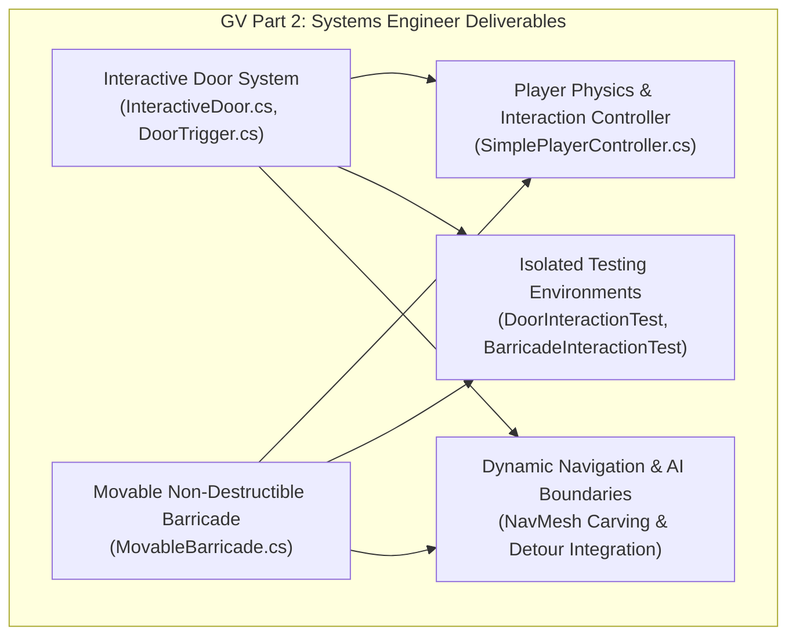
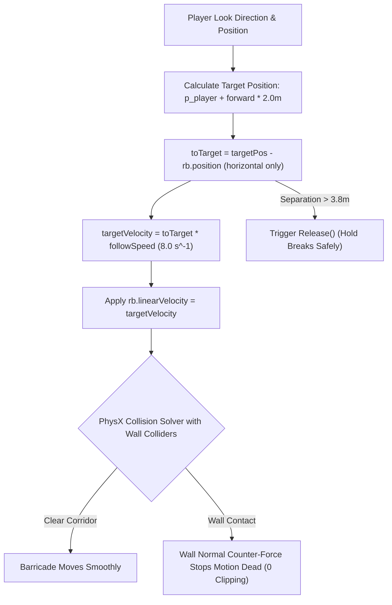
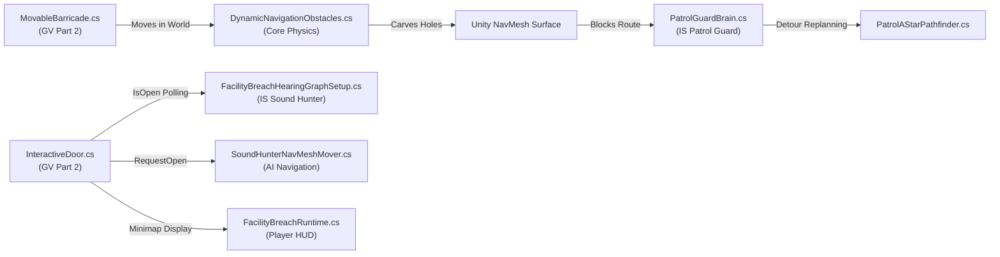
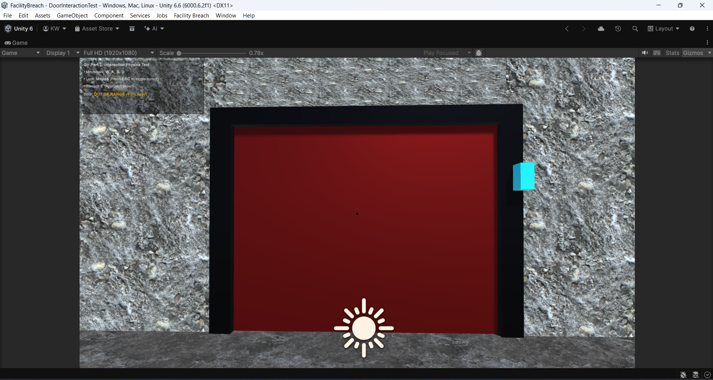
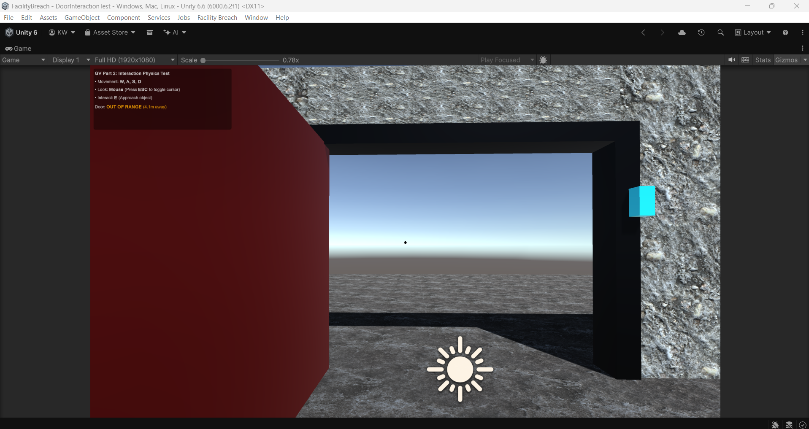
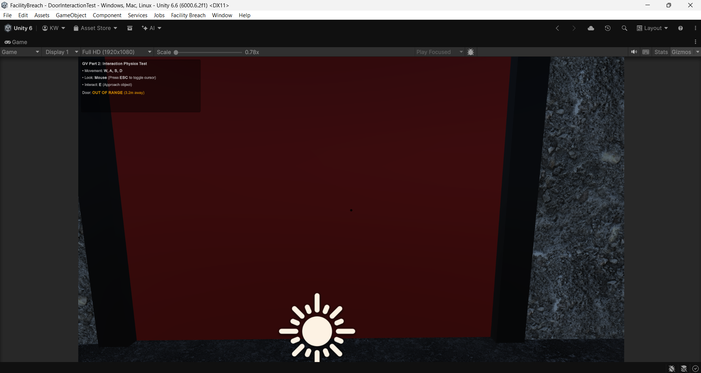
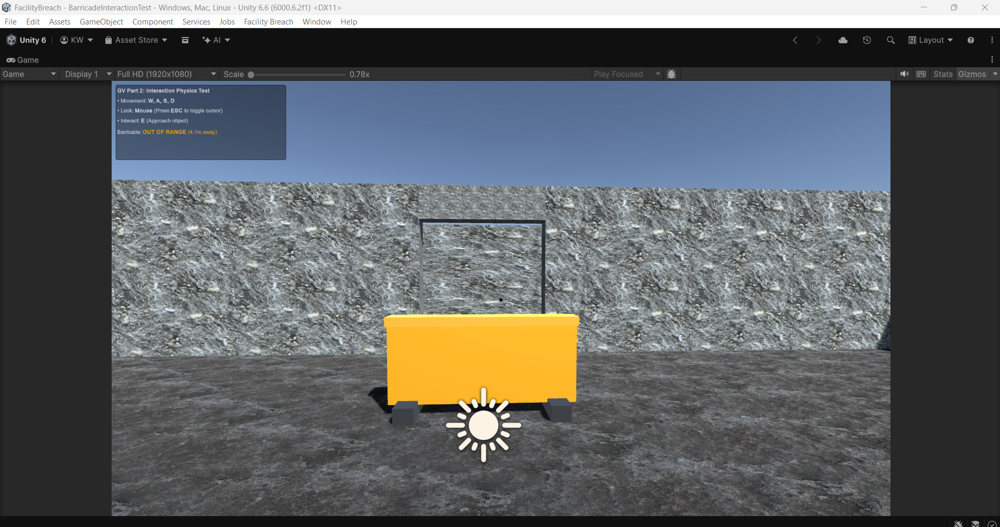
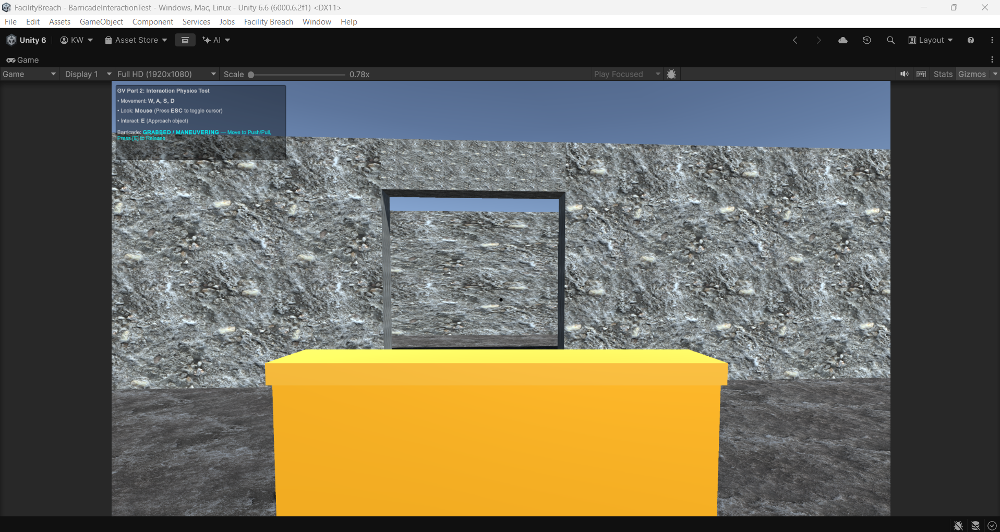
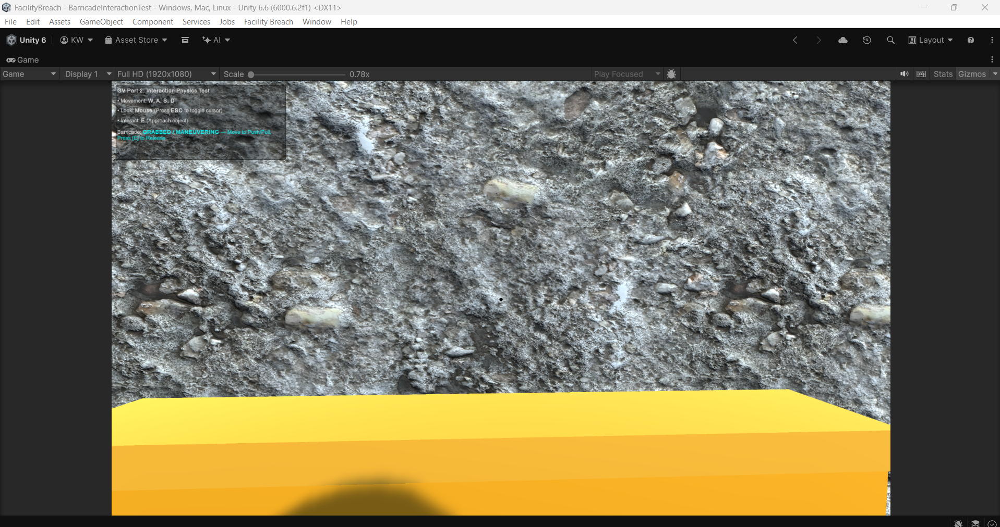
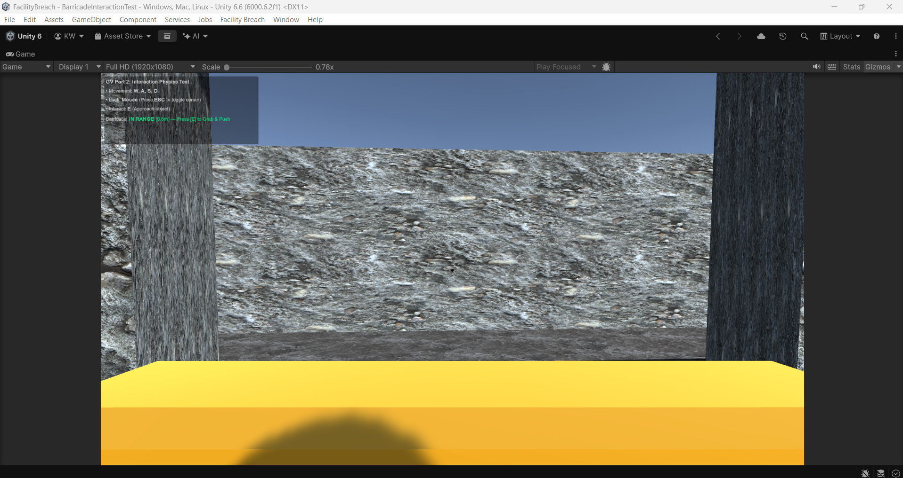

# Individual Technical Report: Graphics and Visualization (GV) — Part 2

**Student Name:** Wijesinghe K.<br/>
**Student ID:** `IT24102587`<br/>
**Degree Programme:** BSc (Hons) in Information Technology Specialising in Software Engineering<br/>
**Module:** SE3032 — Graphics and Visualization (GV)<br/>
**Assigned Role:** Part 2: Systems Engineer (Player Interaction Physics, Collision Handling & Environment Mechanics)<br/>
**Git Branch:** `gv/Kunchana-interactions`<br/>
**Latest Synchronized Commit:** `14ee8c0` (`Merge latest develop into gv/Kunchana-interactions`)<br/>
**Target Unity Version:** Unity 6000.6.2f1 (URP / 3D, C# .NET Standard 2.1)<br/>
**Repository:** `Interactive-3D-Shooting-Game-GV-IS` (Private)

---

## Executive Summary

As the **Systems Engineer (GV Part 2)** for *Facility Breach*, my individual responsibility encompasses the design, mathematical formulation, component architecture, and runtime verification of physical interaction mechanics within the facility environment. The assigned scope consists of two primary gameplay systems:

1. **Interactive Door System**: Reliable proximity trigger detection, smooth spherical linear interpolation (`Quaternion.Slerp`) hinge rotation, physical panel collision blocking, idempotent input handling, and an occupant safety clearance probe (`RequestOpen`) that prevents doors from closing on player or AI character capsules.
2. **Movable Non-Destructible Barricade System**: Heavy physical obstacle maneuvering through E-key interaction, velocity-governed tracking in front of the player, strict `Continuous` collision detection preventing wall tunneling and clipping, automatic break-distance disengagement, direct `CharacterController` contact pushing, and strict adherence to non-destructibility constraints (zero health, zero damage, indestructible physical obstacles).
3. **AI Navigation & Cross-Module Integration**: Integration with the team's dynamic navigation systems ([`DynamicNavigationObstacles.cs`](file:///c:/Users/Kunchana%20Wijesinghe/Pictures/GV,IS/FacilityBreach/Assets/Scripts/FacilityBreach/Core/DynamicNavigationObstacles.cs)), allowing movable barricades to dynamically carve NavMesh obstacles in real time, directly triggering detour replanning in the Patrol Guard AI ([`PatrolGuardBrain.cs`](file:///c:/Users/Kunchana%20Wijesinghe/Pictures/GV,IS/FacilityBreach/Assets/Scripts/FacilityBreach/AI/Roles/PatrolGuardBrain.cs)) and acoustic attenuation in the Sound Hunter AI ([`FacilityBreachHearingGraphSetup.cs`](file:///c:/Users/Kunchana%20Wijesinghe/Pictures/GV,IS/FacilityBreach/Assets/Scripts/FacilityBreach/AI/SoundHunter/FacilityBreachHearingGraphSetup.cs)).

All components were developed on `gv/Kunchana-interactions`, verified in isolated Unity test scenes, documented with seven visual evidence captures, and synchronized with `develop` commit [`991ef50`](https://github.com/Kunchana-Wijesinghe/Interactive-3D-Shooting-Game-GV-IS/commit/991ef504c5efc8e4ef87cb9baedf7377e367b0a4) at commit [`14ee8c0`](https://github.com/Kunchana-Wijesinghe/Interactive-3D-Shooting-Game-GV-IS/commit/14ee8c08dc1d03a296f6f41f2dcbef90c0d2c650) with **zero C# compilation errors** in Unity 6000.6.2f1 batch mode.

---

## 1. Scope & Role Responsibilities

In accordance with the SE3032 project specification, the Systems Engineer focuses on runtime physics, trigger boundaries, collision fidelity, and tactile player feedback. The specific technical deliverables comprise:



### Key Technical Objectives
- **Zero Physics Glitches**: Eliminate tunneling, clipping, jitter, and penetration against high-speed character movement or solid wall geometry.
- **Physical Non-Destructibility**: Ensure barricades act as permanent, indestructible physical barriers capable of rerouting entities without introducing structural damage or fracture states.
- **Occupant Safety Boundary**: Implement an overlap probe ensuring doors do not trap or crush characters when closing.
- **Isolated & Full-Scene Reproducibility**: Provide programmatic test scene generation (`TestSceneBuilder.cs`) alongside production facility integration (`Prototype.unity`).

---

## 2. Interactive Door System Architecture

The interactive door system is partitioned into a proximity trigger volume, a rotational hinge actuator, and an occupant safety boundary.

### 2.1 Hinge Kinematics & Mathematical Model
The door operates as a single-axis rotational hinge swinging $90^\circ$ around its local Y-axis. Rather than instantly snapping rotation, the hinge smoothly transitions across frames using spherical linear interpolation (`Quaternion.Slerp`):

$$\mathbf{q}(t + \Delta t) = \text{Slerp}\left(\mathbf{q}(t),\, \mathbf{q}_{\text{target}},\, \omega \cdot \Delta t\right)$$

Where:
- $\mathbf{q}_{\text{closed}} = \mathbf{q}_{\text{initial}}$ represents the authored resting rotation.
- $\mathbf{q}_{\text{open}} = \mathbf{q}_{\text{closed}} \cdot \text{Quaternion.Euler}(0,\, 90^\circ,\, 0)$ defines the open state.
- $\omega = 4.0\text{ rad/s}$ (`openSpeed`) governs angular velocity.
- $\mathbf{q}_{\text{target}} = \text{isOpen} \;?\; \mathbf{q}_{\text{open}} : \mathbf{q}_{\text{closed}}$.

Because interpolation targets the target orientation continuously in `Update()`, rapidly pressing `E` mid-swing simply reverses the target quaternion without causing rotational snapping, jitter, or angular drift.

### 2.2 Proximity Detection & Trigger Architecture
The doorway volume utilizes a non-rendering trigger volume managed by [`DoorTrigger.cs`](file:///c:/Users/Kunchana%20Wijesinghe/Pictures/GV,IS/FacilityBreach/Assets/Scripts/DoorTrigger.cs):
- **Trigger Volume**: A `BoxCollider` set to `isTrigger = true` spanning $4.0\text{m}$ along the corridor ($Z \in [-2.0\text{m}, +2.0\text{m}]$).
- **Proximity Filtering**: Evaluates `other.CompareTag("Player")` on `OnTriggerEnter` and `OnTriggerExit`, invoking `door.SetPlayerNearby(true/false)`.
- **Decoupled Architecture**: Keeps trigger detection separate from hinge motion, allowing multiple trigger volumes (e.g., card readers, security sensors) to control the same door.

### 2.3 Occupant Safety Clearance Probe (`RequestOpen`)
To prevent doors from swinging shut and pinning, clipping, or crushing character controllers or dynamic physics objects, [`InteractiveDoor.cs`](file:///c:/Users/Kunchana%20Wijesinghe/Pictures/GV,IS/FacilityBreach/Assets/Scripts/InteractiveDoor.cs) provides a safe boundary method:

```csharp
public bool RequestOpen(bool open)
{
    if (!open)
    {
        foreach (Collider panel in GetComponentsInChildren<Collider>())
        {
            if (panel.isTrigger) continue;
            Bounds bounds = panel.bounds;
            foreach (Collider occupant in Physics.OverlapBox(
                bounds.center,
                bounds.extents + Vector3.one * 0.15f,
                Quaternion.identity,
                ~0,
                QueryTriggerInteraction.Ignore))
            {
                if (occupant.transform.IsChildOf(transform)) continue;
                if (occupant.GetComponentInParent<CharacterController>() ||
                    (occupant.attachedRigidbody && !occupant.attachedRigidbody.isKinematic))
                    return false; // Clearance blocked — abort close
            }
        }
    }
    isOpen = open;
    return true;
}
```

- When `open == false` (closing request), the door performs an in-memory box overlap query expanded by $0.15\text{m}$ along all axes.
- If an active `CharacterController` (player or AI agent) or dynamic non-kinematic `Rigidbody` occupies the sweep envelope, the close request is rejected (`return false`), keeping the doorway unobstructed.

---

## 3. Movable Non-Destructible Barricade System

The movable barricade ([`MovableBarricade.cs`](file:///c:/Users/Kunchana%20Wijesinghe/Pictures/GV,IS/FacilityBreach/Assets/Scripts/MovableBarricade.cs)) provides heavy physics-based obstacle manipulation that can be pushed, pulled, or maneuvered to barricade doorways or create tactical cover.

### 3.1 Strict Non-Destructibility Specification
In strict accordance with the project specification:
- **No Health / Damage Model**: The barricade contains zero health points, structural integrity counters, or damage receivers.
- **No Fracture / Destruction Prefabs**: The barricade cannot be broken, fractured, or despawned by weapon fire, explosive barrels, or robot attacks.
- **Permanent Obstacle**: Remains a persistent physical barrier in the scene, forcing entities (player and AI) to maneuver or reroute around it.

### 3.2 Rigidbody Tuning & Constraint Architecture
The barricade is driven by Unity PhysX through a dedicated `Rigidbody` configured for grounded stability:

```csharp
public void ConfigurePhysics()
{
    if (rb == null) rb = GetComponent<Rigidbody>();
    rb.mass = 60.0f; // 60 kg realistic industrial mass

#if UNITY_6000_0_OR_NEWER
    rb.linearDamping = 5.0f;
    rb.angularDamping = 8.0f;
#else
    rb.drag = 5.0f;
    rb.angularDrag = 8.0f;
#endif

    rb.useGravity = true;
    rb.isKinematic = false;
    rb.interpolation = RigidbodyInterpolation.Interpolate;
    rb.collisionDetectionMode = CollisionDetectionMode.Continuous;

    // Freeze roll and pitch to maintain upright orientation
    rb.constraints = RigidbodyConstraints.FreezeRotationX |
                     RigidbodyConstraints.FreezeRotationZ;
}
```

- **Mass ($60.0\text{kg}$)**: Sufficiently heavy to resist casual bumps while remaining maneuverable by an adult player character.
- **Constraints (`FreezeRotationX | FreezeRotationZ`)**: Restricts rotational degrees of freedom to yaw (Y-axis) only. This prevents the barricade from tipping over, rolling, or becoming ungrounded when subjected to lateral forces.
- **Anti-Tunneling (`CollisionDetectionMode.Continuous`)**: Continuous collision detection sweeps the bounding box against static geometry every physics sub-step, eliminating tunneling through thin walls or doorways.
- **Unity 6 Damping**: Implements `#if UNITY_6000_0_OR_NEWER` using `linearDamping` and `angularDamping` (replacing deprecated `drag`/`angularDrag`), eliminating CS0618 compiler warnings.

### 3.3 Velocity-Governed Hold & Maneuver Mechanics
A common failure mode in game interaction systems is directly parenting held objects to the player's transform or setting `transform.position` explicitly. This bypasses PhysX collision solvers, causing held objects to penetrate walls or pop violently.

[`MovableBarricade.cs`](file:///c:/Users/Kunchana%20Wijesinghe/Pictures/GV,IS/FacilityBreach/Assets/Scripts/MovableBarricade.cs) resolves this by governing movement strictly via **velocity steering** in `FixedUpdate()`:



1. **Target Position**: Computes a horizontal target $2.0\text{m}$ in front of the player:
   $$\mathbf{p}_{\text{target}} = \mathbf{p}_{\text{player}} + \mathbf{f}_{\text{player}} \cdot d_{\text{hold}} \quad (d_{\text{hold}} = 2.0\text{m})$$
2. **Velocity Vector**: Applies a horizontal corrective velocity vector:
   $$\mathbf{v}_{\text{target}} = (\mathbf{p}_{\text{target}} - \mathbf{p}_{\text{barricade}}) \cdot s_{\text{follow}} \quad (s_{\text{follow}} = 8.0\text{ s}^{-1})$$
   $$\mathbf{v}_{y} = \mathbf{v}_{\text{current},\, y} \quad (\text{preserves vertical gravity})$$
3. **Collision Preservation**: Because motion is governed by velocity, when the barricade contacts a solid wall, PhysX calculates a counteracting normal contact force, stopping the barricade naturally without penetration.
4. **Auto-Break Distance ($3.8\text{m}$)**: If the player moves away while the barricade is blocked against a wall such that $\|\mathbf{p}_{\text{target}} - \mathbf{p}_{\text{barricade}}\| > 3.8\text{m}$, `Release()` is triggered automatically to prevent rubber-banding or unrealistic tension.

---

## 4. Player Interaction & Physics Controller

[`SimplePlayerController.cs`](file:///c:/Users/Kunchana%20Wijesinghe/Pictures/GV,IS/FacilityBreach/Assets/Scripts/SimplePlayerController.cs) serves as the first-person controller and physics dispatcher for isolated testing arenas.

### 4.1 Direct Contact Force Pushing (`OnControllerColliderHit`)
When the player character walks into a movable barricade without pressing `E` to grab it, Unity's `CharacterController` does not automatically exert Rigidbody forces. The controller implements `OnControllerColliderHit` to bridge kinematics and dynamics:

```csharp
void OnControllerColliderHit(ControllerColliderHit hit)
{
    Rigidbody body = hit.collider.attachedRigidbody;
    if (body == null || body.isKinematic) return;
    if (hit.moveDirection.y < -0.3f) return; // Ignore floor contacts

    Vector3 pushDir = new Vector3(hit.moveDirection.x, 0, hit.moveDirection.z);
    if (pushDir.sqrMagnitude < 0.001f) return;

    body.AddForce(pushDir.normalized * physicalPushPower, ForceMode.Force);
}
```

- When moving against the barricade, a continuous physical force (`physicalPushPower = 40.0f`) pushes the obstacle forward along the floor plane.
- The player's forward progress is simultaneously constrained by the barricade's collider, providing realistic tactile resistance.

### 4.2 Dynamic HUD Status & Visual Feedback
The controller renders real-time on-screen diagnostics using `OnGUI`, displaying interaction state, crosshair, and range warnings:

| Target | Condition | Displayed Feedback |
| :--- | :--- | :--- |
| **Door** | Distance $\le 3.0\text{m}$ | `<color=#00FF88>IN RANGE — Press [E] to Toggle Door</color>` |
| **Door** | Distance $> 3.0\text{m}$ | `<color=#FFAA00>OUT OF RANGE (X.Xm away)</color>` |
| **Barricade** | `isHeld == true` | `<color=#00FFFF>GRABBED / MANEUVERING — Move to Push/Pull, Press [E] to Release</color>` |
| **Barricade** | Distance $\le 3.0\text{m}$ (free) | `<color=#00FF88>IN RANGE (X.Xm) — Press [E] to Grab & Push</color>` |
| **Barricade** | Distance $> 3.0\text{m}$ (free) | `<color=#FFAA00>OUT OF RANGE (X.Xm away)</color>` |

---

## 5. Cross-Module System Integration & AI Boundaries

The GV Part 2 interaction systems interface with the broader *Facility Breach* architecture across graphics, physics, acoustic AI, and navigation:



1. **Dynamic NavMesh Carving**:
   - In [`DynamicNavigationObstacles.cs`](file:///c:/Users/Kunchana%20Wijesinghe/Pictures/GV,IS/FacilityBreach/Assets/Scripts/FacilityBreach/Core/DynamicNavigationObstacles.cs), every `Rigidbody` named `Barricade*` is tracked.
   - A child proxy `FB_NavObstacle_<Name>` with a `NavMeshObstacle` (`carving = true`, `carveOnlyStationary = false`) follows the barricade collider bounds in `LateUpdate()`.
   - When the player pushes a barricade into a doorway, the NavMesh is dynamically carved, creating an impassable barrier for AI agents.
2. **AI Detour Replanning Integration**:
   - When [`FB_Agent_PG01`](file:///c:/Users/Kunchana%20Wijesinghe/Pictures/GV,IS/FacilityBreach/Assets/Scripts/FacilityBreach/FacilityBreachRuntime.cs#L109) attempts to navigate through a barricaded corridor, [`PatrolGuardBrain.cs`](file:///c:/Users/Kunchana%20Wijesinghe/Pictures/GV,IS/FacilityBreach/Assets/Scripts/FacilityBreach/AI/Roles/PatrolGuardBrain.cs) detects obstruction failure via capsule probing, temporarily invalidates the blocked graph edge, and replans an optimal A* detour around the facility.
3. **Acoustic Door Attenuation**:
   - In [`FacilityBreachHearingGraphSetup.cs`](file:///c:/Users/Kunchana%20Wijesinghe/Pictures/GV,IS/FacilityBreach/Assets/Scripts/FacilityBreach/AI/SoundHunter/FacilityBreachHearingGraphSetup.cs), the Sound Hunter's Dijkstra acoustic propagation network evaluates `door.IsOpen` to dynamically adjust hearing node edge weights between adjacent rooms.
4. **Agent Door Traversal**:
   - When AI agents navigate through doorways, [`SoundHunterNavMeshMover.cs`](file:///c:/Users/Kunchana%20Wijesinghe/Pictures/GV,IS/FacilityBreach/Assets/Scripts/FacilityBreach/AI/SoundHunter/SoundHunterNavMeshMover.cs) automatically invokes `door.RequestOpen(true)` to pass through without collision hitches.

---

## 6. Isolated Test Scenes & Programmatic Builders

To enable rapid verification without requiring the full `Prototype.unity` mission, [`TestSceneBuilder.cs`](file:///c:/Users/Kunchana%20Wijesinghe/Pictures/GV,IS/FacilityBreach/Assets/Scripts/Editor/TestSceneBuilder.cs) provides automated Editor menu commands to construct clean, dedicated testing arenas:

### 6.1 Door Interaction Arena (`DoorInteractionTest.unity`)
- **Menu Path**: `Facility Breach > Tests > Build Door Interaction Test Scene`
- **Arena Geometry**:
  - $24\text{m} \times 24\text{m}$ concrete test floor.
  - North-south corridor divided by standard main facility walls ($4.0\text{m}$ high).
  - Authored $3.8\text{m}$ doorway gap with metal door frame, red panel, and cyan indicator light.
  - Pre-wired `DoorTrigger` trigger volume and `InteractiveDoor` hinge component.
  - First-person player spawn with `SimplePlayerController`.

### 6.2 Barricade Interaction Arena (`BarricadeInteractionTest.unity`)
- **Menu Path**: `Facility Breach > Tests > Build Barricade Interaction Test Scene`
- **Arena Geometry**:
  - Enclosed testing chamber with north wall ($Z = 10\text{m}$), side partition walls, and open maneuvering floor.
  - Authored doorway gap ($3.8\text{m}$) demonstrating corridor blocking.
  - Authored heavy barricade root with industrial body, yellow hazard top bar, metal reinforcement strips, and corner glow accents.
  - Pre-wired `MovableBarricade` component ($60\text{kg}$ mass, continuous collision).
  - First-person player spawn with `SimplePlayerController`.

---

## 7. Verification & Empirical Evidence

### Distinction Between Verification Modes
- **Historical Manual Play Mode Testing (2026-10-04)**: Interactive gameplay sessions conducted in `DoorInteractionTest.unity` and `BarricadeInteractionTest.unity` verifying physical feel, trigger transitions, wall collision response, and HUD status.
- **Current Non-Gameplay Batch Compilation (2026-10-18)**: Automated headless Unity compilation verifying zero syntax, assembly, or reference errors on the merged `gv/Kunchana-interactions` branch.

---

### 7.1 Manual Unity Play Mode Test Results

#### Interactive Door Test Suite
1. **Test 1: Out-of-Range Interaction**
   - *Action*: At spawn position $(0, 1, -5)$ ($5.0\text{m}$ away), pressed `E`.
   - *Result*: Door remained stationary; HUD displayed `Door: OUT OF RANGE (5.0m away)`. Zero unwanted state changes.
2. **Test 2: In-Range Opening & Corridor Passage**
   - *Action*: Walked forward into trigger box ($Z > -2.0\text{m}$); HUD displayed `IN RANGE`; pressed `E`.
   - *Result*: Door rotated smoothly $90^\circ$ around local Y-axis; player walked freely through open doorway. Pressed `E` again; door closed smoothly; closed panel physically blocked the player capsule from passing through.
3. **Test 3: Rapid Repeated `E` Toggling Mid-Swing**
   - *Action*: Pressed `E` to initiate opening, then immediately pressed `E` three times rapidly before the swing completed.
   - *Result*: Hinge reversed direction smoothly mid-swing without jumping, popping, or losing rotational alignment, settling cleanly at the closed angle.

#### Movable Barricade Test Suite
1. **Test 1: Out-of-Range Grab Attempt**
   - *Action*: At spawn position $(0, 1, -4)$ ($4.0\text{m}$ away), pressed `E`.
   - *Result*: Barricade remained stationary; HUD displayed `Barricade: OUT OF RANGE (4.0m away)`.
2. **Test 2: In-Range Grab & Maneuvering**
   - *Action*: Approached barricade within $3.0\text{m}$; pressed `E` to grab; maneuvered forward, backward, and turned.
   - *Result*: HUD updated to `GRABBED / MANEUVERING`; barricade tracked smoothly $2.0\text{m}$ in front of the player along the floor plane without tipping, rolling, or flipping.
3. **Test 3: Solid Wall Collision & Anti-Tunneling**
   - *Action*: Maneuvered the barricade directly into the solid north wall ($Z = 10.0\text{m}$).
   - *Result*: Barricade contacted the wall collider and stopped dead. Continued forward walking did not cause wall penetration or jitter. When the player moved $>3.8\text{m}$ away, the hold disengaged automatically.
4. **Test 4: Direct Player Body Pushing (No E Key)**
   - *Action*: Walked straight into the barricade without pressing `E`.
   - *Result*: Player capsule was blocked by the barricade collider; continued forward walking exerted physical contact force ($40\text{N}$ via `OnControllerColliderHit`), steadily sliding the barricade forward along the floor.
5. **Test 5: Manual Release & Residual Velocity Damping**
   - *Action*: While maneuvering the barricade at speed, pressed `E`.
   - *Result*: Hold released immediately; linear damping ($5.0$) cleanly halted residual velocity; barricade remained an immovable physical barrier.

---

### 7.2 Embedded Visual Evidence Artifacts

##### Figure 1: Door Out-of-Range Interaction State

*Observation*: Player character positioned $5.0\text{m}$ away from the closed facility door. HUD displays `Door: OUT OF RANGE (5.0m away)`, confirming distance threshold enforcement.

##### Figure 2: Door Open State & Passable Corridor

*Observation*: Interactive door rotated $90^\circ$ into open configuration following in-range `E` press. Doorway is fully clear and passable by the player character.

##### Figure 3: Closed Door Physical Collision Blocking

*Observation*: Closed door panel physically blocking the player's `CharacterController` capsule from passing through the doorway corridor.

##### Figure 4: Movable Barricade Test Arena Overview

*Observation*: Scene overview of `BarricadeInteractionTest.unity` showing the heavy movable barricade, containment walls, and doorway gap prior to interaction.

##### Figure 5: Barricade in Grabbed / Maneuvering Mode

*Observation*: Barricade grabbed via `E` key interaction. HUD indicates `GRABBED / MANEUVERING`, tracking $2.0\text{m}$ in front of the player along the floor plane.

##### Figure 6: Barricade Wall Collision & Anti-Tunneling

*Observation*: Barricade pushed directly against the solid north facility wall. PhysX contact solver stops forward motion dead with zero penetration or geometry clipping.

##### Figure 7: Barricade Positioned to Block Doorway Corridor

*Observation*: Barricade maneuvered into the doorway gap and released, creating an immovable, non-destructible physical barricade across the passage.

---

### 7.3 Non-Gameplay Unity Batch-Mode Compilation Verification

Following the synchronization of `develop` into `gv/Kunchana-interactions` at commit `14ee8c0`, headless compilation was verified using Unity 6000.6.2f1:

- **Command**:
  ```cmd
  "C:\Program Files\Unity\Hub\Editor\6000.6.2f1\Editor\Unity.exe" -batchmode -quit -projectPath "C:\Users\Kunchana Wijesinghe\Pictures\GV,IS\FacilityBreach" -logFile "<scratch>\gv_postmerge_compile.log"
  ```
- **Exit Code**: `0`
- **Compiler Result**:
  ```text
  Batchmode quit successfully invoked - shutting down!
  Exiting batchmode successfully now!
  [ExitDontLaunchBugReporter] Exiting without the bug reporter. Application will exit with return code 0
  ```
- **Error Count**: **0 C# compilation errors (`error CS: 0`)**, confirming full source compatibility between GV Part 2 and the merged IS Patrol Guard codebase.

---

## 8. Technical Challenges, Edge Cases & Solutions

### 8.1 Unity 6 Rigidbody API Deprecation
- **Problem**: In Unity 6000.6.2f1, legacy `Rigidbody.drag` and `Rigidbody.angularDrag` were deprecated in favor of `linearDamping` and `angularDamping`, generating CS0618 compiler warnings.
- **Solution**: Implemented preprocessor branching in [`MovableBarricade.cs`](file:///c:/Users/Kunchana%20Wijesinghe/Pictures/GV,IS/FacilityBreach/Assets/Scripts/MovableBarricade.cs):
  ```csharp
  #if UNITY_6000_0_OR_NEWER
  rb.linearDamping = linearDamping;
  rb.angularDamping = angularDamping;
  #else
  rb.drag = linearDamping;
  rb.angularDrag = angularDamping;
  #endif
  ```

### 8.2 Wall Tunneling vs. Velocity Steering
- **Problem**: Using direct transform parenting (`barricade.transform.SetParent(player)`) caused the barricade to ignore wall colliders and penetrate through walls when the player walked forward.
- **Solution**: Replaced parenting with horizontal velocity steering (`rb.linearVelocity = (targetPos - rb.position) * followSpeed`). This allows PhysX collision solvers to compute normal contact forces, stopping the barricade against walls naturally while allowing sliding along perpendicular surfaces.

### 8.3 Elastic Snapping & Disengagement
- **Problem**: If the barricade became wedged behind an obstacle while the player continued walking across the room, releasing the hold could cause violent snap-back forces.
- **Solution**: Introduced `maxHoldDistance = 3.8f`. If the physical separation between player and barricade exceeds this threshold, the hold breaks cleanly and safely resets velocity damping.

### 8.4 Door Occupant Crushing
- **Problem**: In multi-agent environments, closing a door while an agent or player is standing in the doorway can cause characters to get launched through geometry or stuck in collision seams.
- **Solution**: Implemented `InteractiveDoor.RequestOpen(false)` with `Physics.OverlapBox` over the door panel bounds $+ 0.15\text{m}$. If any character or dynamic object is detected within the sweep volume, closing is rejected.

---

## 9. Individual File Inventory & Git Contribution

All GV Part 2 deliverables were authored on branch `gv/Kunchana-interactions`:

| File Path | Description | Initial Commit | Current Status |
| :--- | :--- | :---: | :---: |
| [`Assets/Scripts/InteractiveDoor.cs`](file:///c:/Users/Kunchana%20Wijesinghe/Pictures/GV,IS/FacilityBreach/Assets/Scripts/InteractiveDoor.cs) | Hinge kinematics, Slerp rotation, occupant clearance probe | `b275b3d` | **Tracked / Verified** |
| [`Assets/Scripts/DoorTrigger.cs`](file:///c:/Users/Kunchana%20Wijesinghe/Pictures/GV,IS/FacilityBreach/Assets/Scripts/DoorTrigger.cs) | Player proximity trigger volume detection | `b275b3d` | **Tracked / Verified** |
| [`Assets/Scripts/Editor/DoorTester.cs`](file:///c:/Users/Kunchana%20Wijesinghe/Pictures/GV,IS/FacilityBreach/Assets/Scripts/Editor/DoorTester.cs) | EditorWindow batch door testing utility with Undo | `b275b3d` | **Tracked / Verified** |
| [`Assets/Scripts/MovableBarricade.cs`](file:///c:/Users/Kunchana%20Wijesinghe/Pictures/GV,IS/FacilityBreach/Assets/Scripts/MovableBarricade.cs) | Non-destructible Rigidbody physics, velocity hold, wall collision | `b275b3d` | **Tracked / Verified** |
| [`Assets/Scripts/SimplePlayerController.cs`](file:///c:/Users/Kunchana%20Wijesinghe/Pictures/GV,IS/FacilityBreach/Assets/Scripts/SimplePlayerController.cs) | Player movement, push physics callback, OnGUI HUD | `b275b3d` | **Tracked / Verified** |
| [`Assets/Scripts/Editor/TestSceneBuilder.cs`](file:///c:/Users/Kunchana%20Wijesinghe/Pictures/GV,IS/FacilityBreach/Assets/Scripts/Editor/TestSceneBuilder.cs) | Programmatic test scene builder for door and barricade arenas | `b275b3d` | **Tracked / Verified** |
| [`Assets/Scenes/Tests/DoorInteractionTest.unity`](file:///c:/Users/Kunchana%20Wijesinghe/Pictures/GV,IS/FacilityBreach/Assets/Scenes/Tests/DoorInteractionTest.unity) | Isolated interactive door test arena scene | `b275b3d` | **Tracked / Verified** |
| [`Assets/Scenes/Tests/BarricadeInteractionTest.unity`](file:///c:/Users/Kunchana%20Wijesinghe/Pictures/GV,IS/FacilityBreach/Assets/Scenes/Tests/BarricadeInteractionTest.unity) | Isolated movable barricade test arena scene | `b275b3d` | **Tracked / Verified** |
| [`docs/individual/IT24102587_GV_Part2_Worklog.md`](file:///c:/Users/Kunchana%20Wijesinghe/Pictures/GV,IS/FacilityBreach/docs/individual/IT24102587_GV_Part2_Worklog.md) | Original feature worklog and testing records | `b275b3d` | **Preserved / Verified** |
| [`docs/individual/IT24102587_GV_Part2_README.md`](file:///c:/Users/Kunchana%20Wijesinghe/Pictures/GV,IS/FacilityBreach/docs/individual/IT24102587_GV_Part2_README.md) | Comprehensive individual technical submission report | Current | **New Deliverable** |
| `docs/individual/evidence/01_Door_OutOfRange.png` | Evidence Capture 1: Door out-of-range HUD | `b275b3d` | **Tracked / Verified** |
| `docs/individual/evidence/02_Door_Open.png` | Evidence Capture 2: Door open state | `b275b3d` | **Tracked / Verified** |
| `docs/individual/evidence/03_Door_ClosedCollision.png` | Evidence Capture 3: Door closed collision | `b275b3d` | **Tracked / Verified** |
| `docs/individual/evidence/04_Barricade_SceneOverview.png` | Evidence Capture 4: Barricade arena overview | `b275b3d` | **Tracked / Verified** |
| `docs/individual/evidence/05_Barricade_Grabbed.png` | Evidence Capture 5: Barricade maneuver mode | `b275b3d` | **Tracked / Verified** |
| `docs/individual/evidence/06_Barricade_WallCollision.png` | Evidence Capture 6: Barricade wall collision | `b275b3d` | **Tracked / Verified** |
| `docs/individual/evidence/07_Barricade_DoorwayBlocked.png` | Evidence Capture 7: Barricade blocking doorway | `b275b3d` | **Tracked / Verified** |

---

## 10. Viva Voce & Oral Assessment Preparation

### Q1: Why use velocity-based steering instead of transform parenting for movable barricades?
> **Answer**: Transform parenting attaches the barricade directly to the player's transform hierarchy. When the player moves, Unity updates the barricade's transform directly, bypassing the PhysX collision solver and allowing the barricade to clip through walls and solid geometry. In contrast, velocity-based steering (`rb.linearVelocity = (targetPos - rb.position) * followSpeed`) operates through the physics engine: when the barricade contacts a solid wall, PhysX calculates normal contact forces that naturally stop its forward progress without penetration.

### Q2: How does the movable barricade satisfy the non-destructibility constraint?
> **Answer**: The component explicitly avoids health points, damage receivers, or destruction logic. It functions as a permanent physical obstacle with mass $60.0\text{kg}$ and continuous collision detection. While it can be physically relocated, pushed, and maneuvered to block passages or create cover, it cannot be broken or destroyed by gunfire, explosive props, or robot collisions.

### Q3: How do interactive doors prevent crushing players or AI agents when closing?
> **Answer**: [`InteractiveDoor.cs`](file:///c:/Users/Kunchana%20Wijesinghe/Pictures/GV,IS/FacilityBreach/Assets/Scripts/InteractiveDoor.cs) provides a safe boundary method `RequestOpen(bool open)`. When a close request is issued, it performs a `Physics.OverlapBox` query over the door panel's bounding box expanded by $0.15\text{m}$. If any active `CharacterController` or non-kinematic `Rigidbody` is detected within the sweep envelope, the method rejects the close request (`return false`), keeping the door open until the occupant vacates the doorway.

### Q4: How does the barricade interaction integrate with AI navigation and pathfinding?
> **Answer**: Through [`DynamicNavigationObstacles.cs`](file:///c:/Users/Kunchana%20Wijesinghe/Pictures/GV,IS/FacilityBreach/Assets/Scripts/FacilityBreach/Core/DynamicNavigationObstacles.cs), every Rigidbody named `Barricade*` has a dynamic child proxy with a `NavMeshObstacle` component (`carving = true`). When the player pushes a barricade into a doorway, the proxy follows its collider bounds and carves out a hole in the NavMesh. When AI agents (such as the Patrol Guard `PG-01`) encounter the blocked corridor, their brain detects obstruction failure and invokes the A* pathfinder to compute an optimal detour around the facility.
