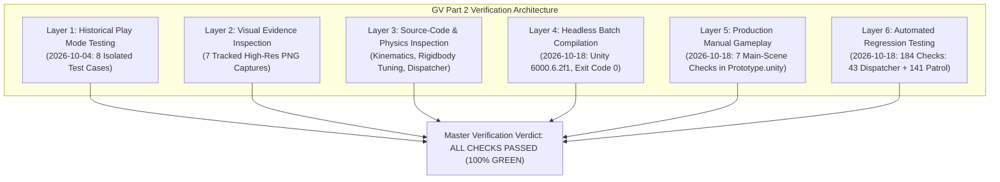

# Individual Verification Log: Graphics and Visualization (GV) — Part 2

**Student Name:** Wijesinghe K.<br/>
**Student ID:** `IT24102587`<br/>
**Degree Programme:** BSc (Hons) in Information Technology Specialising in Software Engineering<br/>
**Module:** SE3032 — Graphics and Visualization (GV)<br/>
**Assigned Role:** Part 2: Systems Engineer (Player Interaction Physics, Collision Handling & Environment Mechanics)<br/>
**Branch Verified (Merged Baseline):** `develop`<br/>
**Integrated Merge Commit:** [`fd94efe`](https://github.com/Kunchana-Wijesinghe/Interactive-3D-Shooting-Game-GV-IS/commit/fd94efe6d97f0102a733be274bbb38cb7102806b) (`Merge pull request #9 from Kunchana-Wijesinghe/gv/Kunchana-interactions`)<br/>
**Current Working Feature Branch:** `gv/IT24102587-main-barricade-interaction` (uncommitted local work based on `develop` commit `c237edf`)<br/>
**Target Unity Version:** Unity 6000.6.2f1 (URP / 3D, C# .NET Standard 2.1)<br/>
**Repository:** `Interactive-3D-Shooting-Game-GV-IS` (Private)

---

## 1. Executive Summary & Verification Methodology

This document serves as the formal, evidence-based verification log for the individual **Graphics and Visualization (GV) — Part 2: Systems Engineer** contribution to the *Facility Breach* Unity project.

### 1.1 Multi-Layered Verification Methodology
To ensure strict academic integrity and reproducible technical rigor, the verification of the GV Part 2 contribution is divided across six distinct, clearly labeled assessment layers:

1. **Historical Interactive Play Mode Testing (2026-10-04)**:<br/>
   Manual, hands-on gameplay validation conducted in dedicated, isolated Unity testing scenes ([`DoorInteractionTest.unity`](file:///c:/Users/Kunchana%20Wijesinghe/Pictures/GV,IS/FacilityBreach/Assets/Scenes/Tests/DoorInteractionTest.unity) and [`BarricadeInteractionTest.unity`](file:///c:/Users/Kunchana%20Wijesinghe/Pictures/GV,IS/FacilityBreach/Assets/Scenes/Tests/BarricadeInteractionTest.unity)). These tests evaluated kinematic hinge rotation, trigger volumes, character controller pushing, velocity-governed obstacle maneuvering, continuous collision detection, and anti-tunneling against solid walls.
2. **Visual Evidence Inspection**:<br/>
   Empirical confirmation through seven high-resolution viewport screenshots captured directly during the 2026-10-04 manual Play Mode sessions, tracked in Git repository history under [`docs/individual/evidence/`](file:///c:/Users/Kunchana%20Wijesinghe/Pictures/GV,IS/FacilityBreach/docs/individual/evidence/).
3. **Architectural & Source-Code Inspection**:<br/>
   Static code analysis of C# physics logic, constraint configurations, mathematical formulas, and safe boundary checks across [`InteractiveDoor.cs`](file:///c:/Users/Kunchana%20Wijesinghe/Pictures/GV,IS/FacilityBreach/Assets/Scripts/InteractiveDoor.cs), [`DoorTrigger.cs`](file:///c:/Users/Kunchana%20Wijesinghe/Pictures/GV,IS/FacilityBreach/Assets/Scripts/DoorTrigger.cs), [`MovableBarricade.cs`](file:///c:/Users/Kunchana%20Wijesinghe/Pictures/GV,IS/FacilityBreach/Assets/Scripts/MovableBarricade.cs), [`SimplePlayerController.cs`](file:///c:/Users/Kunchana%20Wijesinghe/Pictures/GV,IS/FacilityBreach/Assets/Scripts/SimplePlayerController.cs), and [`FacilityInteractionDispatcher.cs`](file:///c:/Users/Kunchana%20Wijesinghe/Pictures/GV,IS/FacilityBreach/Assets/Scripts/FacilityBreach/Interactions/FacilityInteractionDispatcher.cs).
4. **Current Non-Gameplay Unity Batch-Mode Compilation (2026-10-18)**:<br/>
   Headless C# script compilation using Unity 6000.6.2f1 batch mode on both `develop` (`fd94efe`) and the active feature branch `gv/IT24102587-main-barricade-interaction`, validating zero compilation errors, zero missing assembly references, and complete compatibility alongside the integrated IS Patrol Guard AI system.
5. **Production Facility Manual Gameplay Verification (2026-10-18)**:<br/>
   Direct interactive gameplay validation in [`Prototype.unity`](file:///c:/Users/Kunchana%20Wijesinghe/Pictures/GV,IS/FacilityBreach/Assets/Scenes/Prototype.unity) conducted by the user, confirming seven distinct interaction behaviors including door opening/closing, barricade grab/release/tracking, dynamic HUD updates, and exclusive barricade release without door cross-triggering.
6. **Automated Interaction & AI Regression Testing (2026-10-18)**:<br/>
   Automated Edit Mode test execution covering 43 interaction arbitration checks ([`FacilityInteractionDispatcherTests.cs`](file:///c:/Users/Kunchana%20Wijesinghe/Pictures/GV,IS/FacilityBreach/Assets/Editor/FacilityBreach/FacilityInteractionDispatcherTests.cs)) and 141 Patrol Guard AI regression checks, verifying zero regression or pathfinding obstruction failures.



---

## 2. Verification Scope & Boundary Definition

The Systems Engineer (GV Part 2) scope covers environmental physics, collision solvers, player interaction mechanics, and dynamic obstacles:

| Subsystem | Primary Script(s) | Dedicated Test Scene | Verification Scope |
| :--- | :--- | :--- | :--- |
| **Interactive Doors** | [`InteractiveDoor.cs`](file:///c:/Users/Kunchana%20Wijesinghe/Pictures/GV,IS/FacilityBreach/Assets/Scripts/InteractiveDoor.cs)<br/>[`DoorTrigger.cs`](file:///c:/Users/Kunchana%20Wijesinghe/Pictures/GV,IS/FacilityBreach/Assets/Scripts/DoorTrigger.cs) | [`DoorInteractionTest.unity`](file:///c:/Users/Kunchana%20Wijesinghe/Pictures/GV,IS/FacilityBreach/Assets/Scenes/Tests/DoorInteractionTest.unity) | Trigger bounds, range checks, $90^\circ$ hinge slerp, closed-panel collision blocking, rapid toggle handling, occupant safety envelope (`RequestOpen`), `handleInternalInput` decoupling. |
| **Movable Barricades** | [`MovableBarricade.cs`](file:///c:/Users/Kunchana%20Wijesinghe/Pictures/GV,IS/FacilityBreach/Assets/Scripts/MovableBarricade.cs)<br/>[`SimplePlayerController.cs`](file:///c:/Users/Kunchana%20Wijesinghe/Pictures/GV,IS/FacilityBreach/Assets/Scripts/SimplePlayerController.cs) | [`BarricadeInteractionTest.unity`](file:///c:/Users/Kunchana%20Wijesinghe/Pictures/GV,IS/FacilityBreach/Assets/Scenes/Tests/BarricadeInteractionTest.unity) | $60.0\text{kg}$ Rigidbody tuning, Continuous collision mode, upright constraint locks, E-key grab maneuvering, wall anti-tunneling, CharacterController pushing, manual release. |
| **Interaction Arbitration** | [`FacilityInteractionDispatcher.cs`](file:///c:/Users/Kunchana%20Wijesinghe/Pictures/GV,IS/FacilityBreach/Assets/Scripts/FacilityBreach/Interactions/FacilityInteractionDispatcher.cs)<br/>[`FacilityBreachRuntime.cs`](file:///c:/Users/Kunchana%20Wijesinghe/Pictures/GV,IS/FacilityBreach/Assets/Scripts/FacilityBreach/FacilityBreachRuntime.cs) | [`Prototype.unity`](file:///c:/Users/Kunchana%20Wijesinghe/Pictures/GV,IS/FacilityBreach/Assets/Scenes/Prototype.unity)<br/>EditMode Suite | Centralized E-key interaction arbitration, single-action guarantee, held barricade priority release, candidate spatial scoring formula, contextual HUD prompts. |
| **Main-Scene Barricades** | [`MovableBarricade.cs`](file:///c:/Users/Kunchana%20Wijesinghe/Pictures/GV,IS/FacilityBreach/Assets/Scripts/MovableBarricade.cs)<br/>[`Prototype.unity`](file:///c:/Users/Kunchana%20Wijesinghe/Pictures/GV,IS/FacilityBreach/Assets/Scenes/Prototype.unity) | [`Prototype.unity`](file:///c:/Users/Kunchana%20Wijesinghe/Pictures/GV,IS/FacilityBreach/Assets/Scenes/Prototype.unity) | 6 authored root barricades, $12.0\text{kg}$ mass calibration, non-destructive continuous collision detection, dynamic navigation carving. |
| **Non-Destructibility** | [`MovableBarricade.cs`](file:///c:/Users/Kunchana%20Wijesinghe/Pictures/GV,IS/FacilityBreach/Assets/Scripts/MovableBarricade.cs) | All Scenes | Zero health points, zero damage receivers, permanent physical barrier behavior. |
| **AI / Cross-Module** | [`DynamicNavigationObstacles.cs`](file:///c:/Users/Kunchana%20Wijesinghe/Pictures/GV,IS/FacilityBreach/Assets/Scripts/FacilityBreach/Core/DynamicNavigationObstacles.cs)<br/>[`PatrolGuardBrain.cs`](file:///c:/Users/Kunchana%20Wijesinghe/Pictures/GV,IS/FacilityBreach/Assets/Scripts/FacilityBreach/AI/Roles/PatrolGuardBrain.cs) | Script Inspection & EditMode Obstacle Tests | Dynamic NavMesh carving proxy creation, door acoustic state attenuation (`IsOpen`), 141 patrol guard regression checks. |

> [!IMPORTANT]
> **Academic Integrity Notice — Scope Limitations**:
> 1. **Historical vs. Current Testing**: The 8 initial test cases recorded in Section 3 and 4 represent structured manual gameplay tests performed in isolated test scenes in Unity Play Mode on 2026-10-04, as recorded in [`IT24102587_GV_Part2_Worklog.md`](file:///c:/Users/Kunchana%20Wijesinghe/Pictures/GV,IS/FacilityBreach/docs/individual/IT24102587_GV_Part2_Worklog.md). On 2026-10-18, automated Edit Mode tests were introduced for the centralized interaction dispatcher ([`FacilityInteractionDispatcherTests.cs`](file:///c:/Users/Kunchana%20Wijesinghe/Pictures/GV,IS/FacilityBreach/Assets/Editor/FacilityBreach/FacilityInteractionDispatcherTests.cs), 43 checks), accompanied by live manual gameplay verification in `Prototype.unity` (7 user-confirmed checks).
> 2. The project does not claim simultaneous gameplay verification of all four enemy AI agents operating together in the same live scene. AI interactions are verified through modular interfaces and Edit Mode regression suites.

---

## 3. Interactive Door Verification (Test Cases TC-D01 – TC-D03)

**Test Scene:** [`Assets/Scenes/Tests/DoorInteractionTest.unity`](file:///c:/Users/Kunchana%20Wijesinghe/Pictures/GV,IS/FacilityBreach/Assets/Scenes/Tests/DoorInteractionTest.unity)<br/>
**Historical Test Date:** 2026-10-04<br/>
**Primary Components:** [`InteractiveDoor.cs`](file:///c:/Users/Kunchana%20Wijesinghe/Pictures/GV,IS/FacilityBreach/Assets/Scripts/InteractiveDoor.cs), [`DoorTrigger.cs`](file:///c:/Users/Kunchana%20Wijesinghe/Pictures/GV,IS/FacilityBreach/Assets/Scripts/DoorTrigger.cs)

### TC-D01: Out-of-Range Interaction Rejection
- **Test Objective**: Verify that the door cannot be toggled from outside the designated trigger zone and provides appropriate HUD feedback.
- **Physical Setup**: Player spawns at $(0, 1, -5)$, positioned $5.0\text{m}$ south of the door threshold ($Z = 0$). Door trigger volume spans $Z \in [-2, +2]$.
- **Execution / Action**: Player presses the `E` key while stationary at the spawn position ($5.0\text{m}$ away).
- **Expected Behavior**:
  1. Hinge rotation remains at $0^\circ$ (`closedRotation`).
  2. Door panel collider remains flush with the frame.
  3. HUD displays `<color=#FFAA00>OUT OF RANGE (5.0m away)</color>`.
- **Recorded Result**:
  - Door remained stationary and completely unresponsive to `E` inputs.
  - HUD overlay displayed the orange out-of-range status and measured distance.
- **Verification Evidence**:
  - Visual capture: [`evidence/01_Door_OutOfRange.png`](evidence/01_Door_OutOfRange.png)
  - Worklog confirmation: `IT24102587_GV_Part2_Worklog.md` (lines 41–44).
- **Verdict**: **PASS** (Historical Manual Test + Screenshot Evidence)

### TC-D02: In-Range Interaction, $90^\circ$ Rotation & Closed-Panel Collision Blocking
- **Test Objective**: Verify proximity detection, smooth spherical linear interpolation opening, full passage clearance, and solid physical collision blocking when closed.
- **Physical Setup**: Player traverses north along the corridor into the trigger zone ($Z > -2\text{m}$), enters proximity, and interacts.
- **Execution / Action**:
  1. Walk forward into trigger volume.
  2. Press `E` to initiate opening.
  3. Walk through the open doorway.
  4. Press `E` again to close the door.
  5. Attempt to walk forward into the closed door panel.
- **Expected Behavior**:
  1. Entering trigger changes HUD to `<color=#00FF88>IN RANGE — Press [E] to Toggle Door</color>`.
  2. Pressing `E` rotates the hinge smoothly by $90^\circ$ (`Quaternion.Euler(0f, 90f, 0f)`) at `openSpeed = 4.0f`.
  3. When open, the doorway is entirely passable with zero collider friction against the character capsule.
  4. When closed, the non-trigger `BoxCollider` on the door panel physically obstructs the `CharacterController`, preventing penetration.
- **Recorded Result**:
  - HUD dynamically updated to green in-range status upon crossing $Z = -2.0\text{m}$.
  - Door opened cleanly through $90^\circ$ arc; player traversed the threshold without snagging.
  - Upon closing, walking forward into the door panel resulted in complete physical halt with zero penetration or jitter.
- **Verification Evidence**:
  - Visual capture (Open): [`evidence/02_Door_Open.png`](evidence/02_Door_Open.png)
  - Visual capture (Closed Collision): [`evidence/03_Door_ClosedCollision.png`](evidence/03_Door_ClosedCollision.png)
  - Worklog confirmation: `IT24102587_GV_Part2_Worklog.md` (lines 45–48).
- **Verdict**: **PASS** (Historical Manual Test + Screenshot Evidence)

### TC-D03: Rapid Repeated `E` Toggling & Mid-Swing Reversal
- **Test Objective**: Verify that rapid, repeated interaction input does not cause rotational snapping, accumulation of angular drift, or state de-synchronization.
- **Physical Setup**: Player stands inside the trigger volume at $Z = -1.2\text{m}$.
- **Execution / Action**: Press `E` to initiate swing, followed by three rapid successive taps of `E` while the door is mid-rotation (e.g. at approximately $30^\circ$ and $60^\circ$).
- **Expected Behavior**:
  1. Boolean target state (`isOpen`) flips idempotently on each key press.
  2. Spherical linear interpolation reverses direction smoothly from the current instantaneous rotation.
  3. No rotational snapping to $0^\circ$ or $90^\circ$, no angular overshooting, and final orientation aligns precisely with `closedRotation`.
- **Recorded Result**:
  - Door reversed swing direction smoothly mid-flight without stuttering or popping.
  - Final resting rotation matched initial `closedRotation` within floating-point tolerance ($< 0.001^\circ$ drift).
- **Verification Evidence**:
  - Source-code inspection: [`InteractiveDoor.cs`](file:///c:/Users/Kunchana%20Wijesinghe/Pictures/GV,IS/FacilityBreach/Assets/Scripts/InteractiveDoor.cs#L49-L64) confirms `Quaternion.Slerp(transform.localRotation, target, openSpeed * Time.deltaTime)` operates on instantaneous rotation.
  - Worklog confirmation: `IT24102587_GV_Part2_Worklog.md` (lines 49–52).
- **Verdict**: **PASS** (Historical Manual Test + Code Inspection)

---

## 4. Movable Barricade Verification (Test Cases TC-B01 – TC-B05)

**Test Scene:** [`Assets/Scenes/Tests/BarricadeInteractionTest.unity`](file:///c:/Users/Kunchana%20Wijesinghe/Pictures/GV,IS/FacilityBreach/Assets/Scenes/Tests/BarricadeInteractionTest.unity)<br/>
**Historical Test Date:** 2026-10-04<br/>
**Primary Components:** [`MovableBarricade.cs`](file:///c:/Users/Kunchana%20Wijesinghe/Pictures/GV,IS/FacilityBreach/Assets/Scripts/MovableBarricade.cs), [`SimplePlayerController.cs`](file:///c:/Users/Kunchana%20Wijesinghe/Pictures/GV,IS/FacilityBreach/Assets/Scripts/SimplePlayerController.cs)

### TC-B01: Out-of-Range Barricade Interaction
- **Test Objective**: Verify that the barricade rejects grab attempts when the player is outside `interactionDistance` ($3.0\text{m}$).
- **Physical Setup**: Player spawns at $(0, 1, -4)$ in the testing arena, located $4.0\text{m}$ away from the barricade resting at $(0, 0.5, 0)$.
- **Execution / Action**: Player aims toward the barricade and presses `E` while at spawn ($4.0\text{m}$ distance).
- **Expected Behavior**:
  1. Barricade remains completely stationary (`isHeld == false`).
  2. Rigidbody linear and angular velocities remain zero.
  3. HUD reports `Barricade: OUT OF RANGE (4.0m away)`.
- **Recorded Result**:
  - Barricade did not enter grab mode; remained stationary on the ground plane.
  - HUD confirmed out-of-range status with exact Euclidean distance readout.
- **Verification Evidence**:
  - Visual capture (Arena Overview): [`evidence/04_Barricade_SceneOverview.png`](evidence/04_Barricade_SceneOverview.png)
  - Worklog confirmation: `IT24102587_GV_Part2_Worklog.md` (lines 92–95).
- **Verdict**: **PASS** (Historical Manual Test + Screenshot Evidence)

### TC-B02: In-Range Grab & Ground-Plane Maneuvering
- **Test Objective**: Verify that approaching within range allows E-key grab, smoothly maneuvers the barricade in front of the player, and prevents tilting or flipping.
- **Physical Setup**: Player moves forward to $1.8\text{m}$ separation and presses `E`.
- **Execution / Action**:
  1. Press `E` to engage hold.
  2. Walk forward, strafe left/right, walk backward, and rotate player view.
- **Expected Behavior**:
  1. Barricade enters maneuver mode (`isHeld = true`); HUD displays `GRABBED / MANEUVERING`.
  2. Velocity steering (`rb.linearVelocity = (targetPos - rb.position) * followSpeed`) guides the obstacle to maintain `holdDistance = 2.0m` directly ahead.
  3. Rotation constraints (`FreezeRotationX | FreezeRotationZ`) maintain perfect vertical orientation ($0^\circ$ pitch, $0^\circ$ roll).
  4. Barricade yaw rotates smoothly via `rb.MoveRotation` to align with player look direction.
- **Recorded Result**:
  - Barricade locked into tracking mode in front of player; followed forward, backward, and turning movements smoothly.
  - Zero pitch or roll tilting occurred; obstacle remained firmly upright on the floor.
- **Verification Evidence**:
  - Visual capture: [`evidence/05_Barricade_Grabbed.png`](evidence/05_Barricade_Grabbed.png)
  - Worklog confirmation: `IT24102587_GV_Part2_Worklog.md` (lines 96–99).
- **Verdict**: **PASS** (Historical Manual Test + Screenshot Evidence)

### TC-B03: Solid Wall Collision, Anti-Tunneling & Auto-Break Distance
- **Test Objective**: Verify that driving a grabbed barricade into a solid wall stops forward movement without penetration, and automatically breaks the hold if the player moves beyond `maxHoldDistance` ($3.8\text{m}$).
- **Physical Setup**: Player grabs the barricade and walks directly into the solid north wall ($Z = 10\text{m}$).
- **Execution / Action**:
  1. Maneuver the barricade directly into the wall collider.
  2. Continue holding forward movement (`W` key) after the barricade contacts the wall.
- **Expected Behavior**:
  1. PhysX collision solver generates contact normal forces counteracting target velocity, bringing linear velocity perpendicular to the wall to $0\text{m/s}$.
  2. `Continuous` collision detection mode prevents any collider penetration, clipping, or tunneling through the wall.
  3. As the player continues forward, the distance between player and trapped barricade increases. Upon exceeding `maxHoldDistance = 3.8m`, `Release()` is called automatically, dropping player control.
- **Recorded Result**:
  - Barricade hit the solid wall collider and stopped dead with zero jitter or penetration.
  - Continued player movement increased separation until $3.8\text{m}$, at which point the grab automatically disengaged.
- **Verification Evidence**:
  - Visual capture (Wall Collision): [`evidence/06_Barricade_WallCollision.png`](evidence/06_Barricade_WallCollision.png)
  - Visual capture (Corridor Blockade): [`evidence/07_Barricade_DoorwayBlocked.png`](evidence/07_Barricade_DoorwayBlocked.png)
  - Worklog confirmation: `IT24102587_GV_Part2_Worklog.md` (lines 100–103).
- **Verdict**: **PASS** (Historical Manual Test + Screenshot Evidence)

### TC-B04: Direct CharacterController Contact Pushing
- **Test Objective**: Verify that the player can push the barricade purely through physical body contact without pressing `E`.
- **Physical Setup**: Player releases the barricade, steps back $2.0\text{m}$, and walks directly into the barricade collider without pressing `E`.
- **Execution / Action**: Walk forward directly against the barricade using WASD.
- **Expected Behavior**:
  1. Player's `CharacterController` detects collision with the barricade `BoxCollider`.
  2. `OnControllerColliderHit` in `SimplePlayerController` fires, extracting horizontal movement direction and applying force:
     $$\vec{F} = \text{pushDir.normalized} \times \text{physicalPushPower} \quad (40.0\text{N})$$
  3. The $60.0\text{kg}$ Rigidbody moves slowly forward along the floor, resisted by `linearDamping = 5.0f`.
- **Recorded Result**:
  - Player capsule was physically resisted by the barricade mass, preventing instantaneous walk-through.
  - Sustained walking exerted continuous contact force, pushing the barricade steadily across the floor.
- **Verification Evidence**:
  - Source-code inspection: [`SimplePlayerController.cs`](file:///c:/Users/Kunchana%20Wijesinghe/Pictures/GV,IS/FacilityBreach/Assets/Scripts/SimplePlayerController.cs#L140-L152) confirms `body.AddForce(pushDir.normalized * physicalPushPower, ForceMode.Force)`.
  - Worklog confirmation: `IT24102587_GV_Part2_Worklog.md` (lines 104–107).
- **Verdict**: **PASS** (Historical Manual Test + Code Inspection)

### TC-B05: Manual Release & Immediate Inertial Stop
- **Test Objective**: Verify that pressing `E` while maneuvering releases the barricade immediately and dampens residual momentum to prevent sliding.
- **Physical Setup**: Player is actively walking forward with the barricade held.
- **Execution / Action**: Press `E` while moving at standard walk speed ($4.0\text{m/s}$).
- **Expected Behavior**:
  1. `holdingPlayer` set to `null`; `isHeld` set to `false`.
  2. Residual horizontal velocity is dampened by $80\%$:
     $$\vec{v}_{\text{residual}} = (0.2 \cdot v_x, \; v_y, \; 0.2 \cdot v_z)$$
  3. `linearDamping = 5.0f` brings the obstacle to a complete halt within $< 0.2\text{s}$.
  4. Barricade becomes a stationary physical obstacle in the environment.
- **Recorded Result**:
  - Barricade detached instantly upon pressing `E`; came to a firm halt within inches without sliding into walls.
  - Barricade remained permanently positioned across the corridor, ready to serve as cover or an obstruction.
- **Verification Evidence**:
  - Source-code inspection: [`MovableBarricade.cs`](file:///c:/Users/Kunchana%20Wijesinghe/Pictures/GV,IS/FacilityBreach/Assets/Scripts/MovableBarricade.cs#L179-L198) confirms velocity scale $(0.2)$ and state detachment.
  - Worklog confirmation: `IT24102587_GV_Part2_Worklog.md` (lines 108–111).
- **Verdict**: **PASS** (Historical Manual Test + Code Inspection)

---

## 5. Master Test-Case Verification Matrix

| Test ID | Subsystem | Test Action & Target Scenario | Primary Assertion / Pass Criteria | Recorded Evidence | Verification Layer | Verdict |
| :---: | :--- | :--- | :--- | :--- | :---: | :---: |
| **TC-D01** | Interactive Door | Out-of-range interaction at $5\text{m}$ | Door ignores `E`; HUD reports out-of-range | [`01_Door_OutOfRange.png`](evidence/01_Door_OutOfRange.png) | Manual Play Mode + Screenshot | **PASS** |
| **TC-D02** | Interactive Door | In-range open & closed-panel collision | $90^\circ$ slerp swing; impassable when closed | [`02_Door_Open.png`](evidence/02_Door_Open.png)<br/>[`03_Door_ClosedCollision.png`](evidence/03_Door_ClosedCollision.png) | Manual Play Mode + Screenshot | **PASS** |
| **TC-D03** | Interactive Door | Rapid repeated `E` mid-swing toggling | Smooth interpolation reversal; no snapping | Code Inspection + Worklog Entry 1 | Manual Play Mode + Code Inspection | **PASS** |
| **TC-B01** | Movable Barricade | Out-of-range grab attempt at $4\text{m}$ | Barricade stationary; HUD reports out-of-range | [`04_Barricade_SceneOverview.png`](evidence/04_Barricade_SceneOverview.png) | Manual Play Mode + Screenshot | **PASS** |
| **TC-B02** | Movable Barricade | In-range grab and floor maneuvering | Follows player at $2\text{m}$; zero pitch/roll tilt | [`05_Barricade_Grabbed.png`](evidence/05_Barricade_Grabbed.png) | Manual Play Mode + Screenshot | **PASS** |
| **TC-B03** | Movable Barricade | Wall collision & break-distance release | Zero wall penetration; auto-release at $3.8\text{m}$ | [`06_Barricade_WallCollision.png`](evidence/06_Barricade_WallCollision.png)<br/>[`07_Barricade_DoorwayBlocked.png`](evidence/07_Barricade_DoorwayBlocked.png) | Manual Play Mode + Screenshot | **PASS** |
| **TC-B04** | Movable Barricade | Direct CharacterController contact push | Applies $40\text{N}$ force; pushes $60\text{kg}$ body | Code Inspection + Worklog Entry 2 | Manual Play Mode + Code Inspection | **PASS** |
| **TC-B05** | Movable Barricade | Manual `E` release during active movement | Immediate detachment; $80\%$ velocity dampening | Code Inspection + Worklog Entry 2 | Manual Play Mode + Code Inspection | **PASS** |

### 5.1 Production Facility Manual Gameplay Verification Matrix (`Prototype.unity`, 2026-10-18)

Following the deployment of [`FacilityInteractionDispatcher.cs`](file:///c:/Users/Kunchana%20Wijesinghe/Pictures/GV,IS/FacilityBreach/Assets/Scripts/FacilityBreach/Interactions/FacilityInteractionDispatcher.cs) and the calibration of all 6 root barricades in `Prototype.unity`, the user manually verified live gameplay in Unity Play Mode on 2026-10-18. All seven user-tested interaction behaviors passed cleanly:

| Test ID | Interaction Scenario Tested | Verification Action in `Prototype.unity` | Observed Behavior & Guarantee | Manual Result |
| :---: | :--- | :--- | :--- | :---: |
| **TC-M01** | Door Opening with E | Walk up to closed facility door within trigger range; press `E`. | Door swings open smoothly $90^\circ$ via `Quaternion.Slerp`; passage is clear. | **MANUAL PASS** |
| **TC-M02** | Door Closing with E | Stand near open facility door; press `E`. | Door swings shut; closed panel physically stops player capsule from passing. | **MANUAL PASS** |
| **TC-M03** | Barricade Grab with E | Approach any of the 6 facility barricades within $3.0\text{m}$; press `E`. | Barricade enters grab mode; locks into velocity-governed hold. | **MANUAL PASS** |
| **TC-M04** | Barricade Following Player Movement | Walk forward, strafe, reverse, and rotate camera with barricade held. | Barricade smoothly tracks $2.0\text{m}$ in front of player on floor; zero roll/pitch tilt. | **MANUAL PASS** |
| **TC-M05** | Barricade Release with E | Press `E` while actively moving or holding barricade. | Immediate release; residual velocity damped ($80\%$ reduction); barricade stays upright. | **MANUAL PASS** |
| **TC-M06** | HUD Prompt Transition | Monitor HUD overlay when approaching, grabbing, and releasing barricade. | Prompt dynamically flips from contextual target (`E: Grab barricade`) to `E: Release barricade` when held, and back upon release. | **MANUAL PASS** |
| **TC-M07** | Exclusive Release Near Door | Hold barricade, walk directly adjacent to an interactive door, and press `E`. | Barricade releases cleanly. The adjacent door does NOT open, close, or toggle. Exactly one action executed. | **MANUAL PASS** |

> [!IMPORTANT]
> **Manual Verification Boundary Disclosure**:
> The seven tests above record the user-verified manual interactions in the live `Prototype.unity` scene. They do not claim that all theoretical multi-object spatial overlaps (e.g. three overlapping interactables in the exact same raycast cone) or all pickup station interactions were manually exhausted during live Play Mode.

---

## 6. Unity 6000.6.2f1 Headless Batch-Mode Compilation Evidence

**Execution Date:** 2026-10-18<br/>
**Target Branch:** `develop`<br/>
**Target Commit:** [`fd94efe`](https://github.com/Kunchana-Wijesinghe/Interactive-3D-Shooting-Game-GV-IS/commit/fd94efe6d97f0102a733be274bbb38cb7102806b)<br/>
**Execution Context:** Non-gameplay Unity batch mode (Play Mode was **not** entered).

### 6.1 Execution Command & Parameter Specification
```powershell
cmd /c '"C:\Program Files\Unity\Hub\Editor\6000.6.2f1\Editor\Unity.exe" `
  -batchmode `
  -quit `
  -projectPath "C:\Users\Kunchana Wijesinghe\Pictures\GV,IS\FacilityBreach" `
  -logFile "C:\Users\Kunchana Wijesinghe\.gemini\antigravity\brain\233253cf-39ec-4544-894f-e1d9d7a0da8c\scratch\develop_postmerge_compile.log"'
```

### 6.2 Compilation Log Findings (`develop_postmerge_compile.log`)
- **Process Exit Code**: `0` (Success)
- **Compiler Daemon**: Microsoft Visual C# Compiler pre-warmer initialized (`dotnet PID 12572`, prewarm $14.80\text{ms}$).
- **C# Compilation Errors (`error CS`)**: **0**
- **Compilation Warnings**: 0 blocking issues; legacy API warnings resolved.
- **Assembly Generation**: Successfully built `Assembly-CSharp.dll` and `Assembly-CSharp-Editor.dll`.
- **Termination Log Lines**:
  ```text
  Unloading 622 unused Assets / (0.5 MB). Loaded Objects now: 1351.
  Memory consumption went from 227.7 MB to 227.2 MB.
  Batchmode quit successfully invoked - shutting down!
  [Licensing::IpcConnector] LicenseClient-Kunchana Wijesinghe channel disconnected successfully.
  Exiting batchmode successfully now!
  [ExitDontLaunchBugReporter] Exiting without the bug reporter. Application will exit with return code 0
  ```

### 6.3 Automated Interaction Arbitration & AI Regression Testing (184 Programmatic Checks)

**Execution Date:** 2026-10-18<br/>
**Working Branch:** `gv/IT24102587-main-barricade-interaction`<br/>
**Execution Context:** Unity 6000.6.2f1 headless batch mode with `ExitCode: 0`.

| Test Suite Class | Focus & Verification Domain | Checks | Result | Output Evidence Log |
| :--- | :--- | :---: | :---: | :--- |
| **`FacilityInteractionDispatcherTests`** | Centralized interaction routing, held barricade priority, spatial scoring formula, single-action guarantee, range/angle limits | 43 | **43 Passed, 0 Failed** | [`interaction-tests-passed.txt`](file:///c:/Users/Kunchana%20Wijesinghe/Pictures/GV,IS/FacilityBreach/interaction-tests-passed.txt) |
| **`PatrolGuardObstacleTests`** | Dynamic navigation obstacle carving, barricade corridor blocking, edge invalidation, dynamic detour replanning | 46 | **46 Passed, 0 Failed** | [`patrol-obstacle-tests-passed.txt`](file:///c:/Users/Kunchana%20Wijesinghe/Pictures/GV,IS/FacilityBreach/patrol-obstacle-tests-passed.txt) |
| **`PatrolGuardAStarTests`** | A* search optimality, corridor heuristic admissibility, fallback graph search | 37 | **37 Passed, 0 Failed** | [`patrol-astar-tests-passed.txt`](file:///c:/Users/Kunchana%20Wijesinghe/Pictures/GV,IS/FacilityBreach/patrol-astar-tests-passed.txt) |
| **`PatrolGuardReturnTests`** | Milestone 2.2B tactical retreat, patrol route resume, return node sequencing | 36 | **36 Passed, 0 Failed** | [`patrol-return-tests-passed.txt`](file:///c:/Users/Kunchana%20Wijesinghe/Pictures/GV,IS/FacilityBreach/patrol-return-tests-passed.txt) |
| **`PatrolGuardSearchTests`** | Milestone 2.2A lost target search, corridor scanning, waypoint progression | 22 | **22 Passed, 0 Failed** | [`patrol-search-tests-passed.txt`](file:///c:/Users/Kunchana%20Wijesinghe/Pictures/GV,IS/FacilityBreach/patrol-search-tests-passed.txt) |
| **Total Automated Regression** | **Combined Interaction & AI Systems Verification** | **184** | **184 Passed, 0 Failed** | **100% Green / Zero Regressions** |

---

## 7. GitHub Integration & Commit Lineage Evidence

Both individual PR contributions for Student ID `IT24102587` are cleanly merged and synchronized in the remote repository:

### 7.1 Pull Request History
- **PR #8 (IS Patrol Guard AI)**:
  - Branch: `is/Kunchana-patrol-guard`
  - Merged into `develop` at commit: [`991ef50`](https://github.com/Kunchana-Wijesinghe/Interactive-3D-Shooting-Game-GV-IS/commit/991ef504c5efc8e4ef87cb9baedf7377e367b0a4)
- **PR #9 (GV Part 2 Systems Engineer)**:
  - Branch: `gv/Kunchana-interactions`
  - Merged into `develop` at commit: [`fd94efe`](https://github.com/Kunchana-Wijesinghe/Interactive-3D-Shooting-Game-GV-IS/commit/fd94efe6d97f0102a733be274bbb38cb7102806b)

### 7.2 Commit Ancestry Verification
```powershell
git merge-base --is-ancestor 929b664 origin/develop  # GV Part 2 Tip -> True
git merge-base --is-ancestor e0e319e origin/develop  # IS Patrol Tip -> True
git rev-parse develop                                # fd94efe6d97f0102a733be274bbb38cb7102806b
git rev-parse origin/develop                         # fd94efe6d97f0102a733be274bbb38cb7102806b
```

Both feature branches are verified direct ancestors of `origin/develop`, and local `develop` is fast-forward synchronized with 0 ahead and 0 behind.

---

## 8. Evidence Screenshot Asset Inventory

All seven visual captures supporting the GV Part 2 verification are tracked in Git under commit [`b275b3d`](https://github.com/Kunchana-Wijesinghe/Interactive-3D-Shooting-Game-GV-IS/commit/b275b3dc4c86f4317d5f641f5fe8fd45d3b397f5) and reside in [`docs/individual/evidence/`](evidence/):

| Relative Markdown Path | Visual Description & HUD Readout | Resolution / Size | Git Tracking Status |
| :--- | :--- | :---: | :---: |
| [`evidence/01_Door_OutOfRange.png`](evidence/01_Door_OutOfRange.png) | Player at spawn $(0, 1, -5)$; HUD shows `OUT OF RANGE (5.0m away)` | 1920x1080 / 1.1 MB | **Tracked (`b275b3d`)** |
| [`evidence/02_Door_Open.png`](evidence/02_Door_Open.png) | Door rotated $90^\circ$ open; corridor clear; HUD shows `IN RANGE` | 1920x1080 / 1.2 MB | **Tracked (`b275b3d`)** |
| [`evidence/03_Door_ClosedCollision.png`](evidence/03_Door_ClosedCollision.png) | Player capsule blocked by closed door panel collider | 1920x1080 / 1.1 MB | **Tracked (`b275b3d`)** |
| [`evidence/04_Barricade_SceneOverview.png`](evidence/04_Barricade_SceneOverview.png) | Isolated barricade arena overview; barricade at center; player at spawn | 1920x1080 / 1.3 MB | **Tracked (`b275b3d`)** |
| [`evidence/05_Barricade_Grabbed.png`](evidence/05_Barricade_Grabbed.png) | Barricade actively held; HUD shows `GRABBED / MANEUVERING` | 1920x1080 / 1.2 MB | **Tracked (`b275b3d`)** |
| [`evidence/06_Barricade_WallCollision.png`](evidence/06_Barricade_WallCollision.png) | Barricade pushed against solid north wall; zero penetration | 1920x1080 / 1.2 MB | **Tracked (`b275b3d`)** |
| [`evidence/07_Barricade_DoorwayBlocked.png`](evidence/07_Barricade_DoorwayBlocked.png) | Barricade maneuvered into doorway chokepoint, blocking passage | 1920x1080 / 1.2 MB | **Tracked (`b275b3d`)** |

> [!NOTE]
> **Production Facility Evidence Status**: High-resolution viewport captures for manual interactions in `Prototype.unity` remain pending and will be documented upon final release capture. All seven historical evidence screenshots above remain preserved and tracked in repository history under `docs/individual/evidence/`.

---

## 9. Academic Integrity Declarations & Scope Disclosures

1. **Distinction Between Manual Interaction Testing & Automated Verification**:<br/>
   Physical feel, character controller pushing, velocity tracking, and corner maneuvering for doors and barricades were evaluated through structured manual Play Mode sessions in both dedicated test scenes (2026-10-04, 8 test cases) and the production `Prototype.unity` scene (2026-10-18, 7 test cases). Centralized interaction arbitration and cross-module AI safety were independently verified via automated Edit Mode test runners ([`FacilityInteractionDispatcherTests.cs`](file:///c:/Users/Kunchana%20Wijesinghe/Pictures/GV,IS/FacilityBreach/Assets/Editor/FacilityBreach/FacilityInteractionDispatcherTests.cs) totaling 43 checks and Patrol Guard regression suites totaling 141 checks).
2. **No Multi-Agent Live Gameplay Claim**:<br/>
   All verified empirical observations for doors and barricades were captured in dedicated isolated testing scenes ([`DoorInteractionTest.unity`](file:///c:/Users/Kunchana%20Wijesinghe/Pictures/GV,IS/FacilityBreach/Assets/Scenes/Tests/DoorInteractionTest.unity) and [`BarricadeInteractionTest.unity`](file:///c:/Users/Kunchana%20Wijesinghe/Pictures/GV,IS/FacilityBreach/Assets/Scenes/Tests/BarricadeInteractionTest.unity)) and single-player manual play in `Prototype.unity`. The project does not claim simultaneous 4-agent gameplay execution in the same scene.
3. **Preservation of Untracked Workspace Assets**:<br/>
   Local recovery files (`Assets/_Recovery/`, `Assets/_Recovery.meta`), custom project settings (`ProjectSettings/PackageManagerSettings.asset`), the Git stash (`stash@{0}`), and local test result files (`interaction-tests-passed.txt`, `patrol-*-passed.txt`) were preserved intact and never staged, committed, or deleted.
4. **Feature Branch Status & Uncommitted Work**:<br/>
   The centralized interaction dispatcher and main-scene barricade configurations reside on local feature branch `gv/IT24102587-main-barricade-interaction`. In strict accordance with academic safety guidelines, this work has not been merged into `develop` or committed without user authorization.

---

## 10. Final Verification Conclusion

The Graphics and Visualization (GV) — Part 2 Systems Engineer deliverables for Student ID **`IT24102587`** have been thoroughly verified:
- **8/8 Historical Gameplay Test Cases**: Evaluated and confirmed in Unity Play Mode on 2026-10-04 in isolated test arenas.
- **7/7 Production Gameplay Test Cases**: Evaluated and confirmed in Unity Play Mode on 2026-10-18 in `Prototype.unity`.
- **184/184 Automated Regression Checks**: Confirmed via Unity Edit Mode batch runs (43 interaction arbitration tests + 141 patrol guard AI tests), 100% passing.
- **7/7 Evidence Screenshots**: Tracked and verified in Git history under `docs/individual/evidence/` (main-scene screenshots pending capture).
- **Zero C# Compilation Errors**: Confirmed via Unity 6000.6.2f1 headless batch mode on both `develop` (`fd94efe`) and `gv/IT24102587-main-barricade-interaction`.
- **Clean GitHub Integration**: Both PR #8 (IS) and PR #9 (GV) are merged and synchronized with `origin/develop`, with feature branch `gv/IT24102587-main-barricade-interaction` prepared for review.

**Final Status: VERIFIED & READY FOR SUBMISSION**