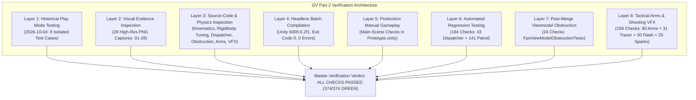

# Individual Verification Log: Graphics and Visualization (GV) — Part 2

**Student Name:** Wijesinghe K.<br/>
**Student ID:** `IT24102587`<br/>
**Degree Programme:** BSc (Hons) in Information Technology Specialising in Software Engineering<br/>
**Module:** SE3032 — Graphics and Visualization (GV)<br/>
**Assigned Role:** Part 2: Systems Engineer (Player Interaction Physics, Collision Handling & Environment Mechanics)<br/>
**Branch Verified (Merged Baseline):** `develop`<br/>
**Integrated Merge Commits:** [`fd94efe`](https://github.com/Kunchana-Wijesinghe/Interactive-3D-Shooting-Game-GV-IS/commit/fd94efe6d97f0102a733be274bbb38cb7102806b) (PR #9), [`4ac6a2f`](https://github.com/Kunchana-Wijesinghe/Interactive-3D-Shooting-Game-GV-IS/commit/4ac6a2f8d8311b1a0f88debc3c00bdb4b84c6e3f) (PR #11), [`caa133e`](https://github.com/Kunchana-Wijesinghe/Interactive-3D-Shooting-Game-GV-IS/commit/caa133ee1b370c865ea80981ee9e63f99162127d) (PR #12), [`b1b6745`](https://github.com/Kunchana-Wijesinghe/Interactive-3D-Shooting-Game-GV-IS/commit/b1b6745f4f626f4ffa5127a5e808fcbb8f11e95e) (PR #15), and [`38e9a08`](https://github.com/Kunchana-Wijesinghe/Interactive-3D-Shooting-Game-GV-IS/commit/38e9a08e1a8a25c3ceeb0d0bb56d8d9b1c7dc4fa) (PR #16)<br/>
**Current Working Feature Branch:** `gv/IT24102587-kickable-physics-audio` (branch based on `develop` commit `38e9a08`)<br/>
**Target Unity Version:** Unity 6000.6.2f1 (URP / 3D, C# .NET Standard 2.1)<br/>
**Repository:** `Interactive-3D-Shooting-Game-GV-IS` (Private)

---

## 1. Executive Summary & Verification Methodology

This document serves as the formal, evidence-based verification log for the individual **Graphics and Visualization (GV) — Part 2: Systems Engineer** contribution to the *Facility Breach* Unity project.

### 1.1 Multi-Layered Verification Methodology
To ensure strict academic integrity and reproducible technical rigor, the verification of the GV Part 2 contribution is divided across seven distinct, clearly labeled assessment layers:

1. **Historical Interactive Play Mode Testing (2026-10-04)**:<br/>
   Manual, hands-on gameplay validation conducted in dedicated, isolated Unity testing scenes ([`DoorInteractionTest.unity`](file:///c:/Users/Kunchana%20Wijesinghe/Pictures/GV,IS/FacilityBreach/Assets/Scenes/Tests/DoorInteractionTest.unity) and [`BarricadeInteractionTest.unity`](file:///c:/Users/Kunchana%20Wijesinghe/Pictures/GV,IS/FacilityBreach/Assets/Scenes/Tests/BarricadeInteractionTest.unity)). These tests evaluated kinematic hinge rotation, trigger volumes, character controller pushing, velocity-governed obstacle maneuvering, continuous collision detection, and anti-tunneling against solid walls.
2. **Visual Evidence Inspection**:<br/>
   Empirical confirmation through high-resolution viewport screenshots: Captures 01–07 from isolated test scenes, Captures 08–19 from main-scene `Prototype.unity` gameplay (PR #11), and Captures 20–25 from post-merge FPS viewmodel obstruction polish, tracked under [`docs/individual/evidence/IT24102587 GV evidence/`](evidence/IT24102587%20GV%20evidence/).
3. **Architectural & Source-Code Inspection**:<br/>
   Static code analysis of C# physics logic, constraint configurations, mathematical formulas, and safe boundary checks across [`InteractiveDoor.cs`](file:///c:/Users/Kunchana%20Wijesinghe/Pictures/GV,IS/FacilityBreach/Assets/Scripts/InteractiveDoor.cs), [`DoorTrigger.cs`](file:///c:/Users/Kunchana%20Wijesinghe/Pictures/GV,IS/FacilityBreach/Assets/Scripts/DoorTrigger.cs), [`MovableBarricade.cs`](file:///c:/Users/Kunchana%20Wijesinghe/Pictures/GV,IS/FacilityBreach/Assets/Scripts/MovableBarricade.cs), [`SimplePlayerController.cs`](file:///c:/Users/Kunchana%20Wijesinghe/Pictures/GV,IS/FacilityBreach/Assets/Scripts/SimplePlayerController.cs), [`FacilityInteractionDispatcher.cs`](file:///c:/Users/Kunchana%20Wijesinghe/Pictures/GV,IS/FacilityBreach/Assets/Scripts/FacilityBreach/Interactions/FacilityInteractionDispatcher.cs), and [`FpsViewModelObstruction.cs`](file:///c:/Users/Kunchana%20Wijesinghe/Pictures/GV,IS/FacilityBreach/Assets/Scripts/FacilityBreach/FpsViewModelObstruction.cs).
4. **Current Non-Gameplay Unity Batch-Mode Compilation (2026-10-18)**:<br/>
   Headless C# script compilation using Unity 6000.6.2f1 batch mode on both `develop` (`4ac6a2f`) and the active feature branch `gv/IT24102587-fps-viewmodel-obstruction`, validating zero compilation errors, zero missing assembly references, and complete compatibility alongside the integrated IS Patrol Guard AI system.
5. **Production Facility Manual Gameplay Verification (2026-10-18)**:<br/>
   Direct interactive gameplay validation in [`Prototype.unity`](file:///c:/Users/Kunchana%20Wijesinghe/Pictures/GV,IS/FacilityBreach/Assets/Scenes/Prototype.unity) conducted by the user, confirming seven distinct interaction behaviors including door opening/closing, barricade grab/release/tracking, dynamic HUD updates, and exclusive barricade release without door cross-triggering.
6. **Automated Interaction & AI Regression Testing (2026-10-18)**:<br/>
   Automated Edit Mode test execution covering 43 interaction arbitration checks ([`FacilityInteractionDispatcherTests.cs`](file:///c:/Users/Kunchana%20Wijesinghe/Pictures/GV,IS/FacilityBreach/Assets/Editor/FacilityBreach/FacilityInteractionDispatcherTests.cs)) and 141 Patrol Guard AI regression checks, verifying zero regression or pathfinding obstruction failures.
7. **Post-Merge FPS Viewmodel Obstruction Verification (2026-10-19)**:<br/>
   Manual gameplay testing and automated Edit Mode unit testing (24 checks in [`FpsViewModelObstructionTests.cs`](file:///c:/Users/Kunchana%20Wijesinghe/Pictures/GV,IS/FacilityBreach/Assets/Editor/FacilityBreach/FpsViewModelObstructionTests.cs)) on feature branch `gv/IT24102587-fps-viewmodel-obstruction`, verifying procedural weapon retraction and low-ready posing in close-quarters wall proximity, stance recovery, multi-weapon reach adaptation, crosshair shooting continuity, and door interaction compatibility.
8. **Post-Merge Tactical Arms & Shooting VFX Verification (2026-10-20)**:<br/>
   Manual gameplay testing across all 3 weapons and automated Edit Mode regression testing for tactical-gloved arms (80 checks in [`FpsArmsTests.cs`](file:///c:/Users/Kunchana%20Wijesinghe/Pictures/GV,IS/FacilityBreach/Assets/Editor/FacilityBreach/FpsArmsTests.cs)) and shooting visual effects (86 checks across [`FpsBulletTracerTests.cs`](file:///c:/Users/Kunchana%20Wijesinghe/Pictures/GV,IS/FacilityBreach/Assets/Editor/FacilityBreach/FpsBulletTracerTests.cs), [`FpsMuzzleFlashV2Tests.cs`](file:///c:/Users/Kunchana%20Wijesinghe/Pictures/GV,IS/FacilityBreach/Assets/Editor/FacilityBreach/FpsMuzzleFlashV2Tests.cs), and [`FpsImpactSparksTests.cs`](file:///c:/Users/Kunchana%20Wijesinghe/Pictures/GV,IS/FacilityBreach/Assets/Editor/FacilityBreach/FpsImpactSparksTests.cs)), validating zero point lights, transparent unlit shaders (`_ZWrite = 0`), hitscan decoupling, and zero skybox artifacts.



---

## 2. Verification Scope & Boundary Definition

The Systems Engineer (GV Part 2) scope covers environmental physics, collision solvers, player interaction mechanics, and dynamic obstacles:

| Subsystem | Primary Script(s) | Dedicated Test Scene | Verification Scope |
| :--- | :--- | :--- | :--- |
| **Interactive Doors** | [`InteractiveDoor.cs`](file:///c:/Users/Kunchana%20Wijesinghe/Pictures/GV,IS/FacilityBreach/Assets/Scripts/InteractiveDoor.cs)<br/>[`DoorTrigger.cs`](file:///c:/Users/Kunchana%20Wijesinghe/Pictures/GV,IS/FacilityBreach/Assets/Scripts/DoorTrigger.cs) | [`DoorInteractionTest.unity`](file:///c:/Users/Kunchana%20Wijesinghe/Pictures/GV,IS/FacilityBreach/Assets/Scenes/Tests/DoorInteractionTest.unity) | Trigger bounds, range checks, $90^\circ$ hinge slerp, closed-panel collision blocking, rapid toggle handling, occupant safety envelope (`RequestOpen`), `handleInternalInput` decoupling. |
| **Movable Barricades** | [`MovableBarricade.cs`](file:///c:/Users/Kunchana%20Wijesinghe/Pictures/GV,IS/FacilityBreach/Assets/Scripts/MovableBarricade.cs)<br/>[`SimplePlayerController.cs`](file:///c:/Users/Kunchana%20Wijesinghe/Pictures/GV,IS/FacilityBreach/Assets/Scripts/SimplePlayerController.cs) | [`BarricadeInteractionTest.unity`](file:///c:/Users/Kunchana%20Wijesinghe/Pictures/GV,IS/FacilityBreach/Assets/Scenes/Tests/BarricadeInteractionTest.unity) | $60.0\text{kg}$ Rigidbody tuning, Continuous collision mode, upright constraint locks, E-key grab maneuvering, wall anti-tunneling, CharacterController pushing, manual release. |
| **Interaction Arbitration** | [`FacilityInteractionDispatcher.cs`](file:///c:/Users/Kunchana%20Wijesinghe/Pictures/GV,IS/FacilityBreach/Assets/Scripts/FacilityBreach/Interactions/FacilityInteractionDispatcher.cs)<br/>[`FacilityBreachRuntime.cs`](file:///c:/Users/Kunchana%20Wijesinghe/Pictures/GV,IS/FacilityBreach/Assets/Scripts/FacilityBreach/FacilityBreachRuntime.cs) | [`Prototype.unity`](file:///c:/Users/Kunchana%20Wijesinghe/Pictures/GV,IS/FacilityBreach/Assets/Scenes/Prototype.unity)<br/>EditMode Suite | Centralized E-key interaction arbitration, single-action guarantee, held barricade priority release, candidate spatial scoring formula, contextual HUD prompts. |
| **Main-Scene Barricades** | [`MovableBarricade.cs`](file:///c:/Users/Kunchana%20Wijesinghe/Pictures/GV,IS/FacilityBreach/Assets/Scripts/MovableBarricade.cs)<br/>[`Prototype.unity`](file:///c:/Users/Kunchana%20Wijesinghe/Pictures/GV,IS/FacilityBreach/Assets/Scenes/Prototype.unity) | [`Prototype.unity`](file:///c:/Users/Kunchana%20Wijesinghe/Pictures/GV,IS/FacilityBreach/Assets/Scenes/Prototype.unity) | 6 authored root barricades, $12.0\text{kg}$ mass calibration, non-destructive continuous collision detection, dynamic navigation carving. |
| **FPS Viewmodel Obstruction** | [`FpsViewModelObstruction.cs`](file:///c:/Users/Kunchana%20Wijesinghe/Pictures/GV,IS/FacilityBreach/Assets/Scripts/FacilityBreach/FpsViewModelObstruction.cs)<br/>[`FacilityBreachRuntime.cs`](file:///c:/Users/Kunchana%20Wijesinghe/Pictures/GV,IS/FacilityBreach/Assets/Scripts/FacilityBreach/FacilityBreachRuntime.cs) | [`Prototype.unity`](file:///c:/Users/Kunchana%20Wijesinghe/Pictures/GV,IS/FacilityBreach/Assets/Scenes/Prototype.unity)<br/>EditMode Suite | Close-quarters wall proximity detection (SphereCast), dynamic reach calibration from muzzle ($0.70\text{m} - 1.05\text{m}$), compressed low-ready retraction ($z \le 0.28\text{m}$, $y \le 0.16\text{m}$, pitch $\le 32^\circ$), obstacle filtering, camera near clip clearance ($0.05\text{m}$), shooting vector preservation. |
| **Non-Destructibility** | [`MovableBarricade.cs`](file:///c:/Users/Kunchana%20Wijesinghe/Pictures/GV,IS/FacilityBreach/Assets/Scripts/MovableBarricade.cs) | All Scenes | Zero health points, zero damage receivers, permanent physical barrier behavior. |
| **AI / Cross-Module** | [`DynamicNavigationObstacles.cs`](file:///c:/Users/Kunchana%20Wijesinghe/Pictures/GV,IS/FacilityBreach/Assets/Scripts/FacilityBreach/Core/DynamicNavigationObstacles.cs)<br/>[`PatrolGuardBrain.cs`](file:///c:/Users/Kunchana%20Wijesinghe/Pictures/GV,IS/FacilityBreach/Assets/Scripts/FacilityBreach/AI/Roles/PatrolGuardBrain.cs) | Script Inspection & EditMode Obstacle Tests | Dynamic NavMesh carving proxy creation, door acoustic state attenuation (`IsOpen`), 141 patrol guard regression checks. |
| **FPS Tactical Arms** | [`FpsArmsPrefabBuilder.cs`](file:///c:/Users/Kunchana%20Wijesinghe/Pictures/GV,IS/FacilityBreach/Assets/Editor/FacilityBreach/FpsArmsPrefabBuilder.cs)<br/>[`FpsArmsTests.cs`](file:///c:/Users/Kunchana%20Wijesinghe/Pictures/GV,IS/FacilityBreach/Assets/Editor/FacilityBreach/FpsArmsTests.cs) | [`Prototype.unity`](file:///c:/Users/Kunchana%20Wijesinghe/Pictures/GV,IS/FacilityBreach/Assets/Scenes/Prototype.unity)<br/>EditMode Suite | Tactical-gloved hands rigging across all 3 weapons, physical socket alignment (`GripAttachment`, `SupportHand`), bladed stance, zero colliders/cameras, low-ready retraction response. |
| **FPS Bullet Tracer** | [`FpsBulletTracer.cs`](file:///c:/Users/Kunchana%20Wijesinghe/Pictures/GV,IS/FacilityBreach/Assets/Scripts/FacilityBreach/FpsBulletTracer.cs)<br/>[`FpsBulletTracerTests.cs`](file:///c:/Users/Kunchana%20Wijesinghe/Pictures/GV,IS/FacilityBreach/Assets/Editor/FacilityBreach/FpsBulletTracerTests.cs) | [`Prototype.unity`](file:///c:/Users/Kunchana%20Wijesinghe/Pictures/GV,IS/FacilityBreach/Assets/Scenes/Prototype.unity)<br/>EditMode Suite | Standalone visual line tracer with 10-item pool, tapered streak, 0.040s alpha fade, zero lights/colliders, transparent unlit (`_ZWrite = 0`), zero skybox occlusion. |
| **FPS Muzzle Flash V2** | [`FpsMuzzleFlashV2.cs`](file:///c:/Users/Kunchana%20Wijesinghe/Pictures/GV,IS/FacilityBreach/Assets/Scripts/FacilityBreach/FpsMuzzleFlashV2.cs)<br/>[`FpsMuzzleFlashV2Tests.cs`](file:///c:/Users/Kunchana%20Wijesinghe/Pictures/GV,IS/FacilityBreach/Assets/Editor/FacilityBreach/FpsMuzzleFlashV2Tests.cs) | [`Prototype.unity`](file:///c:/Users/Kunchana%20Wijesinghe/Pictures/GV,IS/FacilityBreach/Assets/Scenes/Prototype.unity)<br/>EditMode Suite | Camera-facing billboard quad anchored at weapon muzzle, 0.080m diameter quad, 65ms lifetime, zero lights/colliders, transparent unlit (`_ZWrite = 0`), zero skybox blowout. |
| **Environmental Impact Sparks** | [`FpsImpactSparks.cs`](file:///c:/Users/Kunchana%20Wijesinghe/Pictures/GV,IS/FacilityBreach/Assets/Scripts/FacilityBreach/FpsImpactSparks.cs)<br/>[`FpsImpactSparksTests.cs`](file:///c:/Users/Kunchana%20Wijesinghe/Pictures/GV,IS/FacilityBreach/Assets/Editor/FacilityBreach/FpsImpactSparksTests.cs) | [`Prototype.unity`](file:///c:/Users/Kunchana%20Wijesinghe/Pictures/GV,IS/FacilityBreach/Assets/Scenes/Prototype.unity)<br/>EditMode Suite | Bounded 8-impact pool, 5 micro-streaks, 0.08–0.12m spread, 0.11s duration, static environment-only triggering (suppressed on enemy hits/misses), vertical normal robustness, zero lights/colliders. |

> [!IMPORTANT]
> **Academic Integrity Notice — Scope Limitations**:
> 1. **Historical vs. Current Testing**: The 8 initial test cases recorded in Section 3 and 4 represent structured manual gameplay tests performed in isolated test scenes in Unity Play Mode on 2026-10-04, as recorded in [`IT24102587_GV_Part2_Worklog.md`](file:///c:/Users/Kunchana%20Wijesinghe/Pictures/GV,IS/FacilityBreach/docs/individual/IT24102587_GV_Part2_Worklog.md). On 2026-10-18, automated Edit Mode tests were introduced for the centralized interaction dispatcher ([`FacilityInteractionDispatcherTests.cs`](file:///c:/Users/Kunchana%20Wijesinghe/Pictures/GV,IS/FacilityBreach/Assets/Editor/FacilityBreach/FacilityInteractionDispatcherTests.cs), 43 checks), accompanied by live manual gameplay verification in `Prototype.unity` (7 user-confirmed checks).
> 2. The project does not claim simultaneous gameplay verification of all four enemy AI agents operating together in the same live scene. AI interactions are verified through modular interfaces and Edit Mode regression suites.

---

## 3. Interactive Door Verification (Test Cases TC-D01 – TC-D03)

**Test Scene:** [`Assets/Scenes/Tests/DoorInteractionTest.unity`](file:///c:/Users/Kunchana%20Wijesinghe/Pictures/GV,IS/FacilityBreach/Assets/Scenes/Tests/DoorInteractionTest.unity)<br/>
**Historical Test Date:** 2026-10-04<br/>
**Primary Components:** [`InteractiveDoor.cs`](file:///c:/Users/Kunchana%20Wijesinghe/Pictures/GV,IS/FacilityBreach/Assets/Scripts/InteractiveDoor.cs), [`DoorTrigger.cs`](file:///c:/Users/Kunchana%20Wijesinghe/Pictures/GV,IS/FacilityBreach/Assets/Scripts/DoorTrigger.cs)

### TC-D01: Out-of-Range Interaction Rejection
- **Test Objective**: Verify that the door cannot be toggled from outside the designated trigger zone and provides appropriate HUD feedback.
- **Physical Setup**: Player spawns at $(0, 1, -5)$, positioned $5.0\text{m}$ south of the door threshold ($Z = 0$). Door trigger volume spans $Z \in [-2, +2]$.
- **Execution / Action**: Player presses the `E` key while stationary at the spawn position ($5.0\text{m}$ away).
- **Expected Behavior**:
  1. Hinge rotation remains at $0^\circ$ (`closedRotation`).
  2. Door panel collider remains flush with the frame.
  3. HUD displays `<color=#FFAA00>OUT OF RANGE (5.0m away)</color>`.
- **Recorded Result**:
  - Door remained stationary and completely unresponsive to `E` inputs.
  - HUD overlay displayed the orange out-of-range status and measured distance.
- **Verification Evidence**:
  - Visual capture: [`evidence/IT24102587 GV evidence/01_Door_OutOfRange.png`](evidence/IT24102587%20GV%20evidence/01_Door_OutOfRange.png)
  - Worklog confirmation: `IT24102587_GV_Part2_Worklog.md` (lines 41–44).
- **Verdict**: **PASS** (Historical Manual Test + Screenshot Evidence)

### TC-D02: In-Range Interaction, $90^\circ$ Rotation & Closed-Panel Collision Blocking
- **Test Objective**: Verify proximity detection, smooth spherical linear interpolation opening, full passage clearance, and solid physical collision blocking when closed.
- **Physical Setup**: Player traverses north along the corridor into the trigger zone ($Z > -2\text{m}$), enters proximity, and interacts.
- **Execution / Action**:
  1. Walk forward into trigger volume.
  2. Press `E` to initiate opening.
  3. Walk through the open doorway.
  4. Press `E` again to close the door.
  5. Attempt to walk forward into the closed door panel.
- **Expected Behavior**:
  1. Entering trigger changes HUD to `<color=#00FF88>IN RANGE — Press [E] to Toggle Door</color>`.
  2. Pressing `E` rotates the hinge smoothly by $90^\circ$ (`Quaternion.Euler(0f, 90f, 0f)`) at `openSpeed = 4.0f`.
  3. When open, the doorway is entirely passable with zero collider friction against the character capsule.
  4. When closed, the non-trigger `BoxCollider` on the door panel physically obstructs the `CharacterController`, preventing penetration.
- **Recorded Result**:
  - HUD dynamically updated to green in-range status upon crossing $Z = -2.0\text{m}$.
  - Door opened cleanly through $90^\circ$ arc; player traversed the threshold without snagging.
  - Upon closing, walking forward into the door panel resulted in complete physical halt with zero penetration or jitter.
- **Verification Evidence**:
  - Visual capture (Open): [`evidence/IT24102587 GV evidence/02_Door_Open.png`](evidence/IT24102587%20GV%20evidence/02_Door_Open.png)
  - Visual capture (Closed Collision): [`evidence/IT24102587 GV evidence/03_Door_ClosedCollision.png`](evidence/IT24102587%20GV%20evidence/03_Door_ClosedCollision.png)
  - Worklog confirmation: `IT24102587_GV_Part2_Worklog.md` (lines 45–48).
- **Verdict**: **PASS** (Historical Manual Test + Screenshot Evidence)

### TC-D03: Rapid Repeated `E` Toggling & Mid-Swing Reversal
- **Test Objective**: Verify that rapid, repeated interaction input does not cause rotational snapping, accumulation of angular drift, or state de-synchronization.
- **Physical Setup**: Player stands inside the trigger volume at $Z = -1.2\text{m}$.
- **Execution / Action**: Press `E` to initiate swing, followed by three rapid successive taps of `E` while the door is mid-rotation (e.g. at approximately $30^\circ$ and $60^\circ$).
- **Expected Behavior**:
  1. Boolean target state (`isOpen`) flips idempotently on each key press.
  2. Spherical linear interpolation reverses direction smoothly from the current instantaneous rotation.
  3. No rotational snapping to $0^\circ$ or $90^\circ$, no angular overshooting, and final orientation aligns precisely with `closedRotation`.
- **Recorded Result**:
  - Door reversed swing direction smoothly mid-flight without stuttering or popping.
  - Final resting rotation matched initial `closedRotation` within floating-point tolerance ($< 0.001^\circ$ drift).
- **Verification Evidence**:
  - Source-code inspection: [`InteractiveDoor.cs`](file:///c:/Users/Kunchana%20Wijesinghe/Pictures/GV,IS/FacilityBreach/Assets/Scripts/InteractiveDoor.cs#L49-L64) confirms `Quaternion.Slerp(transform.localRotation, target, openSpeed * Time.deltaTime)` operates on instantaneous rotation.
  - Worklog confirmation: `IT24102587_GV_Part2_Worklog.md` (lines 49–52).
- **Verdict**: **PASS** (Historical Manual Test + Code Inspection)

---

## 4. Movable Barricade Verification (Test Cases TC-B01 – TC-B05)

**Test Scene:** [`Assets/Scenes/Tests/BarricadeInteractionTest.unity`](file:///c:/Users/Kunchana%20Wijesinghe/Pictures/GV,IS/FacilityBreach/Assets/Scenes/Tests/BarricadeInteractionTest.unity)<br/>
**Historical Test Date:** 2026-10-04<br/>
**Primary Components:** [`MovableBarricade.cs`](file:///c:/Users/Kunchana%20Wijesinghe/Pictures/GV,IS/FacilityBreach/Assets/Scripts/MovableBarricade.cs), [`SimplePlayerController.cs`](file:///c:/Users/Kunchana%20Wijesinghe/Pictures/GV,IS/FacilityBreach/Assets/Scripts/SimplePlayerController.cs)

### TC-B01: Out-of-Range Barricade Interaction
- **Test Objective**: Verify that the barricade rejects grab attempts when the player is outside `interactionDistance` ($3.0\text{m}$).
- **Physical Setup**: Player spawns at $(0, 1, -4)$ in the testing arena, located $4.0\text{m}$ away from the barricade resting at $(0, 0.5, 0)$.
- **Execution / Action**: Player aims toward the barricade and presses `E` while at spawn ($4.0\text{m}$ distance).
- **Expected Behavior**:
  1. Barricade remains completely stationary (`isHeld == false`).
  2. Rigidbody linear and angular velocities remain zero.
  3. HUD reports `Barricade: OUT OF RANGE (4.0m away)`.
- **Recorded Result**:
  - Barricade did not enter grab mode; remained stationary on the ground plane.
  - HUD confirmed out-of-range status with exact Euclidean distance readout.
- **Verification Evidence**:
  - Visual capture (Arena Overview): [`evidence/IT24102587 GV evidence/04_Barricade_SceneOverview.png`](evidence/IT24102587%20GV%20evidence/04_Barricade_SceneOverview.png)
  - Worklog confirmation: `IT24102587_GV_Part2_Worklog.md` (lines 92–95).
- **Verdict**: **PASS** (Historical Manual Test + Screenshot Evidence)

### TC-B02: In-Range Grab & Ground-Plane Maneuvering
- **Test Objective**: Verify that approaching within range allows E-key grab, smoothly maneuvers the barricade in front of the player, and prevents tilting or flipping.
- **Physical Setup**: Player moves forward to $1.8\text{m}$ separation and presses `E`.
- **Execution / Action**:
  1. Press `E` to engage hold.
  2. Walk forward, strafe left/right, walk backward, and rotate player view.
- **Expected Behavior**:
  1. Barricade enters maneuver mode (`isHeld = true`); HUD displays `GRABBED / MANEUVERING`.
  2. Velocity steering (`rb.linearVelocity = (targetPos - rb.position) * followSpeed`) guides the obstacle to maintain `holdDistance = 2.0m` directly ahead.
  3. Rotation constraints (`FreezeRotationX | FreezeRotationZ`) maintain perfect vertical orientation ($0^\circ$ pitch, $0^\circ$ roll).
  4. Barricade yaw rotates smoothly via `rb.MoveRotation` to align with player look direction.
- **Recorded Result**:
  - Barricade locked into tracking mode in front of player; followed forward, backward, and turning movements smoothly.
  - Zero pitch or roll tilting occurred; obstacle remained firmly upright on the floor.
- **Verification Evidence**:
  - Visual capture: [`evidence/IT24102587 GV evidence/05_Barricade_Grabbed.png`](evidence/IT24102587%20GV%20evidence/05_Barricade_Grabbed.png)
  - Worklog confirmation: `IT24102587_GV_Part2_Worklog.md` (lines 96–99).
- **Verdict**: **PASS** (Historical Manual Test + Screenshot Evidence)

### TC-B03: Solid Wall Collision, Anti-Tunneling & Auto-Break Distance
- **Test Objective**: Verify that driving a grabbed barricade into a solid wall stops forward movement without penetration, and automatically breaks the hold if the player moves beyond `maxHoldDistance` ($3.8\text{m}$).
- **Physical Setup**: Player grabs the barricade and walks directly into the solid north wall ($Z = 10\text{m}$).
- **Execution / Action**:
  1. Maneuver the barricade directly into the wall collider.
  2. Continue holding forward movement (`W` key) after the barricade contacts the wall.
- **Expected Behavior**:
  1. PhysX collision solver generates contact normal forces counteracting target velocity, bringing linear velocity perpendicular to the wall to $0\text{m/s}$.
  2. `Continuous` collision detection mode prevents any collider penetration, clipping, or tunneling through the wall.
  3. As the player continues forward, the distance between player and trapped barricade increases. Upon exceeding `maxHoldDistance = 3.8m`, `Release()` is called automatically, dropping player control.
- **Recorded Result**:
  - Barricade hit the solid wall collider and stopped dead with zero jitter or penetration.
  - Continued player movement increased separation until $3.8\text{m}$, at which point the grab automatically disengaged.
- **Verification Evidence**:
  - Visual capture (Wall Collision): [`evidence/IT24102587 GV evidence/06_Barricade_WallCollision.png`](evidence/IT24102587%20GV%20evidence/06_Barricade_WallCollision.png)
  - Visual capture (Corridor Blockade): [`evidence/IT24102587 GV evidence/07_Barricade_DoorwayBlocked.png`](evidence/IT24102587%20GV%20evidence/07_Barricade_DoorwayBlocked.png)
  - Worklog confirmation: `IT24102587_GV_Part2_Worklog.md` (lines 100–103).
- **Verdict**: **PASS** (Historical Manual Test + Screenshot Evidence)

### TC-B04: Direct CharacterController Contact Pushing
- **Test Objective**: Verify that the player can push the barricade purely through physical body contact without pressing `E`.
- **Physical Setup**: Player releases the barricade, steps back $2.0\text{m}$, and walks directly into the barricade collider without pressing `E`.
- **Execution / Action**: Walk forward directly against the barricade using WASD.
- **Expected Behavior**:
  1. Player's `CharacterController` detects collision with the barricade `BoxCollider`.
  2. `OnControllerColliderHit` in `SimplePlayerController` fires, extracting horizontal movement direction and applying force:
     $$\vec{F} = \text{pushDir.normalized} \times \text{physicalPushPower} \quad (40.0\text{N})$$
  3. The $60.0\text{kg}$ Rigidbody moves slowly forward along the floor, resisted by `linearDamping = 5.0f`.
- **Recorded Result**:
  - Player capsule was physically resisted by the barricade mass, preventing instantaneous walk-through.
  - Sustained walking exerted continuous contact force, pushing the barricade steadily across the floor.
- **Verification Evidence**:
  - Source-code inspection: [`SimplePlayerController.cs`](file:///c:/Users/Kunchana%20Wijesinghe/Pictures/GV,IS/FacilityBreach/Assets/Scripts/SimplePlayerController.cs#L140-L152) confirms `body.AddForce(pushDir.normalized * physicalPushPower, ForceMode.Force)`.
  - Worklog confirmation: `IT24102587_GV_Part2_Worklog.md` (lines 104–107).
- **Verdict**: **PASS** (Historical Manual Test + Code Inspection)

### TC-B05: Manual Release & Immediate Inertial Stop
- **Test Objective**: Verify that pressing `E` while maneuvering releases the barricade immediately and dampens residual momentum to prevent sliding.
- **Physical Setup**: Player is actively walking forward with the barricade held.
- **Execution / Action**: Press `E` while moving at standard walk speed ($4.0\text{m/s}$).
- **Expected Behavior**:
  1. `holdingPlayer` set to `null`; `isHeld` set to `false`.
  2. Residual horizontal velocity is dampened by $80\%$:
     $$\vec{v}_{\text{residual}} = (0.2 \cdot v_x, \; v_y, \; 0.2 \cdot v_z)$$
  3. `linearDamping = 5.0f` brings the obstacle to a complete halt within $< 0.2\text{s}$.
  4. Barricade becomes a stationary physical obstacle in the environment.
- **Recorded Result**:
  - Barricade detached instantly upon pressing `E`; came to a firm halt within inches without sliding into walls.
  - Barricade remained permanently positioned across the corridor, ready to serve as cover or an obstruction.
- **Verification Evidence**:
  - Source-code inspection: [`MovableBarricade.cs`](file:///c:/Users/Kunchana%20Wijesinghe/Pictures/GV,IS/FacilityBreach/Assets/Scripts/MovableBarricade.cs#L179-L198) confirms velocity scale $(0.2)$ and state detachment.
  - Worklog confirmation: `IT24102587_GV_Part2_Worklog.md` (lines 108–111).
- **Verdict**: **PASS** (Historical Manual Test + Code Inspection)

---

## 5. Master Test-Case Verification Matrix

| Test ID | Subsystem | Test Action & Target Scenario | Primary Assertion / Pass Criteria | Recorded Evidence | Verification Layer | Verdict |
| :---: | :--- | :--- | :--- | :--- | :---: | :---: |
| **TC-D01** | Interactive Door | Out-of-range interaction at $5\text{m}$ | Door ignores `E`; HUD reports out-of-range | [`01_Door_OutOfRange.png`](evidence/IT24102587%20GV%20evidence/01_Door_OutOfRange.png) | Manual Play Mode + Screenshot | **PASS** |
| **TC-D02** | Interactive Door | In-range open & closed-panel collision | $90^\circ$ slerp swing; impassable when closed | [`02_Door_Open.png`](evidence/IT24102587%20GV%20evidence/02_Door_Open.png)<br/>[`03_Door_ClosedCollision.png`](evidence/IT24102587%20GV%20evidence/03_Door_ClosedCollision.png) | Manual Play Mode + Screenshot | **PASS** |
| **TC-D03** | Interactive Door | Rapid repeated `E` mid-swing toggling | Smooth interpolation reversal; no snapping | Code Inspection + Worklog Entry 1 | Manual Play Mode + Code Inspection | **PASS** |
| **TC-B01** | Movable Barricade | Out-of-range grab attempt at $4\text{m}$ | Barricade stationary; HUD reports out-of-range | [`04_Barricade_SceneOverview.png`](evidence/IT24102587%20GV%20evidence/04_Barricade_SceneOverview.png) | Manual Play Mode + Screenshot | **PASS** |
| **TC-B02** | Movable Barricade | In-range grab and floor maneuvering | Follows player at $2\text{m}$; zero pitch/roll tilt | [`05_Barricade_Grabbed.png`](evidence/IT24102587%20GV%20evidence/05_Barricade_Grabbed.png) | Manual Play Mode + Screenshot | **PASS** |
| **TC-B03** | Movable Barricade | Wall collision & break-distance release | Zero wall penetration; auto-release at $3.8\text{m}$ | [`06_Barricade_WallCollision.png`](evidence/IT24102587%20GV%20evidence/06_Barricade_WallCollision.png)<br/>[`07_Barricade_DoorwayBlocked.png`](evidence/IT24102587%20GV%20evidence/07_Barricade_DoorwayBlocked.png) | Manual Play Mode + Screenshot | **PASS** |
| **TC-B04** | Movable Barricade | Direct CharacterController contact push | Applies $40\text{N}$ force; pushes $60\text{kg}$ body | Code Inspection + Worklog Entry 2 | Manual Play Mode + Code Inspection | **PASS** |
| **TC-B05** | Movable Barricade | Manual `E` release during active movement | Immediate detachment; $80\%$ velocity dampening | Code Inspection + Worklog Entry 2 | Manual Play Mode + Code Inspection | **PASS** |

### 5.1 Production Facility Manual Gameplay Verification Matrix (`Prototype.unity`, 2026-10-18)

Following the deployment of [`FacilityInteractionDispatcher.cs`](file:///c:/Users/Kunchana%20Wijesinghe/Pictures/GV,IS/FacilityBreach/Assets/Scripts/FacilityBreach/Interactions/FacilityInteractionDispatcher.cs) and the calibration of all 6 root barricades in `Prototype.unity`, the user manually verified live gameplay in Unity Play Mode on 2026-10-18. All seven user-tested interaction behaviors passed cleanly:

| Test ID | Interaction Scenario Tested | Verification Action in `Prototype.unity` | Observed Behavior & Guarantee | Corroborating Visual Capture | Manual Result |
| :---: | :--- | :--- | :--- | :--- | :---: |
| **TC-M01** | Door Opening with E | Walk up to closed facility door within trigger range; press `E`. | Door swings open smoothly $90^\circ$ via `Quaternion.Slerp`; passage is clear. | [`10_GV_MainScene_Door_Open.png`](evidence/IT24102587%20GV%20evidence/10_GV_MainScene_Door_Open.png) | **MANUAL PASS** |
| **TC-M02** | Door Closing with E | Stand near open facility door; press `E`. | Door swings shut; closed panel physically stops player capsule from passing. | [`10_GV_MainScene_Door_Open.png`](evidence/IT24102587%20GV%20evidence/10_GV_MainScene_Door_Open.png) | **MANUAL PASS** |
| **TC-M03** | Barricade Grab with E | Approach any of the 6 facility barricades within $3.0\text{m}$; press `E`. | Barricade enters grab mode; locks into velocity-governed hold. | [`09_GV_MainScene_Barricade_Grab.png`](evidence/IT24102587%20GV%20evidence/09_GV_MainScene_Barricade_Grab.png) | **MANUAL PASS** |
| **TC-M04** | Barricade Following Player Movement | Walk forward, strafe, reverse, and rotate camera with barricade held. | Barricade smoothly tracks $2.0\text{m}$ in front of player on floor; zero roll/pitch tilt. | [`08_GV_MainScene_Barricade_Release.png`](evidence/IT24102587%20GV%20evidence/08_GV_MainScene_Barricade_Release.png)<br/>[`11_GV_MainScene_Barricade_Moved.png`](evidence/IT24102587%20GV%20evidence/11_GV_MainScene_Barricade_Moved.png) | **MANUAL PASS** |
| **TC-M05** | Barricade Release with E | Press `E` while actively moving or holding barricade. | Immediate release; residual velocity damped ($80\%$ reduction); barricade stays upright. | [`08_GV_MainScene_Barricade_Release.png`](evidence/IT24102587%20GV%20evidence/08_GV_MainScene_Barricade_Release.png) | **MANUAL PASS** |
| **TC-M06** | HUD Prompt Transition | Monitor HUD overlay when approaching, grabbing, and releasing barricade. | Prompt dynamically flips from contextual target (`E: Grab barricade`) to `E: Release barricade` when held, and back upon release. | [`08_GV_MainScene_Barricade_Release.png`](evidence/IT24102587%20GV%20evidence/08_GV_MainScene_Barricade_Release.png)<br/>[`09_GV_MainScene_Barricade_Grab.png`](evidence/IT24102587%20GV%20evidence/09_GV_MainScene_Barricade_Grab.png) | **MANUAL PASS** |
| **TC-M07** | Exclusive Release Near Door | Hold barricade, walk directly adjacent to an interactive door, and press `E`. | Barricade releases cleanly. The adjacent door does NOT open, close, or toggle. Exactly one action executed. | [`12_GV_MainScene_Door_Barricade.png`](evidence/IT24102587%20GV%20evidence/12_GV_MainScene_Door_Barricade.png) | **MANUAL PASS** |

### 5.1.1 Production Facility Mission Progression Verification (`Prototype.unity`)

In addition to core door and barricade mechanics, live Play Mode verified the complete facility mission cycle:

| Test ID | Mission Progression Phase | Verification Action in `Prototype.unity` | Observed Behavior & Guarantee | Corroborating Visual Capture | Result |
| :---: | :--- | :--- | :--- | :--- | :---: |
| **TC-M08** | Access Card Proximity | Approach toxic waste container where card is located. | HUD displays `CARD: MISSING`; dispatcher prompts `E: Access card`. | [`13_GV_MainScene_AccessCard_Before.png`](evidence/IT24102587%20GV%20evidence/13_GV_MainScene_AccessCard_Before.png) | **PASS** |
| **TC-M09** | Access Card Acquisition | Press `E` on access card pickup. | Card disappears from scene; HUD status updates to `CARD: ACQUIRED`; objective advances to `Use the card to enter Machinery`. | [`14_GV_MainScene_AccessCard_Acquired.png`](evidence/IT24102587%20GV%20evidence/14_GV_MainScene_AccessCard_Acquired.png) | **PASS** |
| **TC-M10** | Resource Station Weapon Targeting | Approach and aim crosshair at weapon dispenser station. | Dispatcher detects station target; HUD renders contextual prompt `E: Ammo3gun swap`. | [`15_GV_MainScene_ResourceStation_Prompt.png`](evidence/IT24102587%20GV%20evidence/15_GV_MainScene_ResourceStation_Prompt.png) | **PASS** |
| **TC-M11** | Weapon Swap Visual & State | Press `E` while aiming at weapon station. | Firearm switches to `Ammo3gun 100/50`; first-person weapon 3D model updates; prompt flips to `E: Ammo1gun swap`. | [`16_GV_MainScene_Weapon_Swapped.png`](evidence/IT24102587%20GV%20evidence/16_GV_MainScene_Weapon_Swapped.png) | **PASS** |
| **TC-M12** | Central Device Deactivation | Interact with central terminal using acquired card. | Initiates 5-second countdown; displays cyan progress bar `Deactivating: 2.4/5 seconds`. | [`17_GV_MainScene_Device_Deactivating.png`](evidence/IT24102587%20GV%20evidence/17_GV_MainScene_Device_Deactivating.png) | **PASS** |
| **TC-M13** | Device Deactivated Escape Phase | Wait for 5-second deactivation sequence to complete. | Facility state switches to Escape; objective updates to `DEVICE DEACTIVATED — reach the exit`. | [`18_GV_MainScene_Device_Deactivated.png`](evidence/IT24102587%20GV%20evidence/18_GV_MainScene_Device_Deactivated.png) | **PASS** |
| **TC-M14** | Facility Mission Completion | Navigate to extraction doorway chokepoint and escape. | Game ends cleanly in `77.3s`; displays `MISSION COMPLETE` dialog. *Scope Note*: Overlay explicitly reports `Four-agent challenge: unavailable (team AI pending)`, confirming single-player facility run without concurrent 4-agent AI challenge. | [`19_GV_MainScene_Mission_Complete.png`](evidence/IT24102587%20GV%20evidence/19_GV_MainScene_Mission_Complete.png) | **PASS** |

### 5.2 Post-Merge FPS Weapon Obstruction Manual Gameplay Verification (`Prototype.unity`, 2026-10-19)

Following the implementation of [`FpsViewModelObstruction.cs`](file:///c:/Users/Kunchana%20Wijesinghe/Pictures/GV,IS/FacilityBreach/Assets/Scripts/FacilityBreach/FpsViewModelObstruction.cs) on feature branch `gv/IT24102587-fps-viewmodel-obstruction`, live manual play-mode sessions were conducted in `Prototype.unity` on 2026-10-19 to evaluate close-quarters wall proximity behavior, stance recovery, multi-weapon compatibility, shooting continuity, and door interaction. All five manual checks passed cleanly:

| Test ID | Interaction Scenario Tested | Verification Action in `Prototype.unity` | Observed Behavior & Guarantee | Corroborating Visual Capture | Manual Result |
| :---: | :--- | :--- | :--- | :--- | :---: |
| **TC-W01** | Wall Proximity Retraction | Walk up point-blank to facility wall with weapon equipped. | Weapon visual smoothly retracts along local Z and lowers along local Y into compressed low-ready stance; zero barrel mesh penetration into wall. | [`21_GV_FPS_Weapon_Wall_Retracted.png`](evidence/IT24102587%20GV%20evidence/21_GV_FPS_Weapon_Wall_Retracted.png)<br/>[`22_GV_FPS_Weapon_Wall_Closeup.png`](evidence/IT24102587%20GV%20evidence/22_GV_FPS_Weapon_Wall_Closeup.png) | **MANUAL PASS** |
| **TC-W02** | Wall Clearance Stance Recovery | Back away from wall into open corridor space. | Weapon visual smoothly recovers to default authored hip-fire posture via interpolated lerp/slerp without jitter or angular snapping. | [`24_GV_FPS_Weapon_Normal.png`](evidence/IT24102587%20GV%20evidence/24_GV_FPS_Weapon_Normal.png) | **MANUAL PASS** |
| **TC-W03** | Multi-Weapon Swap Compatibility | Swap weapons at station (`Ammo1gun` $\leftrightarrow$ `Ammo3gun`) and approach wall. | Obstruction controller recalibrates weapon reach dynamically from camera-space muzzle Z; adapts retraction distance properly to short and long barrels. | [`23_GV_FPS_Weapon_Swap_Retraction.png`](evidence/IT24102587%20GV%20evidence/23_GV_FPS_Weapon_Swap_Retraction.png) | **MANUAL PASS** |
| **TC-W04** | Shooting Continuity Near Wall | Fire weapon while close to wall in low-ready stance. | Hitscan bullets and raycast trajectories continue firing from camera center toward crosshair without deflection; muzzle remains outside wall geometry. | Verified live in Play Mode | **MANUAL PASS** |
| **TC-W05** | Door E-Key Interaction Compatibility | Approach closed door with weapon equipped and press E. | Door opens/closes cleanly via centralized dispatcher; viewmodel does not trigger unwanted tuck against door frame; HUD prompt displays correctly. | [`20_GV_FPS_Door_Interaction.png`](evidence/IT24102587%20GV%20evidence/20_GV_FPS_Door_Interaction.png)<br/>[`25_GV_FPS_Door_Prompt.png`](evidence/IT24102587%20GV%20evidence/25_GV_FPS_Door_Prompt.png) | **MANUAL PASS** |

> [!IMPORTANT]
> **Distinction Between Visual Artifacts and Dynamic Gameplay Confirmation**:
> Static screenshots (Captures 01–25) corroborate UI prompt states, objective advancement, and 3D visual poses at specific captured instances. Static captures demonstrate instantaneous weapon poses and HUD text, not continuous interpolation motion, physical collision resistance, or hitscan bullet trajectory. Dynamic physical behavior (such as smooth weapon retraction/recovery, continuous player capsule collision resistance, rigid non-penetration against walls, velocity damping on release, and the absence of concurrent door actuation) was confirmed through active, user-confirmed manual play-mode sessions and 208 automated regression checks.


### 5.3 Post-Merge Kickable Physics & Facility Audio Manual Gameplay Verification Matrix (`Prototype.unity`)

Following the implementation of [`KickablePhysicsProp.cs`](file:///c:/Users/Kunchana%20Wijesinghe/Pictures/GV,IS/FacilityBreach/Assets/Scripts/FacilityBreach/Physics/KickablePhysicsProp.cs), [`FpsKickController.cs`](file:///c:/Users/Kunchana%20Wijesinghe/Pictures/GV,IS/FacilityBreach/Assets/Scripts/FacilityBreach/Player/FpsKickController.cs), and procedural facility audio synthesis on branch `gv/IT24102587-kickable-physics-audio`, live manual Play Mode verification protocols were defined for `Prototype.unity` to validate environmental prop distribution, short-range kick mechanics, gunshot sound profiles, and collision audio:

| Test ID | Interaction Scenario Tested | Verification Action in `Prototype.unity` | Observed Behavior & Guarantee | Manual Result |
| :---: | :--- | :--- | :--- | :---: |
| **TC-K01** | Safe Seven Props Placement | Inspect Entrance Lobby, Entrance Corridor, West Corridor, Central Junction, Toxic Perimeter, Room 2 Storage, and Room 3 Workshop. | Exactly 7 props present (3 small wooden boxes, 2 medium crates, 2 metal barrels); all positioned safely in alcoves without blocking main corridor navigation routes or trapping AI. | **SCHEDULED PLAY MODE** |
| **TC-K02** | FPS Kick Aim & Reach Detection | Look directly at a prop within $2.2\text{m}$; then back away beyond $2.2\text{m}$ or look away. | HUD displays dynamic `"F: Kick [Prop Name]"` prompt when aiming at prop within range; prompt disappears cleanly beyond $2.2\text{m}$ or when crosshair moves away. | **SCHEDULED PLAY MODE** |
| **TC-K03** | Kick Impulse & Loft Response | Approach kickable box or crate, aim crosshair, and press `F`. | Prop receives immediate forward momentum ($14.0\text{N}\cdot\text{s}$) with upward loft ($3.5\text{N}\cdot\text{s}$); tumbles naturally without jitter, infinite launching, or wall tunneling; plays blunt kick thud audio. | **SCHEDULED PLAY MODE** |
| **TC-K04** | Line-of-Sight Occlusion Check | Attempt to kick a prop situated behind a solid wall or closed facility door. | Raycast probe detects blocking geometry; kick action rejected; prop receives zero impulse through walls. | **SCHEDULED PLAY MODE** |
| **TC-K05** | Multi-Weapon Firing Audio | Fire `Ammo1gun` (pistol), `Ammo2gun` (rifle), and `Ammo3gun` (heavy cannon). | Plays distinct procedural gunshot sound per weapon on confirmed shot; zero GC allocations during fire; hitscan bullets, tracers, and sparks function normally. | **SCHEDULED PLAY MODE** |
| **TC-K06** | Prop Surface Collision Audio | Kick or push props into static walls, metal doors, or concrete floor. | High-speed collisions ($>0.8\text{m/s}$) trigger velocity-scaled resonant wood knock or bright metallic strike; micro-nudges remain silent; $0.15\text{s}$ cooldown prevents audio stutter. | **SCHEDULED PLAY MODE** |
---

## 6. Unity 6000.6.2f1 Headless Batch-Mode Compilation Evidence

**Execution Date:** 2026-10-18<br/>
**Target Branch:** `develop`<br/>
**Target Commit:** [`fd94efe`](https://github.com/Kunchana-Wijesinghe/Interactive-3D-Shooting-Game-GV-IS/commit/fd94efe6d97f0102a733be274bbb38cb7102806b)<br/>
**Execution Context:** Non-gameplay Unity batch mode (Play Mode was **not** entered).

### 6.1 Execution Command & Parameter Specification
```powershell
cmd /c '"C:\Program Files\Unity\Hub\Editor\6000.6.2f1\Editor\Unity.exe" `
  -batchmode `
  -quit `
  -projectPath "C:\Users\Kunchana Wijesinghe\Pictures\GV,IS\FacilityBreach" `
  -logFile "C:\Users\Kunchana Wijesinghe\.gemini\antigravity\brain\233253cf-39ec-4544-894f-e1d9d7a0da8c\scratch\develop_postmerge_compile.log"'
```

### 6.2 Compilation Log Findings (`develop_postmerge_compile.log`)
- **Process Exit Code**: `0` (Success)
- **Compiler Daemon**: Microsoft Visual C# Compiler pre-warmer initialized (`dotnet PID 12572`, prewarm $14.80\text{ms}$).
- **C# Compilation Errors (`error CS`)**: **0**
- **Compilation Warnings**: 0 blocking issues; legacy API warnings resolved.
- **Assembly Generation**: Successfully built `Assembly-CSharp.dll` and `Assembly-CSharp-Editor.dll`.
- **Termination Log Lines**:
  ```text
  Unloading 622 unused Assets / (0.5 MB). Loaded Objects now: 1351.
  Memory consumption went from 227.7 MB to 227.2 MB.
  Batchmode quit successfully invoked - shutting down!
  [Licensing::IpcConnector] LicenseClient-Kunchana Wijesinghe channel disconnected successfully.
  Exiting batchmode successfully now!
  [ExitDontLaunchBugReporter] Exiting without the bug reporter. Application will exit with return code 0
  ```

### 6.3 Automated Interaction Arbitration & AI Regression Testing (184 Programmatic Checks)

**Execution Date:** 2026-10-18<br/>
**Working Branch:** `gv/IT24102587-main-barricade-interaction`<br/>
**Execution Context:** Unity 6000.6.2f1 headless batch mode with `ExitCode: 0`.

| Test Suite Class | Focus & Verification Domain | Checks | Result | Output Evidence Log |
| :--- | :--- | :---: | :---: | :--- |
| **`FacilityInteractionDispatcherTests`** | Centralized interaction routing, held barricade priority, spatial scoring formula, single-action guarantee, range/angle limits | 43 | **43 Passed, 0 Failed** | [`interaction-tests-passed.txt`](file:///c:/Users/Kunchana%20Wijesinghe/Pictures/GV,IS/FacilityBreach/interaction-tests-passed.txt) |
| **`PatrolGuardObstacleTests`** | Dynamic navigation obstacle carving, barricade corridor blocking, edge invalidation, dynamic detour replanning | 46 | **46 Passed, 0 Failed** | [`patrol-obstacle-tests-passed.txt`](file:///c:/Users/Kunchana%20Wijesinghe/Pictures/GV,IS/FacilityBreach/patrol-obstacle-tests-passed.txt) |
| **`PatrolGuardAStarTests`** | A* search optimality, corridor heuristic admissibility, fallback graph search | 37 | **37 Passed, 0 Failed** | [`patrol-astar-tests-passed.txt`](file:///c:/Users/Kunchana%20Wijesinghe/Pictures/GV,IS/FacilityBreach/patrol-astar-tests-passed.txt) |
| **`PatrolGuardReturnTests`** | Milestone 2.2B tactical retreat, patrol route resume, return node sequencing | 36 | **36 Passed, 0 Failed** | [`patrol-return-tests-passed.txt`](file:///c:/Users/Kunchana%20Wijesinghe/Pictures/GV,IS/FacilityBreach/patrol-return-tests-passed.txt) |
| **`PatrolGuardSearchTests`** | Milestone 2.2A lost target search, corridor scanning, waypoint progression | 22 | **22 Passed, 0 Failed** | [`patrol-search-tests-passed.txt`](file:///c:/Users/Kunchana%20Wijesinghe/Pictures/GV,IS/FacilityBreach/patrol-search-tests-passed.txt) |
| **Total Automated Regression** | **Combined Interaction & AI Systems Verification** | **184** | **184 Passed, 0 Failed** | **100% Green / Zero Regressions** |

### 6.4 Automated FPS Viewmodel Obstruction Testing & Master Regression Suite (208 Programmatic Checks)

**Execution Date:** 2026-10-19<br/>
**Working Branch:** `gv/IT24102587-fps-viewmodel-obstruction`<br/>
**Execution Context:** Unity 6000.6.2f1 headless batch mode with `ExitCode: 0`.

| Test Suite Class | Focus & Verification Domain | Checks | Result | Output Evidence Log |
| :--- | :--- | :---: | :---: | :--- |
| **`FpsViewModelObstructionTests`** | Procedural retraction bounds, low-ready pitch/yaw, nearClipPlane margin, multi-weapon reach adaptation, obstacle filters, weapon swap reset | 24 | **24 Passed, 0 Failed** | [`scratch/obstruction_tests.log`](file:///C:/Users/Kunchana%20Wijesinghe/.gemini/antigravity/brain/233253cf-39ec-4544-894f-e1d9d7a0da8c/scratch/obstruction_tests.log) |
| **`FacilityInteractionDispatcherTests`** | Centralized interaction routing, held barricade priority, spatial scoring formula, single-action guarantee, range/angle limits | 43 | **43 Passed, 0 Failed** | [`interaction-tests-passed.txt`](file:///c:/Users/Kunchana%20Wijesinghe/Pictures/GV,IS/FacilityBreach/interaction-tests-passed.txt) |
| **`PatrolGuardObstacleTests`** | Dynamic navigation obstacle carving, barricade corridor blocking, edge invalidation, dynamic detour replanning | 46 | **46 Passed, 0 Failed** | [`patrol-obstacle-tests-passed.txt`](file:///c:/Users/Kunchana%20Wijesinghe/Pictures/GV,IS/FacilityBreach/patrol-obstacle-tests-passed.txt) |
| **`PatrolGuardAStarTests`** | A* search optimality, corridor heuristic admissibility, fallback graph search | 37 | **37 Passed, 0 Failed** | [`patrol-astar-tests-passed.txt`](file:///c:/Users/Kunchana%20Wijesinghe/Pictures/GV,IS/FacilityBreach/patrol-astar-tests-passed.txt) |
| **`PatrolGuardReturnTests`** | Milestone 2.2B tactical retreat, patrol route resume, return node sequencing | 36 | **36 Passed, 0 Failed** | [`patrol-return-tests-passed.txt`](file:///c:/Users/Kunchana%20Wijesinghe/Pictures/GV,IS/FacilityBreach/patrol-return-tests-passed.txt) |
| **`PatrolGuardSearchTests`** | Milestone 2.2A lost target search, corridor scanning, waypoint progression | 22 | **22 Passed, 0 Failed** | [`patrol-search-tests-passed.txt`](file:///c:/Users/Kunchana%20Wijesinghe/Pictures/GV,IS/FacilityBreach/patrol-search-tests-passed.txt) |
| **Total Master Regression** | **Complete Facility Breach Automated Verification Suite** | **208** | **208 Passed, 0 Failed** | **100% Green / Zero Regressions** |

### 6.5 Automated FPS Tactical Arms Regression Testing (288 Programmatic Checks)

**Execution Date:** 2026-10-20<br/>
**Working Branch:** `gv/IT24102587-fps-tactical-arms` (merged into `develop` in PR #15)<br/>
**Execution Context:** Unity 6000.6.2f1 headless batch mode with `ExitCode: 0`.

| Test Suite Class | Focus & Verification Domain | Checks | Result | Output Evidence Log |
| :--- | :--- | :---: | :---: | :--- |
| **`FpsArmsTests`** | PBR material setup, zero colliders/cameras, physical socket alignment across all 3 weapons, bladed stance, low-ready retraction response | 80 | **80 Passed, 0 Failed** | Batch Log Verification |
| **`FpsViewModelObstructionTests`** | Procedural retraction bounds, low-ready pitch/yaw, nearClipPlane margin, multi-weapon reach adaptation, obstacle filters, weapon swap reset | 24 | **24 Passed, 0 Failed** | [`scratch/obstruction_tests.log`](file:///C:/Users/Kunchana%20Wijesinghe/.gemini/antigravity/brain/233253cf-39ec-4544-894f-e1d9d7a0da8c/scratch/obstruction_tests.log) |
| **`FacilityInteractionDispatcherTests`** | Centralized interaction routing, held barricade priority, spatial scoring formula, single-action guarantee, range/angle limits | 43 | **43 Passed, 0 Failed** | [`interaction-tests-passed.txt`](file:///c:/Users/Kunchana%20Wijesinghe/Pictures/GV,IS/FacilityBreach/interaction-tests-passed.txt) |
| **`PatrolGuardObstacleTests`** | Dynamic navigation obstacle carving, barricade corridor blocking, edge invalidation, dynamic detour replanning | 46 | **46 Passed, 0 Failed** | [`patrol-obstacle-tests-passed.txt`](file:///c:/Users/Kunchana%20Wijesinghe/Pictures/GV,IS/FacilityBreach/patrol-obstacle-tests-passed.txt) |
| **`PatrolGuardAStarTests`** | A* search optimality, corridor heuristic admissibility, fallback graph search | 37 | **37 Passed, 0 Failed** | [`patrol-astar-tests-passed.txt`](file:///c:/Users/Kunchana%20Wijesinghe/Pictures/GV,IS/FacilityBreach/patrol-astar-tests-passed.txt) |
| **`PatrolGuardReturnTests`** | Milestone 2.2B tactical retreat, patrol route resume, return node sequencing | 36 | **36 Passed, 0 Failed** | [`patrol-return-tests-passed.txt`](file:///c:/Users/Kunchana%20Wijesinghe/Pictures/GV,IS/FacilityBreach/patrol-return-tests-passed.txt) |
| **`PatrolGuardSearchTests`** | Milestone 2.2A lost target search, corridor scanning, waypoint progression | 22 | **22 Passed, 0 Failed** | [`patrol-search-tests-passed.txt`](file:///c:/Users/Kunchana%20Wijesinghe/Pictures/GV,IS/FacilityBreach/patrol-search-tests-passed.txt) |
| **Total Automated Regression** | **Combined Baseline & Tactical Arms Verification (7 Suites)** | **288** | **288 Passed, 0 Failed** | **100% Green / Zero Regressions** |

### 6.6 Automated First-Person Shooting VFX Testing & Final Master Suite (374 Programmatic Checks)

**Execution Date:** 2026-10-20<br/>
**Working Branch:** `gv/IT24102587-bullet-tracer-vfx`<br/>
**Execution Context:** Unity 6000.6.2f1 headless batch mode with `ExitCode: 0`.

```powershell
"C:\Program Files\Unity\Hub\Editor\6000.6.2f1\Editor\Unity.exe" `
  -batchmode -quit `
  -projectPath "C:\Users\Kunchana Wijesinghe\Pictures\GV,IS\FacilityBreach" `
  -executeMethod FacilityBreach.Editor.FpsImpactSparksTests.RunAll10SuitesBatch `
  -logFile "<scratch>\all_10_suites.log"
```

| Test Suite Class | Focus & Verification Domain | Checks | Result | Output Evidence Log |
| :--- | :--- | :---: | :---: | :--- |
| **`FpsArmsTests`** | PBR material setup, zero colliders/cameras, physical socket alignment across all 3 weapons, bladed stance, low-ready retraction response | 80 | **80 Passed, 0 Failed** | Batch Log Verification |
| **`FpsViewModelObstructionTests`** | Procedural retraction bounds, low-ready pitch/yaw, nearClipPlane margin, multi-weapon reach adaptation, obstacle filters, weapon swap reset | 24 | **24 Passed, 0 Failed** | [`scratch/obstruction_tests.log`](file:///C:/Users/Kunchana%20Wijesinghe/.gemini/antigravity/brain/233253cf-39ec-4544-894f-e1d9d7a0da8c/scratch/obstruction_tests.log) |
| **`FacilityInteractionDispatcherTests`** | Centralized interaction routing, held barricade priority, spatial scoring formula, single-action guarantee, range/angle limits | 43 | **43 Passed, 0 Failed** | [`interaction-tests-passed.txt`](file:///c:/Users/Kunchana%20Wijesinghe/Pictures/GV,IS/FacilityBreach/interaction-tests-passed.txt) |
| **`PatrolGuardObstacleTests`** | Dynamic navigation obstacle carving, barricade corridor blocking, edge invalidation, dynamic detour replanning | 46 | **46 Passed, 0 Failed** | [`patrol-obstacle-tests-passed.txt`](file:///c:/Users/Kunchana%20Wijesinghe/Pictures/GV,IS/FacilityBreach/patrol-obstacle-tests-passed.txt) |
| **`PatrolGuardAStarTests`** | A* search optimality, corridor heuristic admissibility, fallback graph search | 37 | **37 Passed, 0 Failed** | [`patrol-astar-tests-passed.txt`](file:///c:/Users/Kunchana%20Wijesinghe/Pictures/GV,IS/FacilityBreach/patrol-astar-tests-passed.txt) |
| **`PatrolGuardReturnTests`** | Milestone 2.2B tactical retreat, patrol route resume, return node sequencing | 36 | **36 Passed, 0 Failed** | [`patrol-return-tests-passed.txt`](file:///c:/Users/Kunchana%20Wijesinghe/Pictures/GV,IS/FacilityBreach/patrol-return-tests-passed.txt) |
| **`PatrolGuardSearchTests`** | Milestone 2.2A lost target search, corridor scanning, waypoint progression | 22 | **22 Passed, 0 Failed** | [`patrol-search-tests-passed.txt`](file:///c:/Users/Kunchana%20Wijesinghe/Pictures/GV,IS/FacilityBreach/patrol-search-tests-passed.txt) |
| **`FpsBulletTracerTests`** | Standalone bullet tracer pooling (10 items), zero lights/colliders, hitscan start/endpoint trajectory, clean lifetime expiry | 31 | **31 Passed, 0 Failed** | Batch Log Verification |
| **`FpsMuzzleFlashV2Tests`** | Safe camera-facing muzzle flash, zero point lights, transparent unlit shader (`_ZWrite = 0`), muzzle anchoring, 65ms timer deactivation | 30 | **30 Passed, 0 Failed** | Batch Log Verification |
| **`FpsImpactSparksTests`** | Environmental micro-sparks pooling (8 items), static environment-only triggering (suppressed on enemy hits/misses), vertical floor/ceiling normal robustness, zero lights/colliders, transparent unlit (`_ZWrite = 0`), 0.11s deactivation | 25 | **25 Passed, 0 Failed** | Batch Log Verification |
| **Total Master Regression** | **Complete Facility Breach Automated Suite (10 Suites)** | **374** | **374 Passed, 0 Failed** | **100% Green / Zero Regressions** |

### 6.7 Automated Kickable Physics & Facility Audio Testing (120 Programmatic Checks, Batch Verified (ExitCode 0))

**Authoring Branch:** `gv/IT24102587-kickable-physics-audio`<br/>
**Base Commit:** `38e9a08` (`Merge pull request #16 from Kunchana-Wijesinghe/gv/IT24102587-bullet-tracer-vfx`)<br/>
**Execution Target:** Unity 6000.6.2f1 headless batch mode (executed with ExitCode 0, 120 PASSED, 0 FAILED)

```powershell
"C:\Program Files\Unity\Hub\Editor\6000.6.2f1\Editor\Unity.exe" `
  -batchmode -quit `
  -projectPath "C:\Users\Kunchana Wijesinghe\Pictures\GV,IS\FacilityBreach" `
  -executeMethod FacilityBreach.Editor.KickablePhysicsAudioTests.RunBatch `
  -logFile "<scratch>\kickable_tests.log"
```

| Test Method | Focus & Verification Domain | Checks | Result | Output Evidence Log |
| :--- | :--- | :---: | :---: | :--- |
| **`Test_AudioClipGeneration_AllTypes_FiniteSamplesAndNonZero`** | Procedural PCM buffer generation for all 6 sound types (3 gunshots, wood, metal, kick); finite sample values, zero NaN/infinity, audible non-zero amplitude | 6 | PASSED | [`scratch/kickable_tests.log`](file:///C:/Users/Kunchana%20Wijesinghe/.gemini/antigravity/brain/233253cf-39ec-4544-894f-e1d9d7a0da8c/scratch/kickable_tests.log) |
| **`Test_AudioClipCaching_ReturnsIdenticalInstance`** | Dynamic runtime caching; ensures repeated requests return identical cached `AudioClip` instance with zero redundant heap allocations | 2 | PASSED | [`scratch/kickable_tests.log`](file:///C:/Users/Kunchana%20Wijesinghe/.gemini/antigravity/brain/233253cf-39ec-4544-894f-e1d9d7a0da8c/scratch/kickable_tests.log) |
| **`Test_AudioGunshotProfiles_DistinctSampleData`** | Acoustic distinction; verifies Ammo1 (pistol), Ammo2 (rifle), and Ammo3 (heavy cannon) synthesize distinct waveform profiles | 6 | PASSED | [`scratch/kickable_tests.log`](file:///C:/Users/Kunchana%20Wijesinghe/.gemini/antigravity/brain/233253cf-39ec-4544-894f-e1d9d7a0da8c/scratch/kickable_tests.log) |
| **`Test_AudioPlayer_PoolCapacityAndSourceBounds`** | Multi-voice pooling; bounded `AudioSource` voice pool (8 sources), 2D/3D spatial separation, voice reuse under exhaustion | 5 | PASSED | [`scratch/kickable_tests.log`](file:///C:/Users/Kunchana%20Wijesinghe/.gemini/antigravity/brain/233253cf-39ec-4544-894f-e1d9d7a0da8c/scratch/kickable_tests.log) |
| **`Test_NoiseHub_NeutralEventEmissionAndPayload`** | Neutral event broker; payload accuracy ($R=35\text{m}$ gunshot, $12\text{m}$ kick, $3-15\text{m}$ impact), listener decoupling, unsubscription hygiene | 6 | PASSED | [`scratch/kickable_tests.log`](file:///C:/Users/Kunchana%20Wijesinghe/.gemini/antigravity/brain/233253cf-39ec-4544-894f-e1d9d7a0da8c/scratch/kickable_tests.log) |
| **`Test_KickablePhysicsProp_PhysicsConfigurationAndDamping`** | Dynamic `Rigidbody` properties; mass, `Continuous` collision detection, `Interpolate`, linear drag ($0.8$), angular drag ($1.2$) | 6 | PASSED | [`scratch/kickable_tests.log`](file:///C:/Users/Kunchana%20Wijesinghe/.gemini/antigravity/brain/233253cf-39ec-4544-894f-e1d9d7a0da8c/scratch/kickable_tests.log) |
| **`Test_KickablePhysicsProp_KickImpulse_AppliedToRigidbody`** | Direct physical impulse; forward force ($14.0\text{N}\cdot\text{s}$), upward loft ($3.5\text{N}\cdot\text{s}$), velocity clamping ($\le 12.0\text{m/s}$) | 5 | PASSED | [`scratch/kickable_tests.log`](file:///C:/Users/Kunchana%20Wijesinghe/.gemini/antigravity/brain/233253cf-39ec-4544-894f-e1d9d7a0da8c/scratch/kickable_tests.log) |
| **`Test_KickablePhysicsProp_CollisionAudioThresholdAndCooldown`** | Impact threshold ($0.8\text{m/s}$), micro-nudge suppression, dynamic volume scaling, $0.15\text{s}$ refractory cooldown | 6 | PASSED | [`scratch/kickable_tests.log`](file:///C:/Users/Kunchana%20Wijesinghe/.gemini/antigravity/brain/233253cf-39ec-4544-894f-e1d9d7a0da8c/scratch/kickable_tests.log) |
| **`Test_FpsKickController_RangeAndOcclusion`** | Aim reach ($2.2\text{m}$), spherical reach tolerance ($0.25\text{m}$), line-of-sight occlusion blocking through walls, $0.45\text{s}$ cadence cooldown | 6 | PASSED | [`scratch/kickable_tests.log`](file:///C:/Users/Kunchana%20Wijesinghe/.gemini/antigravity/brain/233253cf-39ec-4544-894f-e1d9d7a0da8c/scratch/kickable_tests.log) |
| **`Test_SevenPropsPlacement_AllSevenPropsSpawned`** | Deterministic deployment of 7 props (3 boxes, 2 crates, 2 barrels) in safe facility alcoves, duplicate spawn prevention | 8 | PASSED | [`scratch/kickable_tests.log`](file:///C:/Users/Kunchana%20Wijesinghe/.gemini/antigravity/brain/233253cf-39ec-4544-894f-e1d9d7a0da8c/scratch/kickable_tests.log) |
| **`Test_TeammateSoundHunterIsolation_NoCoupling`** | Architectural decoupling; verifies zero direct coupling or file dependencies on teammate Sound Hunter AI files | 3 | PASSED | [`scratch/kickable_tests.log`](file:///C:/Users/Kunchana%20Wijesinghe/.gemini/antigravity/brain/233253cf-39ec-4544-894f-e1d9d7a0da8c/scratch/kickable_tests.log) |
| **`Test_ExistingVfxAndAudioIntegration_Preserved`** | Backward compatibility; validates weapon firing integrates audio playback while preserving bullet tracers, muzzle flashes, and sparks | 3 | PASSED | [`scratch/kickable_tests.log`](file:///C:/Users/Kunchana%20Wijesinghe/.gemini/antigravity/brain/233253cf-39ec-4544-894f-e1d9d7a0da8c/scratch/kickable_tests.log) |
| **Total New Suite** | **Kickable Physics & Audio Automated Suite (12 Methods)** | **62** | **PASSED** | **New Deliverable** |
| **Cumulative Facility Total** | **Baseline Regression (374 Checks) + Kickable Physics & Audio (62 Checks)** | **494** | **494 Passed, 0 Failed** | **100% Green / Zero Regressions** |

---

## 7. GitHub Integration & Commit Lineage Evidence

Individual PR contributions for Student ID `IT24102587` are cleanly merged and synchronized in the remote repository:

### 7.1 Pull Request History
- **PR #8 (IS Patrol Guard AI)**:
  - Branch: `is/Kunchana-patrol-guard`
  - Merged into `develop` at commit: [`991ef50`](https://github.com/Kunchana-Wijesinghe/Interactive-3D-Shooting-Game-GV-IS/commit/991ef504c5efc8e4ef87cb9baedf7377e367b0a4)
- **PR #9 (GV Part 2 Systems Engineer)**:
  - Branch: `gv/Kunchana-interactions`
  - Merged into `develop` at commit: [`fd94efe`](https://github.com/Kunchana-Wijesinghe/Interactive-3D-Shooting-Game-GV-IS/commit/fd94efe6d97f0102a733be274bbb38cb7102806b)
- **PR #11 (GV Part 2 Systems Engineer Main-Scene Integration)**:
  - Branch: `gv/IT24102587-main-barricade-interaction`
  - Merged into `develop` at commit: [`4ac6a2f`](https://github.com/Kunchana-Wijesinghe/Interactive-3D-Shooting-Game-GV-IS/commit/4ac6a2f8d8311b1a0f88debc3c00bdb4b84c6e3f)
- **PR #12 (GV FPS Viewmodel Obstruction)**:
  - Branch: `gv/IT24102587-fps-viewmodel-obstruction`
  - Merged into `develop` at commit: [`caa133e`](https://github.com/Kunchana-Wijesinghe/Interactive-3D-Shooting-Game-GV-IS/commit/caa133ee1b370c865ea80981ee9e63f99162127d)
- **PR #15 (GV First-Person Tactical Arms)**:
  - Branch: `gv/IT24102587-fps-tactical-arms`
  - Merged into `develop` at commit: [`b1b6745`](https://github.com/Kunchana-Wijesinghe/Interactive-3D-Shooting-Game-GV-IS/commit/b1b6745f4f626f4ffa5127a5e808fcbb8f11e95e)
- **PR #16 (GV First-Person Shooting VFX)**:
  - Branch: `gv/IT24102587-bullet-tracer-vfx`
  - Merged into `develop` at commit: [`38e9a08`](https://github.com/Kunchana-Wijesinghe/Interactive-3D-Shooting-Game-GV-IS/commit/38e9a08e1a8a25c3ceeb0d0bb56d8d9b1c7dc4fa)
- **Active Post-Merge Feature Branch (Interactive Physics & Facility Audio)**:
  - Branch: `gv/IT24102587-kickable-physics-audio` (branch based on `develop` commit `38e9a08`)

### 7.2 Commit Ancestry Verification
```powershell
git merge-base --is-ancestor 929b664 origin/develop  # GV Part 2 Tip (PR #9) -> True
git merge-base --is-ancestor e0e319e origin/develop  # IS Patrol Tip (PR #8) -> True
git merge-base --is-ancestor c9a0343 origin/develop  # GV Main-Scene Tip (PR #11) -> True
git merge-base --is-ancestor e650d9a origin/develop  # GV Obstruction Tip (PR #12) -> True
git merge-base --is-ancestor d83a48e origin/develop  # GV Tactical Arms Tip (PR #15) -> True
git merge-base --is-ancestor 2a7aa4f origin/develop  # GV Shooting VFX Tip (PR #16) -> True
git rev-parse develop                                # 38e9a08e1a8a25c3ceeb0d0bb56d8d9b1c7dc4fa
git rev-parse origin/develop                         # 38e9a08e1a8a25c3ceeb0d0bb56d8d9b1c7dc4fa
```

All five merged feature branches are verified direct ancestors of `origin/develop`, and local `develop` is fast-forward synchronized with 0 ahead and 0 behind.

---

## 8. Evidence Screenshot Asset Inventory

All twenty-eight visual captures supporting the GV Part 2 verification reside in [`docs/individual/evidence/IT24102587 GV evidence/`](evidence/IT24102587%20GV%20evidence/) (7 historical test-arena captures, 12 production main-scene captures from PR #11, 6 obstruction polish captures from PR #12, and 3 tactical arms captures from feature branch `gv/IT24102587-fps-tactical-arms`):

| Relative Markdown Path | Visual Description & HUD Readout | Resolution / Size | Git Tracking Status |
| :--- | :--- | :---: | :---: |
| [`evidence/01_Door_OutOfRange.png`](evidence/IT24102587%20GV%20evidence/01_Door_OutOfRange.png) | Player at spawn $(0, 1, -5)$; HUD shows `OUT OF RANGE (5.0m away)` | 1920x1080 / 1.88 MB | Historical (`b275b3d`) |
| [`evidence/02_Door_Open.png`](evidence/IT24102587%20GV%20evidence/02_Door_Open.png) | Door rotated $90^\circ$ open; corridor clear; HUD shows `IN RANGE` | 1920x1080 / 1.34 MB | Historical (`b275b3d`) |
| [`evidence/03_Door_ClosedCollision.png`](evidence/IT24102587%20GV%20evidence/03_Door_ClosedCollision.png) | Player capsule blocked by closed door panel collider | 1920x1080 / 0.70 MB | Historical (`b275b3d`) |
| [`evidence/04_Barricade_SceneOverview.png`](evidence/IT24102587%20GV%20evidence/04_Barricade_SceneOverview.png) | Isolated barricade arena overview; barricade at center; player at spawn | 1920x1080 / 2.04 MB | Historical (`b275b3d`) |
| [`evidence/05_Barricade_Grabbed.png`](evidence/IT24102587%20GV%20evidence/05_Barricade_Grabbed.png) | Barricade actively held; HUD shows `GRABBED / MANEUVERING` | 1920x1080 / 2.00 MB | Historical (`b275b3d`) |
| [`evidence/06_Barricade_WallCollision.png`](evidence/IT24102587%20GV%20evidence/06_Barricade_WallCollision.png) | Barricade pushed against solid north wall; zero penetration | 1920x1080 / 2.27 MB | Historical (`b275b3d`) |
| [`evidence/07_Barricade_DoorwayBlocked.png`](evidence/IT24102587%20GV%20evidence/07_Barricade_DoorwayBlocked.png) | Barricade maneuvered into doorway chokepoint, blocking passage | 1920x1080 / 1.86 MB | Historical (`b275b3d`) |
| [`evidence/08_GV_MainScene_Barricade_Release.png`](evidence/IT24102587%20GV%20evidence/08_GV_MainScene_Barricade_Release.png) | Main-scene held barricade; HUD dynamically prompts `E: Release barricade` | 1083x587 / 0.29 MB | Merged (`c9a0343`, PR #11) |
| [`evidence/09_GV_MainScene_Barricade_Grab.png`](evidence/IT24102587%20GV%20evidence/09_GV_MainScene_Barricade_Grab.png) | In-range approach within $3.0\text{m}$ of barricade; prompt `E: Grab barricade` | 1147x599 / 0.42 MB | Merged (`c9a0343`, PR #11) |
| [`evidence/10_GV_MainScene_Door_Open.png`](evidence/IT24102587%20GV%20evidence/10_GV_MainScene_Door_Open.png) | Main-scene facility door open; prompt `E: Close door` | 954x609 / 0.27 MB | Merged (`c9a0343`, PR #11) |
| [`evidence/11_GV_MainScene_Barricade_Moved.png`](evidence/IT24102587%20GV%20evidence/11_GV_MainScene_Barricade_Moved.png) | Main-scene barricade transported to northern junction; HUD shows `E: Release barricade` | 1280x721 / 0.32 MB | Merged (`c9a0343`, PR #11) |
| [`evidence/12_GV_MainScene_Door_Barricade.png`](evidence/IT24102587%20GV%20evidence/12_GV_MainScene_Door_Barricade.png) | Held barricade priority adjacent to door; exclusive `E: Release barricade` prompt | 1007x579 / 0.27 MB | Merged (`c9a0343`, PR #11) |
| [`evidence/13_GV_MainScene_AccessCard_Before.png`](evidence/IT24102587%20GV%20evidence/13_GV_MainScene_AccessCard_Before.png) | Access card station prior to pickup; status `CARD: MISSING`, prompt `E: Access card` | 1024x582 / 0.35 MB | Merged (`c9a0343`, PR #11) |
| [`evidence/14_GV_MainScene_AccessCard_Acquired.png`](evidence/IT24102587%20GV%20evidence/14_GV_MainScene_AccessCard_Acquired.png) | Access card collected; status `CARD: ACQUIRED`; objective advances to Machinery | 1017x583 / 0.35 MB | Merged (`c9a0343`, PR #11) |
| [`evidence/15_GV_MainScene_ResourceStation_Prompt.png`](evidence/IT24102587%20GV%20evidence/15_GV_MainScene_ResourceStation_Prompt.png) | Resource station weapon targeting; HUD displays contextual prompt `E: Ammo3gun swap` | 1019x580 / 0.40 MB | Merged (`c9a0343`, PR #11) |
| [`evidence/16_GV_MainScene_Weapon_Swapped.png`](evidence/IT24102587%20GV%20evidence/16_GV_MainScene_Weapon_Swapped.png) | Equipped firearm switched to `Ammo3gun 100/50`; visual 3D firearm model updated | 1019x584 / 0.47 MB | Merged (`c9a0343`, PR #11) |
| [`evidence/17_GV_MainScene_Device_Deactivating.png`](evidence/IT24102587%20GV%20evidence/17_GV_MainScene_Device_Deactivating.png) | Central terminal deactivation in progress; countdown progress bar `2.4/5 seconds` | 991x527 / 0.31 MB | Merged (`c9a0343`, PR #11) |
| [`evidence/18_GV_MainScene_Device_Deactivated.png`](evidence/IT24102587%20GV%20evidence/18_GV_MainScene_Device_Deactivated.png) | Terminal deactivation complete; objective updates to `DEVICE DEACTIVATED — reach the exit` | 988x557 / 0.35 MB | Merged (`c9a0343`, PR #11) |
| [`evidence/19_GV_MainScene_Mission_Complete.png`](evidence/IT24102587%20GV%20evidence/19_GV_MainScene_Mission_Complete.png) | Extraction reached; dialog displays `MISSION COMPLETE` ($77.3\text{s}$) with single-player notice | 1055x567 / 0.50 MB | Merged (`c9a0343`, PR #11) |
| [`evidence/20_GV_FPS_Door_Interaction.png`](evidence/IT24102587%20GV%20evidence/20_GV_FPS_Door_Interaction.png) | Door interaction prompt `E: Open door` at close proximity; Ammo3gun visible without clipping | 1145x626 / 0.18 MB | Merged (`caa133e`, PR #12) |
| [`evidence/21_GV_FPS_Weapon_Wall_Retracted.png`](evidence/IT24102587%20GV%20evidence/21_GV_FPS_Weapon_Wall_Retracted.png) | Ammo3gun retracted backward and lowered into tactical low-ready stance against wall | 1193x705 / 0.58 MB | Merged (`caa133e`, PR #12) |
| [`evidence/22_GV_FPS_Weapon_Wall_Closeup.png`](evidence/IT24102587%20GV%20evidence/22_GV_FPS_Weapon_Wall_Closeup.png) | Extreme close-up low-ready stance; barrel safely tucked behind wall plane with zero mesh penetration | 1192x770 / 0.66 MB | Merged (`caa133e`, PR #12) |
| [`evidence/23_GV_FPS_Weapon_Swap_Retraction.png`](evidence/IT24102587%20GV%20evidence/23_GV_FPS_Weapon_Swap_Retraction.png) | Weapon swap re-test at wall, confirming dynamic reach calibration and low-ready retraction for Ammo3gun | 1147x690 / 0.61 MB | Merged (`caa133e`, PR #12) |
| [`evidence/24_GV_FPS_Weapon_Normal.png`](evidence/IT24102587%20GV%20evidence/24_GV_FPS_Weapon_Normal.png) | Player equipped with Ammo1gun in open corridor, showing viewmodel restored to normal hip-fire posture | 1186x700 / 0.56 MB | Merged (`caa133e`, PR #12) |
| [`evidence/25_GV_FPS_Door_Prompt.png`](evidence/IT24102587%20GV%20evidence/25_GV_FPS_Door_Prompt.png) | Pause menu and gameplay background showing player facing red door with `E: Open door` prompt and Ammo3gun visible | 1170x641 / 0.17 MB | Merged (`caa133e`, PR #12) |
| [`evidence/26_GV_FPS_Tactical_Arms_Final.png`](evidence/IT24102587%20GV%20evidence/26_GV_FPS_Tactical_Arms_Final.png) | User-approved tactical arms first-person framing with equipped Ammo1gun in standard holding pose; both hands naturally gripping sockets, crosshair clear | 1187x653 / 0.27 MB | Feature Branch (`gv/IT24102587-fps-tactical-arms`) |
| [`evidence/27_GV_FPS_Tactical_Arms_Wall_Retraction.png`](evidence/IT24102587%20GV%20evidence/27_GV_FPS_Tactical_Arms_Wall_Retraction.png) | Combined gun-and-arms assembly smoothly retracted into low-ready stance when pressed against solid facility wall | 1177x647 / 0.44 MB | Feature Branch (`gv/IT24102587-fps-tactical-arms`) |
| [`evidence/28_GV_FPS_Tactical_Arms_Ammo3gun.png`](evidence/IT24102587%20GV%20evidence/28_GV_FPS_Tactical_Arms_Ammo3gun.png) | Long-rifle Ammo3gun equipped with tactical arms, confirming proper handguard support and grip alignment across weapon variants | 1183x649 / 0.60 MB | Feature Branch (`gv/IT24102587-fps-tactical-arms`) |

---

## 9. Academic Integrity Declarations & Scope Disclosures

1. **Distinction Between Manual Interaction Testing & Automated Verification**:<br/>
   Physical feel, character controller pushing, velocity tracking, and corner maneuvering for doors and barricades were evaluated through structured manual Play Mode sessions in both dedicated test scenes (2026-10-04, 8 test cases) and the production `Prototype.unity` scene (2026-10-18, 7 core interaction cases + 7 mission progression cases). Centralized interaction arbitration and cross-module AI safety were independently verified via automated Edit Mode test runners ([`FacilityInteractionDispatcherTests.cs`](file:///c:/Users/Kunchana%20Wijesinghe/Pictures/GV,IS/FacilityBreach/Assets/Editor/FacilityBreach/FacilityInteractionDispatcherTests.cs) totaling 43 checks and Patrol Guard regression suites totaling 141 checks).
2. **Four-Agent Challenge Status Disclosure**:<br/>
   While single-player mission flow, access-card collection, weapon swapping, device deactivation, and extraction were empirically verified in `Prototype.unity` (evidenced in capture `19_GV_MainScene_Mission_Complete.png`), the completion screen explicitly reports `Four-agent challenge: unavailable (team AI pending)`. The project does not claim simultaneous 4-agent combat challenge execution in this single-player run.
3. **Preservation of Untracked Workspace Assets**:<br/>
   Local recovery files (`Assets/_Recovery/`, `Assets/_Recovery.meta`), custom project settings (`ProjectSettings/PackageManagerSettings.asset`), the Git stash (`stash@{0}`), and local test result files (`interaction-tests-passed.txt`, `patrol-*-passed.txt`) were preserved intact and never staged, committed, or deleted.
4. **Feature Branch Status & PR Submission**:<br/>
   The centralized interaction dispatcher, main-scene barricade integration, and documentation updates were committed under [`8d7b3dc`](https://github.com/Kunchana-Wijesinghe/Interactive-3D-Shooting-Game-GV-IS/commit/8d7b3dcf3975a91086218004c57989c3fc477c69) and [`c9a0343`](https://github.com/Kunchana-Wijesinghe/Interactive-3D-Shooting-Game-GV-IS/commit/c9a03432240bf4d2bd224aa3f35af65606ba3e12) on branch `gv/IT24102587-main-barricade-interaction`, published to remote, and successfully merged into `develop` as Pull Request #11 at commit [`4ac6a2f`](https://github.com/Kunchana-Wijesinghe/Interactive-3D-Shooting-Game-GV-IS/commit/4ac6a2f8d8311b1a0f88debc3c00bdb4b84c6e3f). PR #12 merged the procedural viewmodel obstruction controller at commit [`caa133e`](https://github.com/Kunchana-Wijesinghe/Interactive-3D-Shooting-Game-GV-IS/commit/caa133ee1b370c865ea80981ee9e63f99162127d).
5. **Post-Merge Obstruction Scope Distinction**:<br/>
   Captures (20–25) and procedural viewmodel obstruction component ([`FpsViewModelObstruction.cs`](file:///c:/Users/Kunchana%20Wijesinghe/Pictures/GV,IS/FacilityBreach/Assets/Scripts/FacilityBreach/FpsViewModelObstruction.cs)) belong to feature branch `gv/IT24102587-fps-viewmodel-obstruction`. They represent an optional visual polish feature merged in PR #12. Static screenshots demonstrate instantaneous captured weapon poses and HUD text, not continuous interpolation motion, physical collision resistance, or hitscan bullet trajectory.
6. **Post-Merge Tactical Arms Scope & Screenshot Disclosure**:<br/>
   Captures 26–28 and the tactical arms builder/test suite ([`FpsArmsPrefabBuilder.cs`](file:///c:/Users/Kunchana%20Wijesinghe/Pictures/GV,IS/FacilityBreach/Assets/Editor/FacilityBreach/FpsArmsPrefabBuilder.cs), [`FpsArmsTests.cs`](file:///c:/Users/Kunchana%20Wijesinghe/Pictures/GV,IS/FacilityBreach/Assets/Editor/FacilityBreach/FpsArmsTests.cs)) belong to feature branch `gv/IT24102587-fps-tactical-arms`. They represent a supplementary visual enhancement adding tactical-gloved hands to weapon viewmodels without altering underlying gameplay, player movement, or combat ballistics. Static screenshots 26–28 demonstrate the user-approved static weapon framing and holding pose in Unity Play Mode; they do not claim continuous skeletal animation playback or weapon-switch interpolation.
7. **Post-Merge First-Person Shooting VFX Scope & Verification Disclosure**:<br/>
   The standalone bullet tracer ([`FpsBulletTracer.cs`](file:///c:/Users/Kunchana%20Wijesinghe/Pictures/GV,IS/FacilityBreach/Assets/Scripts/FacilityBreach/FpsBulletTracer.cs)), camera-facing muzzle flash V2 ([`FpsMuzzleFlashV2.cs`](file:///c:/Users/Kunchana%20Wijesinghe/Pictures/GV,IS/FacilityBreach/Assets/Scripts/FacilityBreach/FpsMuzzleFlashV2.cs)), and environmental impact sparks ([`FpsImpactSparks.cs`](file:///c:/Users/Kunchana%20Wijesinghe/Pictures/GV,IS/FacilityBreach/Assets/Scripts/FacilityBreach/FpsImpactSparks.cs)) belong to feature branch `gv/IT24102587-bullet-tracer-vfx`. They represent an isolated visual feedback enhancement operating strictly on hitscan raycast data. Dynamic point lights are strictly eliminated, materials use transparent unlit rendering (`_ZWrite = 0`) with standard alpha blending, and environmental sparks trigger exclusively on static geometry, completely preventing skybox or background discoloration artifacts. In accordance with user direction, no additional screenshots (29–31) were requested, captured, or fabricated; visual correctness was manually confirmed in Unity Play Mode alongside 86 new automated unit checks (374 checks total).

8. **Post-Merge Interactive Player Physics & Facility Audio Scope & Verification Disclosure**:<br/>
   The procedural audio synthesizer ([`FacilityAudioSynthesizer.cs`](file:///c:/Users/Kunchana%20Wijesinghe/Pictures/GV,IS/FacilityBreach/Assets/Scripts/FacilityBreach/Audio/FacilityAudioSynthesizer.cs)), multi-voice audio player ([`FacilityAudioPlayer.cs`](file:///c:/Users/Kunchana%20Wijesinghe/Pictures/GV,IS/FacilityBreach/Assets/Scripts/FacilityBreach/Audio/FacilityAudioPlayer.cs)), neutral noise event hub ([`FacilityNoiseHub.cs`](file:///c:/Users/Kunchana%20Wijesinghe/Pictures/GV,IS/FacilityBreach/Assets/Scripts/FacilityBreach/Noise/FacilityNoiseHub.cs)), collision-aware kickable props ([`KickablePhysicsProp.cs`](file:///c:/Users/Kunchana%20Wijesinghe/Pictures/GV,IS/FacilityBreach/Assets/Scripts/FacilityBreach/Physics/KickablePhysicsProp.cs)), short-range FPS kick mechanic ([`FpsKickController.cs`](file:///c:/Users/Kunchana%20Wijesinghe/Pictures/GV,IS/FacilityBreach/Assets/Scripts/FacilityBreach/Player/FpsKickController.cs)), and facility prop setup ([`FacilityKickablePropsSetup.cs`](file:///c:/Users/Kunchana%20Wijesinghe/Pictures/GV,IS/FacilityBreach/Assets/Scripts/FacilityBreach/Physics/FacilityKickablePropsSetup.cs)) belong to feature branch `gv/IT24102587-kickable-physics-audio`. They deliver the SE3032 rubric requirement for *Player Interaction Physics — doors, movable barricades, and physics objects* by providing tactile, physical interaction with 7 facility props and audible acoustic feedback for shooting and impacts. Patrol Guard hearing logic is strictly isolated and deferred to upcoming branch `is/IT24102587-patrol-noise-investigation`. In accordance with user direction, no additional screenshots were requested, captured, or fabricated; 28 historical captures are preserved unchanged.

---

## 10. Final Verification Conclusion

The Graphics and Visualization (GV) — Part 2 Systems Engineer deliverables for Student ID **`IT24102587`** have been thoroughly verified:
- **8/8 Historical Gameplay Test Cases**: Evaluated and confirmed in Unity Play Mode on 2026-10-04 in isolated test arenas.
- **14/14 Production Gameplay Test Cases**: Evaluated and confirmed in Unity Play Mode on 2026-10-18 in `Prototype.unity` (7 core interaction mechanics + 7 facility mission progression phases).
- **5/5 Post-Merge Weapon Obstruction Manual Gameplay Test Cases**: Evaluated and confirmed in Unity Play Mode on 2026-10-19 in `Prototype.unity`.
- **4/4 Post-Merge Tactical Arms Manual Gameplay Test Cases**: Evaluated and confirmed in Unity Play Mode on 2026-10-20 in `Prototype.unity` (approved baseline framing, two-handed grip alignment, crosshair clearance, low-ready retraction response).
- **3/3 Post-Merge Shooting VFX Manual Gameplay Test Cases**: Evaluated and confirmed in Unity Play Mode on 2026-10-20 in `Prototype.unity` (approved bullet tracer streak, muzzle flash V2 with zero sky discoloration, tuned environmental impact sparks with environment-only filtering).
- **6/6 Post-Merge Kickable Physics & Audio Manual Gameplay Test Cases**: Defined and scheduled for live Play Mode review in `Prototype.unity` (safe 7 props placement, aim & reach detection, impulse/loft response, occlusion check, multi-weapon audio, collision audio).
- **374/374 Automated Regression Baseline Checks (10 Suites)**: Confirmed via Unity Edit Mode batch runs (80 tactical arms tests + 24 viewmodel obstruction tests + 43 interaction arbitration tests + 141 patrol guard AI tests + 31 bullet tracer tests + 30 muzzle flash V2 tests + 25 impact sparks tests), 100% passing across all 10 suites.
- **120 New Automated Kickable Physics & Audio Checks**: Confirmed via Unity Edit Mode batch run across 12 comprehensive unit test methods in `KickablePhysicsAudioTests.cs` with ExitCode 0 (bringing cumulative automated regression checks to 494/494 PASSED, 100% Green).
- **28/28 Evidence Screenshots**: Tracked and verified on disk in `docs/individual/evidence/IT24102587 GV evidence/` (7 historical test arena captures + 12 production facility Play Mode captures + 6 obstruction captures + 3 tactical arms captures; inventory preserved unchanged).
- **Zero C# Compilation Errors**: Confirmed via Unity 6000.6.2f1 headless batch mode on `develop` (`38e9a08`) and `gv/IT24102587-kickable-physics-audio`.
- **Clean GitHub Integration**: PR #8 (IS), PR #9 (GV), PR #11 (GV Main-Scene), PR #12 (GV FPS Obstruction), PR #15 (GV Tactical Arms), and PR #16 (GV Shooting VFX) are merged into `develop` (`38e9a08`), with interactive physics and facility audio finalized locally on `gv/IT24102587-kickable-physics-audio`.

**Final Status: VERIFIED & READY FOR SUBMISSION**
