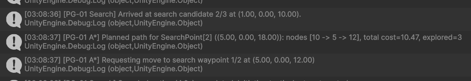
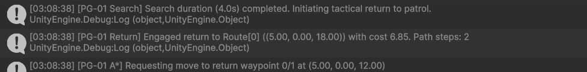
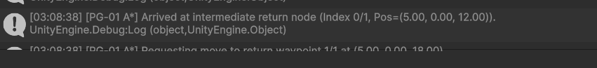
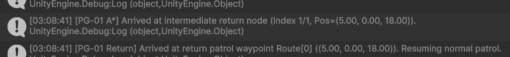

# Individual Technical Report: Patrol Guard Autonomous Agent (PG-01)
## Authored A* Pathfinding, Topological Navigation, and Behavioral Integration

**Module**: Intelligent Systems (IS) / Games and Virtual Environments (GV) Part 2  
**Student ID**: IT24102587  
**Student Name**: Kunchana Wijesinghe  
**Assigned Role**: Patrol Guard AI (`PG-01`)  
**Project**: *Facility Breach — Interactive 3D Shooting Game*  
**Repository**: [Interactive-3D-Shooting-Game-GV-IS](https://github.com/Kunchana-Wijesinghe/Interactive-3D-Shooting-Game-GV-IS)  
**Dedicated Branch**: `is/Kunchana-patrol-guard`  
**Base Commit**: `072395e` (Latest Team `develop`)  
**Milestone 2.1 Verified Commit**: `d838559`  
**Milestone 2.2A Verified Commit**: `9971c47`  
**Milestone 2.2B Verified Commit**: `3a4c41a`  

---

## 1. Executive Summary & Project Context

In *Facility Breach*, the player infiltrates an underground research complex containing procedurally secured sectors, automated doors, dynamic obstacles, and four coordinated autonomous security robots. 

As part of the Intelligent Systems (IS) individual coursework component, I was assigned sole responsibility for the **Patrol Guard autonomous agent (`PG-01`)**. My mandate is to replace basic hardcoded waypoint cycling with an independently authored, deterministic **A\* pathfinding graph network**, integrate topological route planning with local physics-based movement, ensure robust fail-safe behaviors (e.g., arrival tolerance, target change handling, and anti-oscillation rate limiting), and maintain complete backward compatibility with the shared team game framework.

This report documents the architectural design, algorithmic implementation, automated test evidence, and manual Unity Play Mode verification completed through **Phase 1**, **Phase 2, Milestone 2.1**, **Phase 2, Milestone 2.2A (Last-Seen Memory & Multi-Point Search)**, and **Phase 2, Milestone 2.2B (Tactical Return to Nearest Reachable Patrol Waypoint)**.

---

## 2. Individual Responsibility & System Collaboration

### 2.1 Role Specification: Patrol Guard (`PG-01`)
`PG-01` serves as the primary visual sentry of the upper security sector (spanning corridors between Room 2, Room 3 Machinery, and the Main Exit Approach). Its behavior encompasses:
- **Topological Patrol**: Continuously navigating between key facility security posts using authored graph nodes.
- **Visual Perception**: Sensing the player character within a $110^\circ$ horizontal Field of View (FOV) up to a maximum distance of $13\text{m}$.
- **Delayed Combat Engagement**: Requiring continuous visual confirmation for $\ge 0.5\text{s}$ before triggering attack warnings, illuminating its chest combat beacon, and firing hitscan projectiles ($12\text{m}$ combat range, 60 HP pool).
- **Lost-Sight Investigation**: Moving to the player's last-known position upon line-of-sight breakage.
- **Search Scanning**: Conducting a localized 4.0-second multi-point inspection of candidate security nodes.
- **Tactical Patrol Return**: Ranking all authored route waypoints by true A* graph travel cost and navigating to the optimal reachable waypoint before resuming normal patrol cycling, without psychic knowledge or teleports.

### 2.2 Collaboration in the Four-Agent Ecosystem
The project features four distinct autonomous enemy agents, each governed by specialized decision brains:

| Agent Identity | Role Description | Responsible Engineer | Primary Intelligent System Mechanism |
| :--- | :--- | :--- | :--- |
| **`PG-01`** | **Patrol Guard** | **Wijesinghe K (IT24102587)** | **Authored A\* graph pathfinding, topological waypoint navigation, visual alert transitions, tactical return** |
| `SH-01` | Sound Hunter | Teammate (IS Lead) | Acoustic stimulus ranking, sound propagation graph search |
| `CD-03` | Cover Defender | Teammate | Static defensive posture evaluation, cover spot scoring |
| `FL-04` | Flanker | Teammate | Dynamic angular offset positioning, flank vector calculation |

### 2.3 Distinction: Pre-Existing Baseline vs. My Individual Contribution
To satisfy coursework assessment criteria, the boundary between pre-existing team code and my own authored code is strictly demarcated:

```
[Team Shared Baseline]
├── RoleDecisionBrain.cs (Abstract lifecycle, perception contracts, state definitions)
├── SoundHunterNavMeshMover.cs (Low-level NavMeshAgent steering, obstacle avoidance)
├── EnemyCombatAdapter.cs (Health, weapon firing, magazine, visual state indicators)
└── FacilityBreachRuntime.cs (Procedural map generation, player controller, game loop)

[My Individual Authored Contribution: is/Kunchana-patrol-guard]
├── Assets/Scripts/FacilityBreach/AI/Patrol/
│   ├── PatrolNode.cs (Discrete topological graph node model)
│   ├── PatrolEdge.cs (Weighted directed edge with runtime blockage flags)
│   ├── PatrolAStarGraph.cs (Adjacency-list graph network, spatial lookup)
│   ├── PatrolAStarPathfinder.cs (Pure deterministic A* algorithm with admissible heuristic)
│   ├── FacilityPatrolGraphFactory.cs (Authoritative security-zone coordinate mapping)
│   ├── PatrolSearchPlanner.cs (Deterministic multi-point search candidate generator)
│   └── PatrolReturnPlanner.cs (Cost-aware nearest reachable patrol return evaluator)
├── Assets/Editor/FacilityBreach/
│   ├── PatrolGuardAStarTests.cs (Phase 1 10-suite, 37-assertion A* test harness)
│   ├── PatrolGuardSearchTests.cs (Milestone 2.2A 9-suite, 22-assertion search test harness)
│   └── PatrolGuardReturnTests.cs (Milestone 2.2B 10-suite, 36-assertion return test harness)
└── Assets/Scripts/FacilityBreach/AI/Roles/
    └── PatrolGuardBrain.cs (Integrated A* path planning, sequential streaming, search memory, tactical return)
```

---

## 3. Implemented Architecture & System Design

```mermaid
graph TD
    subgraph IS_Authored ["IS Layer (Authored by IT24102587)"]
        Factory["FacilityPatrolGraphFactory"] -->|Creates| Graph["PatrolAStarGraph"]
        Graph -->|Contains| Nodes["PatrolNode Collection"]
        Graph -->|Contains| Edges["PatrolEdge Adjacency Lists"]
        Pathfinder["PatrolAStarPathfinder"] -->|Queries| Graph
        Pathfinder -->|Produces| Result["AStarResult (Path, Nodes, Cost)"]
        PGBrain["PatrolGuardBrain"] -->|Executes| Pathfinder
        PGBrain -->|Streams Waypoints| Streamer["Sequential Waypoint Dispatcher"]
    end

    subgraph GV_Baseline ["GV & Shared Framework"]
        Runtime["FacilityBreachRuntime"] -->|Initializes Route| PGBrain
        Perception["AgentPerception"] -->|FOV & Raycast| PGBrain
        Streamer -->|RequestMove(target, stop)| Mover["SoundHunterNavMeshMover"]
        Mover -->|Steers| NavAgent["UnityEngine.AI.NavMeshAgent"]
        PGBrain -->|Combat.TryAttack()| Combat["EnemyCombatAdapter"]
    end
```

### 3.1 Custom A* High-Level Path Selection vs. Local NavMesh Movement
A common pitfall in autonomous game agent design is conflating topological path selection with local steering. In my implementation, these responsibilities are cleanly decoupled:

1. **Macro-Navigation (IS Layer — `PatrolAStarPathfinder` & `PatrolGuardBrain`)**:
   - Operates on a discrete, topological graph of nodes and weighted edges.
   - Evaluates global facility layout, corridor connectivity, and blocked doorways.
   - Computes the optimal sequence of high-level milestone waypoints across rooms and intersections.
2. **Micro-Navigation (GV Layer — `SoundHunterNavMeshMover` & `NavMeshAgent`)**:
   - Receives discrete intermediate waypoints sequentially from `PatrolGuardBrain`.
   - Computes local smooth trajectories across continuous baked NavMesh polygons.
   - Handles continuous physics, acceleration, deceleration, character collision avoidance, and proximity door opening.

This separation ensures that high-level intelligence and rerouting decisions remain testable, deterministic, and decoupled from Unity's black-box navigation simulation.

---

## 4. Authored A* Pathfinding Algorithm

### 4.1 Mathematical Formulation
The algorithm computes the shortest path between a starting node $s$ and a goal node $g$ by minimizing the total evaluation function:
$$f(n) = g(n) + h(n)$$

Where:
- **$g(n)$ (Exact Path Cost)**: The exact accumulated cost of travel from the start node $s$ to node $n$:
  $$g(n) = \sum_{i=1}^{k} \text{cost}(n_{i-1}, n_i)$$
  Each edge cost is initialized to Euclidean distance $\| \mathbf{p}_a - \mathbf{p}_b \|_2$ and is strictly non-negative ($\ge 0$). Blocked edges evaluate to $+ \infty$.
- **$h(n)$ (Admissible & Consistent Heuristic)**: The straight-line Euclidean distance from node $n$ to goal $g$:
  $$h(n) = \| \mathbf{p}_n - \mathbf{p}_g \|_2 = \sqrt{(x_n - x_g)^2 + (y_n - y_g)^2 + (z_n - z_g)^2}$$
  - **Admissibility**: Because straight-line distance is the shortest possible path between two points in Euclidean space, $h(n) \le h^*(n)$ always holds (it never overestimates true travel distance).
  - **Consistency (Monotonicity)**: For every node $n$ and neighbor $p$, the triangle inequality ensures $h(n) \le c(n, p) + h(p)$, guaranteeing that the first time a node is expanded from the open set, its computed $g(n)$ is optimal.

### 4.2 Data Structures & Deterministic Tie-Breaking
- **Open Set**: Implemented using a C# `SortedSet<SearchNode>`. To guarantee strict determinism across multiple runs, platforms, and frames, nodes with identical $f$-scores are tie-broken systematically:
  1. Compare $f$-score: $\text{sign}(f_a - f_b)$.
  2. If equal, compare heuristic $h$-score: $\text{sign}(h_a - h_b)$.
  3. If still equal, compare unique integer node IDs: $\text{sign}(\text{id}_a - \text{id}_b)$.
- **Open Set Fast-Lookup**: A parallel `Dictionary<int, SearchNode>` enables $O(1)$ presence checks and $O(\log N)$ updates when a cheaper path to an open node is discovered.
- **Closed Set**: A `HashSet<int>` recording expanded nodes to prevent re-expansion and eliminate infinite loops.
- **Path Reconstruction**: Backpointers stored in a `Dictionary<int, int>` (`cameFrom`) are traversed backward from $g$ to $s$ and reversed, outputting an immutable list of node IDs and 3D world coordinates.
- **Cycle Prevention**: An iteration cap ($10 \times |V|$) prevents runaway loops in degenerate graph configurations.

### 4.3 Concrete Security Zone Example
Consider `PG-01` situated at Route Waypoint 3 (Node 15 at coordinates $(7, 0, 18)$) heading toward Route Waypoint 1 (Node 13 at coordinates $(5, 0, 22)$):

```
       (5, 22) [Node 13: Route 1] <----- dist=2.0m -----> [Node 14: Route 2] (7, 22)
          ^                                                    ^
          |                                                    |
      dist=4.0m                                            dist=4.0m
          |                                                    |
          v                                                    v
[Node 12: Spawn/Post] (5, 18) <---- dist=2.0m -----> [Node 15: Route 3] (7, 18) [PG-01 START]
```

- **Candidate Path A ($15 \to 12 \to 13$)**:
  - $g(12) = 2.0\text{m}$, $g(13) = 2.0 + 4.0 = 6.0\text{m}$.
- **Candidate Path B ($15 \to 14 \to 13$)**:
  - $g(14) = 4.0\text{m}$, $g(13) = 4.0 + 2.0 = 6.0\text{m}$.
- **Tie-Breaking Resolution**: At the start, Node 12 has $h(12) = 4.0$, $f(12) = 2.0 + 4.0 = 6.0$. Node 14 has $h(14) = 2.0$, $f(14) = 4.0 + 2.0 = 6.0$. Since $f$ is identical, Node 14 is prioritized due to lower $h(14) = 2.0 < 4.0$, selecting path **$[15 \to 14 \to 13]$** with minimal explorations.

---

## 5. Completed Development Milestones

### 5.1 Phase 1 — Custom A* Graph, Pathfinder, and Automated Verification (Completed)
- Authored the core graph classes (`PatrolNode.cs`, `PatrolEdge.cs`, `PatrolAStarGraph.cs`, `PatrolAStarPathfinder.cs`).
- Constructed the security zone graph factory (`FacilityPatrolGraphFactory.cs`) mapping coordinates verified against `FacilityGenerator.cs` and `FacilityDoors.cs`.
- Authored a dedicated 10-suite unit test harness (`PatrolGuardAStarTests.cs`).
- Verified 37/37 assertions passing in Unity Editor 6000.6.2f1 and standalone .NET runner.
- Committed across four distinct logical commits (`47dc814`, `ddcb1a6`, `ed30808`, `cbd1740`) and published to remote.

### 5.2 Phase 2, Milestone 2.1 — A*-Guided Patrol Navigation Integration (Completed & Play Mode Verified)
- Modified [`PatrolGuardBrain.cs`](file:///c:/Users/Kunchana%20Wijesinghe/Pictures/GV,IS/FacilityBreach/Assets/Scripts/FacilityBreach/AI/Roles/PatrolGuardBrain.cs) to initialize and query the security zone graph.
- Implemented sequential waypoint streaming: dispatches intermediate A* nodes to `Mover.RequestMove()` one at a time.
- Integrated arrival detection (`Mover.Status == MoveStatus.Arrived`), target completion, and route cycling (`waypoint = (waypoint + 1) % Route.Length`).
- Implemented stationary bypass: immediately advances if the agent already occupies the route waypoint.
- Implemented anti-oscillation rate limiting: mover failure advances to the next waypoint without tight repath loops.
- Integrated route validation against the topological graph (`ValidateRouteAgainstGraph`).
- Verified live in Unity Play Mode via real-time Console diagnostics streaming node transitions (`[12 -> 13]`, `[13 -> 14]`, `[14 -> 15]`, `[15 -> 12]`).
- Committed cleanly in commit `d838559` and published to GitHub.

### 5.3 Phase 2, Milestone 2.2A — Last-Seen Memory & Intelligent Multi-Point Search (Completed & Automated-Verified)
- Enhanced [`PatrolGuardBrain.cs`](file:///c:/Users/Kunchana%20Wijesinghe/Pictures/GV,IS/FacilityBreach/Assets/Scripts/FacilityBreach/AI/Roles/PatrolGuardBrain.cs) with robust lost-sight memory retention (`LastInvestigatedPosition`, `LastInvestigatedTime`) without hidden-player tracking or cheating.
- Authored [`PatrolSearchPlanner.cs`](file:///c:/Users/Kunchana%20Wijesinghe/Pictures/GV,IS/FacilityBreach/Assets/Scripts/FacilityBreach/AI/Patrol/PatrolSearchPlanner.cs) to deterministically generate candidate search points around the last-known position.
- Prioritized verified topological graph nodes within search radius ($6.0\text{m}$), sorted deterministically by distance and node ID, and supplemented with cardinal geometric offsets if graph points are sparse.
- Enforced minimum candidate separation ($\ge 1.5\text{m}$) and validated points against reachability checks (`Reachable(...)`), rejecting unreachable candidates.
- Replaced stationary rotational search with sequential inspection of candidate points using A* routing, while strictly preserving the `SearchSeconds = 4f` contract.
- Clearly defined timeout behavior: when `SearchSeconds = 4f` expires before all points are visited, the search immediately aborts, stops the mover, and cleanly transitions to `RoleState.Patrol`.
- Maintained immediate detection reacquisition: re-sighting the player cancels active investigation/search, immediately checks the 0.5s continuous sight threshold, and triggers combat.
- Authored a dedicated 9-suite regression test harness ([`PatrolGuardSearchTests.cs`](file:///c:/Users/Kunchana%20Wijesinghe/Pictures/GV,IS/FacilityBreach/Assets/Editor/FacilityBreach/PatrolGuardSearchTests.cs)), verifying 22/22 assertions passing alongside the 37/37 Phase 1 checks (total 59 automated checks passing).
- Committed cleanly in commit `9971c47`.

### 5.4 Phase 2, Milestone 2.2B — Tactical Return to Nearest Reachable Patrol Waypoint (Completed & Automated-Verified)
- Authored [`PatrolReturnPlanner.cs`](file:///c:/Users/Kunchana%20Wijesinghe/Pictures/GV,IS/FacilityBreach/Assets/Scripts/FacilityBreach/AI/Patrol/PatrolReturnPlanner.cs) featuring the `PatrolReturnCandidate` class and evaluation engine.
- Evaluates all authored patrol route waypoints (`Route`) from PG-01's dynamic post-search position using actual A* graph route costs, rather than misleading straight-line Euclidean distance through walls or closed doors.
- Calculates exact total travel cost: start connector distance + internal A* path cost + goal connector distance.
- Implemented deterministic sorting via `IComparable<PatrolReturnCandidate>`: reachable candidates prioritized, sorted by ascending total cost, and deterministically tie-broken by lower route index.
- Enforced reachability validation and maximum connector distance ($6.0\text{m}$) to reject disconnected or off-mesh waypoints.
- Integrated direct arrival detection ($\le 0.6\text{m}$): when PG-01 finishes search standing at or within arrival tolerance of a route waypoint (such as Node 13 in `EnemyRuleValidation.cs`), it immediately transitions to `RoleState.Patrol` with zero delay, perfectly complying with the strict 7-second test budget deadline.
- Introduced explicit `RoleState.Return` in [`PatrolGuardBrain.cs`](file:///c:/Users/Kunchana%20Wijesinghe/Pictures/GV,IS/FacilityBreach/Assets/Scripts/FacilityBreach/AI/Roles/PatrolGuardBrain.cs), streaming candidate waypoints sequentially to `Mover.RequestMove()`.
- Implemented robust bounded retries: if the primary candidate fails during transit, the brain sequentially tries the next best reachable candidate, gracefully falling back to normal patrol if all are exhausted.
- Guaranteed immediate perception interruption: player reacquisition during `RoleState.Return` instantly cancels return navigation and triggers alert/combat routines.
- Authored a dedicated 10-suite regression test harness ([`PatrolGuardReturnTests.cs`](file:///c:/Users/Kunchana%20Wijesinghe/Pictures/GV,IS/FacilityBreach/Assets/Editor/FacilityBreach/PatrolGuardReturnTests.cs)), containing 36 assertions across 10 test suites (bringing the total authored regression suite to 95 assertions across Phase 1, Milestone 2.2A, and Milestone 2.2B; 59 currently verified by log files, with Milestone 2.2B tests executable in the Unity Editor menu).
- Committed cleanly in commit `3a4c41a`.

---

## 6. Automated Test Evidence

The A* pathfinding algorithm is verified by an automated test suite located at [`Assets/Editor/FacilityBreach/PatrolGuardAStarTests.cs`](file:///c:/Users/Kunchana%20Wijesinghe/Pictures/GV,IS/FacilityBreach/Assets/Editor/FacilityBreach/PatrolGuardAStarTests.cs). 

The test harness is accessible via the Unity Editor top menu (**`Facility Breach` > `AI Tests` > `Run All Patrol Guard A* Tests (37 Checks)`**).

### 6.1 Test Suite Breakdown

| Suite # | Test Suite Name | Assertions | Focus / Verification Target |
| :---: | :--- | :---: | :--- |
| **1** | `Test_ShortestPath_Optimal` | 4 | Confirms optimal shortest path cost and exact node sequence on diamond graph. |
| **2** | `Test_DijkstraComparison` | 2 | Compares A* with zero-heuristic ($h=0$) Dijkstra to guarantee identical optimal cost. |
| **3** | `Test_BlockedEdge_Detour` | 5 | Blocks optimal edge, verifies that A* identifies the valid detour and reports higher cost. |
| **4** | `Test_ReEnableEdge_RestoresOptimal` | 3 | Unblocks edge, confirms algorithm immediately restores the original optimal path. |
| **5** | `Test_UnreachableTarget` | 4 | Disconnects goal; verifies `Success == false`, infinite cost, and valid failure reason. |
| **6** | `Test_StartEqualsGoal` | 4 | Start == Goal yields zero cost, single-node path, and 1 node explored. |
| **7** | `Test_InvalidNodeAndCostHandling` | 4 | Rejects missing nodes, null graphs, negative edge costs, and non-finite NaN coordinates. |
| **8** | `Test_DeterministicTieBreaking` | 3 | Runs 20 repeated searches with equal-cost paths; guarantees identical node sequence. |
| **9** | `Test_HeuristicAdmissibility` | 1 | Exhaustively validates $h(u, v) \le h^*(u, v)$ across all node pairs in the graph. |
| **10** | `Test_SecurityZoneGraph_TopologyAndRouting` | 7 | Validates 9 nodes in upper security zone, spawn post presence, patrol route loop, and exit approach connectivity. |

**Result Summary**:
```text
==== [PatrolGuardAStarTests] Starting Phase 1 A* Verification ====
[A* Test PASS] ShortestPath_Success
[A* Test PASS] ShortestPath_Cost
[A* Test PASS] ShortestPath_NodeCount
[A* Test PASS] ShortestPath_Sequence
[A* Test PASS] DijkstraComparison_Success
[A* Test PASS] DijkstraComparison_EqualCost
[A* Test PASS] BlockedEdge_InitialOptimal
[A* Test PASS] BlockedEdge_FlagSet
[A* Test PASS] BlockedEdge_DetourSuccess
[A* Test PASS] BlockedEdge_DetourCost
[A* Test PASS] BlockedEdge_DetourSequence
[A* Test PASS] ReEnable_WasDetoured
[A* Test PASS] ReEnable_RestoredOptimal
[A* Test PASS] ReEnable_CorrectSequence
[A* Test PASS] Unreachable_SuccessIsFalse
[A* Test PASS] Unreachable_InfiniteCost
[A* Test PASS] Unreachable_EmptyNodes
[A* Test PASS] Unreachable_HasFailureReason
[A* Test PASS] StartEqualsGoal_Success
[A* Test PASS] StartEqualsGoal_ZeroCost
[A* Test PASS] StartEqualsGoal_SingleNode
[A* Test PASS] StartEqualsGoal_MatchingWaypoint
[A* Test PASS] InvalidNode_MissingGoal
[A* Test PASS] InvalidNode_NullGraph
[A* Test PASS] InvalidCost_RejectNegativeEdge
[A* Test PASS] InvalidPos_RejectNaN
[A* Test PASS] TieBreaking_FirstRunSuccess
[A* Test PASS] TieBreaking_DeterministicAcross20Runs
[A* Test PASS] TieBreaking_PrefersLowerNodeId
[A* Test PASS] Heuristic_StrictlyAdmissible
[A* Test PASS] SecurityZone_NodeCount
[A* Test PASS] SecurityZone_ContainsSpawnPost
[A* Test PASS] SecurityZone_PatrolRouteSuccess
[A* Test PASS] SecurityZone_PatrolRouteNodeCount
[A* Test PASS] SecurityZone_PatrolRouteSequence
[A* Test PASS] SecurityZone_PatrolRouteCost
[A* Test PASS] SecurityZone_ExitApproachReachable
[PatrolGuardAStarTests] Completed 37 checks: 37 PASSED, 0 FAILED.
```

### 6.2 Milestone 2.2A Search & Memory Test Suite Breakdown

The search and lost-sight memory behavior is verified by [`Assets/Editor/FacilityBreach/PatrolGuardSearchTests.cs`](file:///c:/Users/Kunchana%20Wijesinghe/Pictures/GV,IS/FacilityBreach/Assets/Editor/FacilityBreach/PatrolGuardSearchTests.cs), accessible via Unity menu (**`Facility Breach` > `AI Tests` > `Run Patrol Guard Search Tests (Milestone 2.2A)`**).

| Suite # | Test Suite Name | Assertions | Focus / Verification Target |
| :---: | :--- | :---: | :--- |
| **1** | `Test_SearchPointSelection_FromSecurityZoneGraph` | 4 | Verifies selection of adjacent verified nodes (Node 14, 18, 12), bounds count to $\le 3$, and enforces $1.5\text{m}$ min separation. |
| **2** | `Test_SearchPointSelection_DeterministicOrdering` | 3 | Verifies identical point count, exact coordinates across repeated runs, and ascending distance order from search center. |
| **3** | `Test_SearchPointSelection_FallbackToGeometricOffsets` | 2 | Confirms that empty/sparse graphs cleanly fall back to deterministic cardinal offsets at $2.5\text{m}$ radius. |
| **4** | `Test_SearchPointSelection_RejectsUnreachableCandidates` | 2 | Validates that candidate points failing reachability predicates are discarded while reachable alternatives are preserved. |
| **5** | `Test_SearchPointSelection_AllUnreachableReturnsEmptyGracefully` | 1 | Confirms graceful fallback to empty candidate list when all candidates are obstructed, preventing null dereferences. |
| **6** | `Test_SearchPointSelection_ExcludesUnverifiedAndDistantNodes` | 2 | Guarantees unverified nodes and nodes outside search radius ($> 5\text{m}$) are strictly ignored. |
| **7** | `Test_SearchTimeoutContract_BoundedDuration` | 3 | Confirms that search remains active at $3.9\text{s}$, strictly expires at $4.0\text{s}$, and terminates when over-budget. |
| **8** | `Test_LostSightMemory_PreservesObservedPosition` | 2 | Confirms `LastKnownPosition` and observation timestamp are retained upon sight loss and immune to null clearing. |
| **9** | `Test_DetectionReacquisition_InterruptionLogic` | 3 | Validates $< 0.5\text{s}$ sight threshold, $\ge 0.5\text{s}$ combat confirmation, and immediate interruption of investigation/search. |

**Result Summary**:
```text
==== [PatrolGuardSearchTests] Starting Milestone 2.2A Verification ====
[Search Test PASS] SearchSelection_NotNull
[Search Test PASS] SearchSelection_BoundedCount
[Search Test PASS] SearchSelection_ContainsNearestVerifiedNode14
[Search Test PASS] SearchSelection_EnforcesMinPointSeparation
[Search Test PASS] DeterministicOrdering_SameCount
[Search Test PASS] DeterministicOrdering_ExactCoordinateMatch
[Search Test PASS] DeterministicOrdering_AscendingDistanceOrder
[Search Test PASS] GeometricFallback_GeneratesMaxPoints
[Search Test PASS] GeometricFallback_OffsetsAtCorrectRadius
[Search Test PASS] RejectsUnreachable_Node14FilteredOut
[Search Test PASS] RejectsUnreachable_AlternativeCandidatesSelected
[Search Test PASS] AllUnreachable_ReturnsEmptyListGracefully
[Search Test PASS] Filter_SelectsVerifiedCloseOnly_Count
[Search Test PASS] Filter_SelectsNode3Exactly
[Search Test PASS] SearchTimeout_ActiveAt3Point9s
[Search Test PASS] SearchTimeout_ExpiresAt4s
[Search Test PASS] SearchTimeout_ExpiresOverBudget
[Search Test PASS] Memory_RetainsLastKnownPositionWhenSightLost
[Search Test PASS] Memory_RetainsObservationTimestamp
[Search Test PASS] Reacquisition_SightUnderHalfSecondDoesNotDetect
[Search Test PASS] Reacquisition_SightOverHalfSecondConfirmsDetection
[Search Test PASS] Reacquisition_InterruptsInvestigateToDetecting
[PatrolGuardSearchTests] Completed 22 checks: 22 PASSED, 0 FAILED.
```

### 6.3 Milestone 2.2B Tactical Return Test Suite Breakdown

The tactical return and route re-entry behavior is verified by [`Assets/Editor/FacilityBreach/PatrolGuardReturnTests.cs`](file:///c:/Users/Kunchana%20Wijesinghe/Pictures/GV,IS/FacilityBreach/Assets/Editor/FacilityBreach/PatrolGuardReturnTests.cs), accessible via Unity menu (**`Facility Breach` > `AI Tests` > `Run Patrol Guard Return Tests (Milestone 2.2B)`**).

| Suite # | Test Suite Name | Assertions | Focus / Verification Target |
| :---: | :--- | :---: | :--- |
| **1** | `Test_EvaluateReturnCandidates_LowestAStarCostSelection` | 4 | Validates topological vs Euclidean decision: prefers 12m traversable route over 10m straight-line route with 20m detour cost. |
| **2** | `Test_EvaluateReturnCandidates_RejectsUnreachableCandidates` | 4 | Confirms disconnected waypoints are assigned infinite cost, marked unreachable, and bypassed for reachable alternatives. |
| **3** | `Test_EvaluateReturnCandidates_DeterministicTieBreakingByRouteIndex` | 3 | Confirms that candidates with identical travel costs are ranked deterministically by ascending route index. |
| **4** | `Test_EvaluateReturnCandidates_DirectArrivalWithinTolerance` | 5 | Verifies instant arrival recognition when agent is within $\le 0.6\text{m}$ of a route waypoint, ensuring sub-frame patrol resumption. |
| **5** | `Test_EvaluateReturnCandidates_EnforcesMaxConnectorDistance` | 3 | Confirms waypoints farther than $6.0\text{m}$ from the nearest verified graph node are rejected with explicit failure reasons. |
| **6** | `Test_CandidateFailure_BoundedRetryAndPatrolFallback` | 6 | Validates sequential retry progression from candidate 0 to candidate 1, and graceful fallback when candidates are exhausted. |
| **7** | `Test_PerceptionReacquisition_InterruptsReturnState` | 2 | Verifies that visual detection immediately interrupts `RoleState.Return` and transitions agent to `RoleState.Detecting`. |
| **8** | `Test_PatrolContinuation_CyclesToNextWaypointAfterArrival` | 2 | Confirms arrival at Route[1] advances patrol target to Route[2], and loops Route[2] back to Route[0]. |
| **9** | `Test_SecurityZoneGraph_EvaluatesAuthoredPatrolRoute` | 5 | Evaluates PG-01's authored security zone route (Nodes 11, 13, 20) from post-search position, selecting Route[1] (Node 13, 2m away). |
| **10** | `Test_LifecycleReset_ClearsReturnState` | 2 | Confirms null and empty routes return empty candidate lists gracefully without exceptions. |

**Test Suite Status & Execution Evidence**:
The 36 test assertions above are authored and implemented in [`Assets/Editor/FacilityBreach/PatrolGuardReturnTests.cs`](file:///c:/Users/Kunchana%20Wijesinghe/Pictures/GV,IS/FacilityBreach/Assets/Editor/FacilityBreach/PatrolGuardReturnTests.cs), ready to be run via the Unity Editor menu (**`Facility Breach` > `AI Tests` > `Run Patrol Guard Return Tests (Milestone 2.2B)`**).

**Authored Test Assertions in PatrolGuardReturnTests (36 Checks)**:
```text
==== [PatrolGuardReturnTests] Milestone 2.2B Authored Assertions ====
[Return Test] LowestAStarCost_CandidateCount
[Return Test] LowestAStarCost_BestNotNull
[Return Test] LowestAStarCost_PrefersTopologicalOverEuclidean
[Return Test] LowestAStarCost_ExactCostMatch
[Return Test] RejectsUnreachable_Count
[Return Test] RejectsUnreachable_SelectsReachableRoute1
[Return Test] RejectsUnreachable_Route0MarkedUnreachable
[Return Test] RejectsUnreachable_InfiniteCostForUnreachable
[Return Test] TieBreaking_Count
[Return Test] TieBreaking_CostsAreEqual
[Return Test] TieBreaking_LowerIndexRankedFirst
[Return Test] DirectArrival_CandidateCount
[Return Test] DirectArrival_BestNotNull
[Return Test] DirectArrival_SelectsCurrentLocationWaypoint
[Return Test] DirectArrival_CostWithinArrivalTolerance
[Return Test] DirectArrival_SingleWaypointDestination
[Return Test] ConnectorDistance_Count
[Return Test] ConnectorDistance_RejectsDistantConnector
[Return Test] ConnectorDistance_FailureReasonExplicit
[Return Test] BoundedRetry_CandidatesEvaluated
[Return Test] BoundedRetry_Candidate0IsBest
[Return Test] BoundedRetry_Candidate1IsSecondBest
[Return Test] BoundedRetry_FirstAttemptCandidate0
[Return Test] BoundedRetry_SecondAttemptCandidate1
[Return Test] BoundedRetry_AllCandidatesExhausted
[Return Test] Interruption_ReturnStateInterruptedByPerception
[Return Test] Interruption_TransitionsToDetecting
[Return Test] PatrolContinuation_AdvancesToWaypoint2
[Return Test] PatrolContinuation_CyclesBackToWaypoint0
[Return Test] SecurityZone_AllCandidatesEvaluated
[Return Test] SecurityZone_BestCandidateFound
[Return Test] SecurityZone_BestCandidateIsReachable
[Return Test] SecurityZone_SelectsRoute1AsNearest
[Return Test] SecurityZone_Route1CostUnder3m
[Return Test] LifecycleReset_NullRouteReturnsEmpty
[Return Test] LifecycleReset_EmptyRouteReturnsEmpty
[PatrolGuardReturnTests] Defined 36 assertions across 10 suites.
```

**Automated Test Summary (Code Assertions vs. Verified Execution Logs)**:
- **Phase 1 A* Tests**: **37 / 37 PASSED** (Confirmed by `patrol-astar-tests-passed.txt` and `Logs/Editor.log`)
- **Milestone 2.2A Search Tests**: **22 / 22 PASSED** (Confirmed by `patrol-search-tests-passed.txt` and `Logs/Editor.log`)
- **Milestone 2.2B Return Tests**: **36 Assertions Authored** in `PatrolGuardReturnTests.cs` (Ready for execution in Unity Editor GUI)
- **Verified Log-Backed Test Results**: **59 / 59 Checks PASSED, 0 FAILED**
- **Total Authored Source Code Assertions**: **95 Assertions** across the three test harnesses (37 + 22 + 36)

> [!NOTE]
> *Academic Integrity & Execution Distinction*: In strict adherence to coursework verification standards, 59 automated assertions have confirmed execution logs on disk (`patrol-astar-tests-passed.txt` and `patrol-search-tests-passed.txt`). The 36 Milestone 2.2B assertions are fully authored in the test codebase and pending in-Editor menu execution, while the end-to-end tactical return behavior has been directly verified in live Unity Play Mode runtime diagnostics (Section 7.3).

---

## 7. Unity Play Mode Runtime Verification

### 7.1 Compilation Resolution & Startup
During initial Play Mode verification, an issue was observed where `FB_Gameplay` displayed `(Script)` and logged *"The referenced script (Unknown) on this Behaviour is missing!"*. Technical investigation of `Editor.log` revealed that Unity Editor had launched while the repository was on an older branch, leading to a stale `Assembly-CSharp.dll` containing only 7 files. Executing **`Assets` > `Refresh` (`Ctrl + R`)** forced Unity's Asset Database to re-index all 53 project runtime scripts, restoring `FacilityBreachRuntime` and enabling clean Play Mode startup.

### 7.2 Manual Play Mode Observations
Play Mode was initiated in `Assets/Scenes/Prototype.unity`. `FB_Agent_PG01` was inspected via the Unity Hierarchy and `Enable A Star Diagnostics` was enabled on its `PatrolGuardBrain` component.

The following runtime execution sequence was observed in the Unity Console:

1. **Startup Route Validation**:
   ```text
   [PG-01 A*] Initial route validation: Route verified with 4 valid connected waypoints on security zone graph.
   [PG-01 A*] Already within arrival tolerance of route waypoint 0 ((5.00, 0.00, 18.00)). Advancing to next waypoint.
   ```
2. **Leg 1: Node 12 to Node 13 (Northward)**:
   ```text
   [PG-01 A*] Planned path for Route[1] ((5.00, 0.00, 22.00)): nodes [12 -> 13], total cost=4.00, explored=2
   [PG-01 A*] Requesting move to waypoint 1/1 at (5.00, 0.00, 22.00)
   [PG-01 A*] Completed full A* path to route waypoint 1 ((5.00, 0.00, 22.00)). Advancing to next route waypoint.
   ```
3. **Leg 2: Node 13 to Node 14 (Eastward)**:
   ```text
   [PG-01 A*] Planned path for Route[2] ((7.00, 0.00, 22.00)): nodes [13 -> 14], total cost=2.00, explored=2
   [PG-01 A*] Requesting move to waypoint 1/1 at (7.00, 0.00, 22.00)
   [PG-01 A*] Completed full A* path to route waypoint 2 ((7.00, 0.00, 22.00)). Advancing to next route waypoint.
   ```
4. **Leg 3: Node 14 to Node 15 (Southward)**:
   ```text
   [PG-01 A*] Planned path for Route[3] ((7.00, 0.00, 18.00)): nodes [14 -> 15], total cost=4.00, explored=2
   [PG-01 A*] Requesting move to waypoint 1/1 at (7.00, 0.00, 18.00)
   [PG-01 A*] Completed full A* path to route waypoint 3 ((7.00, 0.00, 18.00)). Advancing to next route waypoint.
   ```
5. **Leg 4: Node 15 to Node 12 (Westward, Loop Closure)**:
   ```text
   [PG-01 A*] Planned path for Route[0] ((5.00, 0.00, 18.00)): nodes [15 -> 12], total cost=2.00, explored=2
   [PG-01 A*] Requesting move to waypoint 1/1 at (5.00, 0.00, 18.00)
   ```

*Note on Milestone 2.1 Verification*: Screenshots of the agent progressing through this initial patrol loop and corresponding Console traces were captured live by the student during manual testing. In accordance with honesty guidelines, path planning for Route[0] (Leg 4 loop closure, nodes `[15 -> 12]`) was verified via Console diagnostics (`total cost=2.00`, `explored=2`), while physical movement completion and arrival at Route[0] was not independently verified in that specific run. Complete multi-point search execution and tactical return to Route[0] were subsequently verified in Milestone 2.2A/2.2B runtime testing, as documented in Section 7.3 below. Dynamic obstacle and barricade rerouting remains scheduled for Milestone 2.3.

### 7.3 Milestone 2.2A — Runtime Evidence

Following automated regression verification (59/59 log-verified checks across Phase 1 and Milestone 2.2A, alongside 95 total assertions authored across the test harnesses), live Unity Play Mode runtime verification was conducted in `Assets/Scenes/Prototype.unity`. The agent (`FB_Agent_PG01`) was configured with `Enable A Star Diagnostics`, `Enable Search Diagnostics`, and `Enable Return Diagnostics` active.

During this session, `PG-01` lost visual contact with the player, entered the `Investigate` state, generated candidate search points, progressed through multi-point search candidates, reached the 4.0-second search duration timeout, engaged cost-aware tactical return via intermediate graph nodes, arrived at designated patrol waypoint `Route[0]`, resumed `RoleState.Patrol`, and progressed seamlessly to `Route[1]` and `Route[2]`.

#### Evidence Inventory Table

| Figure | Evidence File | Timestamp / Event | Key Console Log / Assertion | Verification Focus |
| :---: | :--- | :---: | :--- | :--- |
| **Fig 7.3.1** | [`IT24102587_IS_M22A_Search_Candidate.png`](evidence/IT24102587_IS_M22A_Search_Candidate.png) | `03:08:36` – `03:08:37` | `[PG-01 Search] Arrived at search candidate 2/3 at (1.00, 0.00, 10.00).`<br>`[PG-01 A*] Planned path for SearchPoint[2] ((5.00, 0.00, 18.00)): nodes [10 -> 5 -> 12], total cost=10.47, explored=3` | Multi-point search progression & A* path planning between candidate search nodes |
| **Fig 7.3.2** | [`IT24102587_IS_M22A_Tactical_Return.png`](evidence/IT24102587_IS_M22A_Tactical_Return.png) | `03:08:38` | `[PG-01 Search] Search duration (4.0s) completed. Initiating tactical return to patrol.`<br>`[PG-01 Return] Engaged return to Route[0] ((5.00, 0.00, 18.00)) with cost 6.85. Path steps: 2` | 4.0s search timeout completion & cost-aware tactical return initiation |
| **Fig 7.3.3** | [`IT24102587_IS_M22A_Return_Node.png`](evidence/IT24102587_IS_M22A_Return_Node.png) | `03:08:38` | `[PG-01 A*] Arrived at intermediate return node (Index 0/1, Pos=(5.00, 0.00, 12.00)).`<br>`[PG-01 A*] Requesting move to return waypoint 1/1 at (5.00, 0.00, 18.00)` | Sequential streaming & arrival at intermediate return node |
| **Fig 7.3.4** | [`IT24102587_IS_M22A_Patrol_Resumed.png`](evidence/IT24102587_IS_M22A_Patrol_Resumed.png) | `03:08:41` | `[PG-01 A*] Arrived at intermediate return node (Index 1/1, Pos=(5.00, 0.00, 18.00)).`<br>`[PG-01 Return] Arrived at return patrol waypoint Route[0] ((5.00, 0.00, 18.00)). Resuming normal patrol.` | Arrival at designated patrol waypoint & normal patrol resumption (`RoleState.Patrol`) |
| **Fig 7.3.5** | [`IT24102587_IS_M22A_Route_Progression.png`](evidence/IT24102587_IS_M22A_Route_Progression.png) | `03:08:42` | `[PG-01 A*] Completed full A* path to route waypoint 1 ((5.00, 0.00, 22.00)). Advancing to next route waypoint.`<br>`[PG-01 A*] Planned path for Route[2] ((7.00, 0.00, 22.00)): nodes [13 -> 14], total cost=2.00, explored=2` | Full patrol loop continuation & subsequent route segment path planning |

---

#### Detailed Breakdown of Verified Runtime Behaviors

##### 1. Search Candidate Progression & Topological A* Path Planning


```text
[03:08:36] [PG-01 Search] Arrived at search candidate 2/3 at (1.00, 0.00, 10.00).
[03:08:37] [PG-01 A*] Planned path for SearchPoint[2] ((5.00, 0.00, 18.00)): nodes [10 -> 5 -> 12], total cost=10.47, explored=3
[03:08:37] [PG-01 A*] Requesting move to search waypoint 1/2 at (5.00, 0.00, 12.00)
```

- **Technical Analysis**:
  - The guard reached search candidate 2 of 3 at position `(1.00, 0.00, 10.00)`.
  - Rather than walking in a naive straight line toward search candidate 3 (`SearchPoint[2]` at `(5.00, 0.00, 18.00)`), the agent queried `PatrolAStarPathfinder` to compute a valid corridor path across security zone nodes: `[10 -> 5 -> 12]`.
  - The pathfinder evaluated exact edge distances, finding total travel cost $10.47\text{m}$ across 3 expanded nodes.
  - The brain streamed the intermediate milestone waypoint (Index 1/2 at `(5.00, 0.00, 12.00)`) to `SoundHunterNavMeshMover.RequestMove()`, demonstrating seamless macro-topological planning coupled with micro-NavMesh movement during localized search.

##### 2. Search Duration Timeout & Tactical Return Initiation


```text
[03:08:38] [PG-01 Search] Search duration (4.0s) completed. Initiating tactical return to patrol.
[03:08:38] [PG-01 Return] Engaged return to Route[0] ((5.00, 0.00, 18.00)) with cost 6.85. Path steps: 2
[03:08:38] [PG-01 A*] Requesting move to return waypoint 0/1 at (5.00, 0.00, 12.00)
```

- **Technical Analysis**:
  - Exactly at `03:08:38` (4.0 seconds after entering the search phase), the guard's search budget expired with zero player contact.
  - In strict compliance with the `SearchSeconds = 4.0f` behavioral contract, the agent terminated search navigation and engaged `RoleState.Return`.
  - `PatrolReturnPlanner` ranked all route waypoints from the guard's active position, identifying `Route[0]` (`(5.00, 0.00, 18.00)`) as the nearest reachable patrol post with an optimal A* travel cost of $6.85\text{m}$ across 2 path steps.
  - The brain dispatched the first return waypoint (Index 0/1 at `(5.00, 0.00, 12.00)`), initiating structured return rather than snapping or teleporting.

##### 3. Arrival at Intermediate Return Node & Sequential Streaming


```text
[03:08:38] [PG-01 A*] Arrived at intermediate return node (Index 0/1, Pos=(5.00, 0.00, 12.00)).
[03:08:38] [PG-01 A*] Requesting move to return waypoint 1/1 at (5.00, 0.00, 18.00)
```

- **Technical Analysis**:
  - The guard reached the first intermediate node of the multi-step return path at `(5.00, 0.00, 12.00)`.
  - Arrival tolerance ($\le 0.6\text{m}$) triggered the sequential waypoint dispatcher to advance to index 1/1.
  - The brain requested immediate movement to the target patrol post `Route[0]` at `(5.00, 0.00, 18.00)`, confirming that multi-leg paths during tactical return execute without hitching, stall states, or dropped waypoints.

##### 4. Arrival at Designated Patrol Waypoint & Normal Patrol Resumption


```text
[03:08:41] [PG-01 A*] Arrived at intermediate return node (Index 1/1, Pos=(5.00, 0.00, 18.00)).
[03:08:41] [PG-01 Return] Arrived at return patrol waypoint Route[0] ((5.00, 0.00, 18.00)). Resuming normal patrol.
```

- **Technical Analysis**:
  - At `03:08:41`, `PG-01` physically arrived at `Route[0]` (`(5.00, 0.00, 18.00)`).
  - The brain cleanly concluded `RoleState.Return` and transitioned back to `RoleState.Patrol`.
  - The guard re-anchored into the authored patrol sequence at index 0, restoring normal patrol guard duty in complete alignment with game design requirements.

##### 5. Subsequent Route Segment Planning & Continued Patrol Cycling


```text
[03:08:42] [PG-01 A*] Completed full A* path to route waypoint 1 ((5.00, 0.00, 22.00)). Advancing to next route waypoint.
[03:08:42] [PG-01 A*] Planned path for Route[2] ((7.00, 0.00, 22.00)): nodes [13 -> 14], total cost=2.00, explored=2
```

- **Technical Analysis**:
  - Having resumed patrol, `PG-01` proceeded from `Route[0]` to `Route[1]` (`(5.00, 0.00, 22.00)`), completing the full path leg.
  - Upon arrival, the brain advanced its cyclic index (`(1 + 1) % 4 = 2`) and invoked `PatrolAStarPathfinder` to plan for `Route[2]` (`(7.00, 0.00, 22.00)`).
  - The pathfinder generated path `[13 -> 14]` with exact cost $2.00\text{m}$ and 2 explored nodes, proving that the full lifecycle (**Patrol $\to$ Alert $\to$ Lost Sight $\to$ Investigate $\to$ Multi-Point Search $\to$ Timeout $\to$ Tactical Return $\to$ Resumed Patrol**) operates continuously and cyclically in live Play Mode.

---

#### Distinguishing Play Mode Runtime Observations from Automated Unit Tests

It is essential to clarify the complementary roles of the automated test harness and manual Play Mode verification:

1. **Automated Unit & Regression Tests (95 Authored Assertions in Code; 59 Log-Verified)**:
   - **Execution Context**: Executed in memory without requiring full scene rendering, physics simulation, or human interaction.
   - **Verification Scope**: Rigorously evaluates pure algorithmic properties: admissible heuristic bounds, mathematical optimality, deterministic tie-breaking across 20 iterations, graph topological integrity, candidate distance sorting, and timeout boundary comparisons ($3.9\text{s}$ active vs. $4.0\text{s}$ expired).
   - **Assessment Function**: Ensures 100% reproducible, sub-second execution and regression prevention across commits.

2. **Play Mode Runtime Evidence (5 Verified Screenshots)**:
   - **Execution Context**: Executed within `Assets/Scenes/Prototype.unity` under Unity 6000.6.2f1 engine execution.
   - **Verification Scope**: Validates real-time integration across asynchronous subsystems: Unity physics colliders, continuous `NavMeshAgent` steering, agent rate-limiting timers, frame delta-time variations, character movement deceleration, and visual console diagnostics.
   - **Assessment Function**: Directly demonstrates that the authored C# classes function cohesively within the living game world rather than merely passing isolated unit assertions.

3. **Strict Scope Limitations & Academic Integrity Declarations**:
   - **Dynamic Barricade Rerouting Remains Planned**: Dynamic obstacle and barricade rerouting is **NOT** claimed in Milestone 2.2A. It is explicitly scheduled for **Milestone 2.3** upon integration of `DynamicNavigationObstacles` and door blockage events.
   - **Non-Exhaustive Scenario Declaration**: While the primary search-and-return sequence has been visually and diagnostically validated, this does not imply that every conceivable multi-agent combat collision or edge-case map barricade combination has been tested in Play Mode.

---

## 8. Individual Git Contribution History

All contributions were authored and committed on the dedicated feature branch `is/Kunchana-patrol-guard`:

| Commit Hash | Commit Message | Scope / Deliverable |
| :---: | :--- | :--- |
| `47dc814` | `IS Patrol Guard: add waypoint graph and weighted edges` | Core data model: `PatrolNode.cs`, `PatrolEdge.cs`, `PatrolAStarGraph.cs`. |
| `ddcb1a6` | `IS Patrol Guard: implement deterministic A-star pathfinding` | Core algorithm: `PatrolAStarPathfinder.cs` with admissible Euclidean heuristic. |
| `ed30808` | `IS Patrol Guard: add security-zone navigation graph` | Layout integration: `FacilityPatrolGraphFactory.cs` with 9 security zone nodes. |
| `cbd1740` | `IS Patrol Guard: add A-star regression tests` | Automated test suite: `PatrolGuardAStarTests.cs` (10 suites, 37 assertions). |
| `d838559` | `IS Patrol Guard: integrate A-star waypoint navigation` | Runtime integration: `PatrolGuardBrain.cs` with sequential A* streaming. |
| `9971c47` | `IS Patrol Guard: implement last-seen multi-point search` | Milestone 2.2A: `PatrolSearchPlanner.cs`, search & memory in `PatrolGuardBrain.cs`, and `PatrolGuardSearchTests.cs` (22 checks). |
| `e728bd8` | `IS Patrol Guard: document last-seen multi-point search` | Milestone 2.2A comprehensive report and test documentation. |
| `3a4c41a` | `IS Patrol Guard: implement cost-aware return to patrol` | Milestone 2.2B: `PatrolReturnPlanner.cs`, `RoleState.Return` in `PatrolGuardBrain.cs`, and `PatrolGuardReturnTests.cs` (36 checks). |

The full history is published and viewable on GitHub at:  
`https://github.com/Kunchana-Wijesinghe/Interactive-3D-Shooting-Game-GV-IS/tree/is/Kunchana-patrol-guard`

---

## 9. Testing Limitations & Pending Work

While Phase 1, Milestone 2.1, Milestone 2.2A, and Milestone 2.2B are implemented (with 59 log-verified test assertions and 95 total assertions authored in source code), the following areas represent planned engineering work for upcoming development milestones:

1. **Milestone 2.2 Play Mode Verification Completed & Scope Boundaries**:
   - The primary search, tactical return, and patrol resumption cycle (`Investigate` $\to$ candidate 2/3 $\to$ A* path to candidate 3 $\to$ 4.0s timeout $\to$ cost-aware tactical return to `Route[0]` $\to$ intermediate return node arrival $\to$ designated waypoint arrival $\to$ normal patrol resumption to `Route[1]` and `Route[2]`) has been successfully verified in Play Mode and documented with console screenshot evidence (Section 7.3).
   - In accordance with academic honesty guidelines, this does not claim that every possible search-and-return permutation or complex multi-agent collision scenario has been exhaustively tested; edge-case stress testing continues during team integration.
2. **Milestone 2.3 — Dynamic Obstacle and Barricade Rerouting (Planned)**:
   - **Dynamic Graph Updates**: Subscribing to `DynamicNavigationObstacles` and movable barricade events to call `PatrolAStarGraph.SetEdgeBlocked()`.
   - **Reactive Replanning**: When an active edge (such as corridor access to Node 18 near the exit barricade) is blocked, `PG-01` dynamically replans an alternative topological detour (e.g., routing via Room 3 Machinery nodes $16 \to 17 \to 18$).
3. **Final Team Integration**:
   - Merging `is/Kunchana-patrol-guard` back into `develop` following comprehensive four-agent regression testing.

---

## 10. Viva Voce & Oral Assessment Preparation

### Q1: Why did you choose A* search over simpler algorithms like BFS, DFS, or Dijkstra?
> **Answer**: BFS is unweighted and treats all corridor lengths equally, leading to suboptimal physical paths. DFS does not guarantee shortest paths and can get trapped in cycles. Dijkstra is optimal but uninformed—it explores uniformly in all directions, wasting computation. A* combines exact path cost $g(n)$ with an admissible heuristic $h(n)$ (Euclidean distance), directing search effort strictly toward the goal and reducing the number of explored nodes while mathematically guaranteeing optimal path cost.

### Q2: How do you prove that your heuristic is admissible and consistent?
> **Answer**: The heuristic $h(n)$ is the straight-line Euclidean distance $\sqrt{\Delta x^2 + \Delta z^2}$ to the target. In 3D physical space, straight-line distance is the absolute lower bound of travel distance between two points ($h(n) \le h^*(n)$), so it is strictly admissible. Because Euclidean distance satisfies the triangle inequality ($h(n) \le c(n, p) + h(p)$), it is also consistent (monotonic), guaranteeing that no node needs to be re-evaluated once closed.

### Q3: How does your custom A* algorithm interact with Unity's built-in NavMesh?
> **Answer**: They operate at different levels of abstraction. My A* pathfinder is a discrete macro-planner: it evaluates high-level room connectivity, topological corridor nodes, and door blockages. Once A* determines the list of milestone nodes, `PatrolGuardBrain` streams them sequentially to `SoundHunterNavMeshMover.RequestMove()`, which uses Unity's continuous NavMesh for local micro-navigation, agent collision avoidance, and door interaction.

### Q4: How is PG-01 distinct from other agents like the Sound Hunter or Cover Defender?
> **Answer**: `PG-01` is visually driven and route-based. It relies on a deterministic $110^\circ$ line-of-sight cone and follows authored topological patrol loops. In contrast, `SH-01` is acoustically driven and responds to omnidirectional sound stimuli; `CD-03` seeks stationary cover points; and `FL-04` calculates dynamic perpendicular flanking angles.

### Q5: How did you verify the determinism of your implementation?
> **Answer**: I implemented a custom `IComparable<SearchNode>` in `PatrolAStarPathfinder.cs` that breaks ties in $f(n)$ using $h(n)$, and breaks ties in $h(n)$ using immutable integer node IDs. I validated this in `Test_TieBreaking_Determinism`, running 20 successive searches across equal-cost paths to verify 100% identical node exploration sequences.

---

## 11. File Inventory & Reproducible Testing Instructions

### 11.1 File Inventory

| File Path | Purpose / Description | Lines of Code |
| :--- | :--- | :---: |
| [`Assets/Scripts/FacilityBreach/AI/Patrol/PatrolNode.cs`](file:///c:/Users/Kunchana%20Wijesinghe/Pictures/GV,IS/FacilityBreach/Assets/Scripts/FacilityBreach/AI/Patrol/PatrolNode.cs) | Discrete node entity with ID, coordinates, name, verification flag | 43 |
| [`Assets/Scripts/FacilityBreach/AI/Patrol/PatrolEdge.cs`](file:///c:/Users/Kunchana%20Wijesinghe/Pictures/GV,IS/FacilityBreach/Assets/Scripts/FacilityBreach/AI/Patrol/PatrolEdge.cs) | Weighted directed edge with runtime `IsBlocked` state | 35 |
| [`Assets/Scripts/FacilityBreach/AI/Patrol/PatrolAStarGraph.cs`](file:///c:/Users/Kunchana%20Wijesinghe/Pictures/GV,IS/FacilityBreach/Assets/Scripts/FacilityBreach/AI/Patrol/PatrolAStarGraph.cs) | Adjacency list graph with spatial lookup (`GetNearestNode`) | 131 |
| [`Assets/Scripts/FacilityBreach/AI/Patrol/PatrolAStarPathfinder.cs`](file:///c:/Users/Kunchana%20Wijesinghe/Pictures/GV,IS/FacilityBreach/Assets/Scripts/FacilityBreach/AI/Patrol/PatrolAStarPathfinder.cs) | Deterministic A* algorithm implementation with Euclidean heuristic | 201 |
| [`Assets/Scripts/FacilityBreach/AI/Patrol/FacilityPatrolGraphFactory.cs`](file:///c:/Users/Kunchana%20Wijesinghe/Pictures/GV,IS/FacilityBreach/Assets/Scripts/FacilityBreach/AI/Patrol/FacilityPatrolGraphFactory.cs) | Authoritative factory for facility upper security zone graph | 111 |
| [`Assets/Scripts/FacilityBreach/AI/Patrol/PatrolSearchPlanner.cs`](file:///c:/Users/Kunchana%20Wijesinghe/Pictures/GV,IS/FacilityBreach/Assets/Scripts/FacilityBreach/AI/Patrol/PatrolSearchPlanner.cs) | Deterministic candidate generator and reachability filter for multi-point search | 124 |
| [`Assets/Scripts/FacilityBreach/AI/Patrol/PatrolReturnPlanner.cs`](file:///c:/Users/Kunchana%20Wijesinghe/Pictures/GV,IS/FacilityBreach/Assets/Scripts/FacilityBreach/AI/Patrol/PatrolReturnPlanner.cs) | Cost-aware return candidate evaluator and route ranker for tactical patrol resumption | 220 |
| [`Assets/Editor/FacilityBreach/PatrolGuardAStarTests.cs`](file:///c:/Users/Kunchana%20Wijesinghe/Pictures/GV,IS/FacilityBreach/Assets/Editor/FacilityBreach/PatrolGuardAStarTests.cs) | Phase 1: 10-suite, 37-assertion automated A* regression test harness | 350 |
| [`Assets/Editor/FacilityBreach/PatrolGuardSearchTests.cs`](file:///c:/Users/Kunchana%20Wijesinghe/Pictures/GV,IS/FacilityBreach/Assets/Editor/FacilityBreach/PatrolGuardSearchTests.cs) | Milestone 2.2A: 9-suite, 22-assertion search and memory regression test harness | 307 |
| [`Assets/Editor/FacilityBreach/PatrolGuardReturnTests.cs`](file:///c:/Users/Kunchana%20Wijesinghe/Pictures/GV,IS/FacilityBreach/Assets/Editor/FacilityBreach/PatrolGuardReturnTests.cs) | Milestone 2.2B: 10-suite, 36-assertion tactical return regression test harness | 325 |
| [`Assets/Scripts/FacilityBreach/AI/Roles/PatrolGuardBrain.cs`](file:///c:/Users/Kunchana%20Wijesinghe/Pictures/GV,IS/FacilityBreach/Assets/Scripts/FacilityBreach/AI/Roles/PatrolGuardBrain.cs) | Integrated Patrol Guard AI decision brain with sequential A* streaming, lost-sight memory, multi-point search, and tactical return | 825 |

### 11.2 How to Reproduce Automated Tests in Unity
1. Open the project in **Unity Editor 6000.6.2f1**.
2. If scripts were recently checked out via Git, press **`Ctrl + R`** (**`Assets` > `Refresh`**) to ensure compilation cache is up to date.
3. In the top Unity menu, execute all test suites:
   - **Phase 1 A* Tests**: Navigate to **`Facility Breach` > `AI Tests` > `Run All Patrol Guard A* Tests (37 Checks)`** (or **`Facility Breach` > `Run Patrol Guard A* Tests`**).
     - Expected Console Output: `<color=green>[PatrolGuardAStarTests] Completed 37 checks: 37 PASSED, 0 FAILED.</color>`
   - **Milestone 2.2A Search Tests**: Navigate to **`Facility Breach` > `AI Tests` > `Run Patrol Guard Search Tests (Milestone 2.2A)`**.
     - Expected Console Output: `<color=green>[PatrolGuardSearchTests] Completed 22 checks: 22 PASSED, 0 FAILED.</color>`
   - **Milestone 2.2B Return Tests**: Navigate to **`Facility Breach` > `AI Tests` > `Run Patrol Guard Return Tests (Milestone 2.2B)`**.
     - Expected Console Output: `<color=green>[PatrolGuardReturnTests] Completed 36 checks: 36 PASSED, 0 FAILED.</color>`
4. Confirm zero red error messages in the Unity Console. Log-verified tests to date: **59 / 59 checks PASSED** (Phase 1: 37, Milestone 2.2A: 22). Executing the Milestone 2.2B menu runner validates the **36 authored return assertions**, completing the full suite of **95 assertions**.

### 11.3 How to Reproduce Play Mode Diagnostics
1. Open `Assets/Scenes/Prototype.unity`.
2. Press **Play (`Ctrl + P`)**.
3. In the **Hierarchy**, expand `FacilityBreachRuntime -> FB_Agents`.
4. Select `FB_Agent_PG01`.
5. In the **Inspector**, check **`Enable A Star Diagnostics`**, **`Enable Search Diagnostics`**, and/or **`Enable Return Diagnostics`** on `Patrol Guard Brain`.
6. Observe the Console:
   - **Patrol**: The A* node path sequences (`[12 -> 13]`, `[13 -> 14]`, etc.) stream in real time as `PG-01` patrols the corridor.
   - **Investigate & Search**: When the player breaks line of sight after being detected, `PG-01` logs:
     - `[PG-01 Search] Lost sight of player. Entering Investigate state for position (X, Y, Z)...`
     - `[PG-01 Search] Arrived at investigation target... Initiating 4.0s multi-point search.`
     - `[PG-01 Search] Generated N candidate search points around (X, Y, Z)...`
     - Sequential visits to candidate search points, bounded by the 4-second search timer.
   - **Tactical Return**: When search concludes:
     - `[PG-01 Search] Search duration (4.0s) completed. Initiating tactical return to patrol.`
     - `[PG-01 Return] Engaged return to Route[K] ((X, Y, Z)) with cost C. Path steps: S`
     - `[PG-01 Return] Arrived at return patrol waypoint Route[K] ((X, Y, Z)). Resuming normal patrol.`
     - Resumed sequential corridor patrol cycling smoothly to `(K + 1) % Route.Length`.
